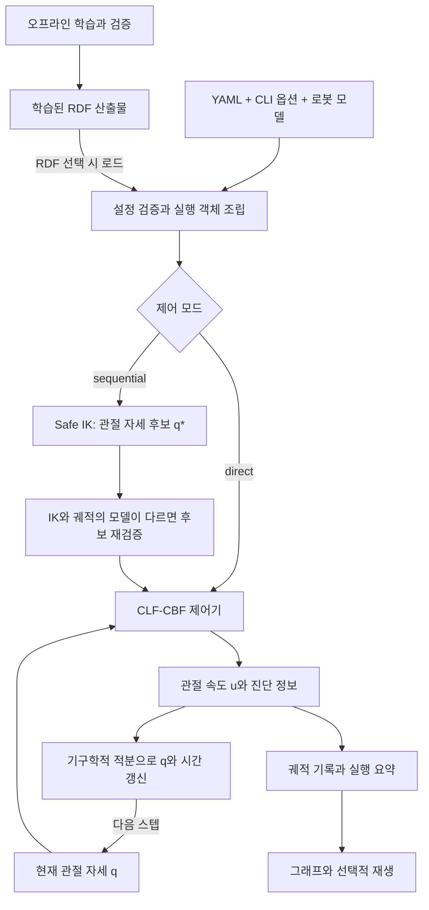

# 현재 구현의 흐름과 기능별 입출력

이 문서는 목표 pose와 로봇 설정이 어떤 계산을 거쳐 관절 속도와 실행 기록이 되는지 설명한다.
Panda 7자유도 실행을 중심으로 읽고, RDF 오프라인 학습과 평면 로봇 비교 실험을 연결한다.
전체 구조는 **2026-10-05, `8ff567a` 기반 의존성 정리 작업트리**, 성공·정체 판정은 **2026-10-06 수정**을 반영한다. 아래 설정값은 작업 설정이며,
실험마다 달라질 수 있다. 설계의 변화와 과거 측정치는 [연구 기록](../history/README.md)에 있다.

## 전체 흐름

Panda 실행은 **목표와 설정을 읽고 → 필요하면 목표 관절 자세를 찾고 → 매 스텝 관절 속도를
계산하고 → 자세를 갱신하고 → 결과를 저장**한다. RDF 모델 학습은 실행 전에 별도로 수행한다.



- **direct**는 Safe IK를 건너뛰고 처음부터 말단 장치 목표 pose를 향해 제어한다.
- **sequential**은 안전한 IK 후보 $q^*$에서 중간 프레임의 목표 위치를 계산하고,
  설정된 순서로 그 위치를 따라간 뒤 말단 장치 pose를 제어한다. 모든 단계에서 CBF를 적용한다.
- 현재 Panda의 명령 `u`는 **관절 속도**다. `MujocoPlant`는 이를 적분하고 자세를 갱신한다.
  이 실행 경로에서 토크나 actuator 동역학을 푸는 `mj_step`은 호출하지 않는다.
- 뷰어는 계산·저장 후 기록을 재생한다. 재생 중 IK·RDF·QP를 다시 계산하지 않는다.

실행 진입점은 [main.py](../../main.py) 또는 `safe-ik`이고,
실제 조정은 [panda_run.main](../../src/safe_ik/application/panda_run.py)과
[run_panda](../../src/safe_ik/application/panda_rollout.py)가 담당한다.
코드가 서로 참조하는 방향과 공통 타입의 위치는 [의존성 구조](dependencies.md)에 정리했다.

## 핵심 기능의 입력과 출력

설정과 의존 객체를 생성 시 받는 기능은 그 입력도 함께 표기했다.
`get_velocity(q)`처럼 인자가 하나여도 내부 상태와 설정에 따라 결과가 달라질 수 있다.

| 기능과 구현 | 받는 것 | 내보내는 것 |
|---|---|---|
| [설정 읽기 `load_panda_config`](../../src/safe_ik/application/panda_configuration.py) | YAML 경로 | 검증된 `PandaControllerConfig`: 초기 관절각, 목표 pose, IK·안전성·궤적·QP 설정 |
| [실행 객체 조립 `build_panda_runtime`](../../src/safe_ik/application/panda_setup.py) | 설정, MJCF, RDF 선택 시 학습 산출물 | `PandaRuntime`: 기구학, 안전성 평가기, QP solver, plant, IK 탐색기 생성 함수 |
| [기구학 `pose_and_jacobian`](../../src/safe_ik/adapters/panda_kinematics.py) | 현재 `q`; 생성 시 로봇 모델·말단 프레임 | 말단 위치 `p`, quaternion `Q`, Jacobian `J` |
| [안전성 `evaluate`](../../src/safe_ik/domain/spatial_safety.py) | `q`; 생성 시 형상·장애물·여유, RDF 선택 시 [RDF 평가기](../../src/safe_ik/domain/panda_rdf_safety.py) | `BarrierEvaluation`: 제약 이름, 장벽값 $h$, 관절 미분 $\frac{\partial h}{\partial q}$ |
| [안전 자세 IK `SafePoseIKSolver.solve`](../../src/safe_ik/domain/safe_pose_ik.py) | 기준 `q`; 생성 시 목표 pose·탐색 설정·기구학·안전성 평가기 | `SafeIKResult`: 후보 목록, 선택 후보, 실패 사유 |
| [궤적 제어 `get_velocity`](../../src/safe_ik/control/panda_controller.py) | 현재 `q`; 생성 시 설정·기구학·안전성·IK 후보·solver | `u`; 내부에 현재 단계, 직전 속도, CLF slack, QP 상태를 갱신 |
| [QP 풀이 `OSQPSolver.solve`](../../src/safe_ik/adapters/osqp_solver.py) | `QPProblem(P, q, A, lower, upper)` | `QPSolution`: 상태, 해 `x`, 풀이 시간, 메시지 |
| [상태 갱신 `MujocoPlant.advance`](../../src/safe_ik/adapters/mujoco_plant.py) | `u`, 적분 간격 $\Delta t$ | 반환값은 없음. plant의 `q`, `time`을 갱신 |
| [전체 실행 `run_panda`](../../src/safe_ik/application/panda_rollout.py) | 설정, runtime, 선택적 관찰·종료 콜백 | `PandaRunResult`: IK 결과, 최종 상태, 궤적, 지표, 실패 정보 |
| [저장과 표시](../../src/safe_ik/logging/panda_results.py) | 실행 결과 또는 궤적 기록, 출력 경로 | JSON 요약, NPZ 궤적, [진단 그래프](../../src/safe_ik/visualization/panda.py), [재생](../../src/safe_ik/visualization/panda_replay.py) |

## 주고받는 값의 의미

| 값 | 크기와 단위 | 좌표계와 해석 |
|---|---|---|
| `q`, `u` | 각각 `(7,)`, rad와 rad/s | 관절각과 관절 속도 |
| `p`, 목표 위치 | `(3,)`, m | base/world 좌표계 |
| `Q` | `(4,)`, 무차원 | scalar-first `[w, x, y, z]`; 방향 허용오차는 상대 quaternion 벡터 성분의 norm으로 판단하며 각도 자체가 아님 |
| `J` | `(6, 7)` | 말단 원점의 world 축 기준 Jacobian. 위 3행은 선속도, 아래 3행은 각속도 |
| $h$, $\frac{\partial h}{\partial q}$ | `(B,)`, `(B, 7)`; $B$는 충돌 제약 수 | 충돌 장벽은 m 단위, 미분은 m/rad. $h \ge 0$은 해당 모델과 여유에 대한 허용 상태 |
| QP 해 $x$ | `(8,)` | $x = [u_1, \ldots, u_7, \delta]^\top$; $\delta$는 CLF 완화량 |

목표 방향의 `approach`는 말단 로컬 +z축의 world 방향이다. `up`은 +z축에 수직인
평면으로 투영·정규화되어 로컬 +y축을 정한다. 설정 로더가 이를 quaternion으로 변환한다.
`QPProblem.q`라는 이름은 QP 목적함수의 선형 계수이며, 로봇의 관절각 `q`와 별개다.
안전성 평가값은 [safety_contracts](../../src/safe_ik/domain/safety_contracts.py),
IK 입출력은 [ik_contracts](../../src/safe_ik/domain/ik_contracts.py),
제어 상태와 궤적·실행 결과는 [panda_types](../../src/safe_ik/domain/panda_types.py)에 정의한다.
이 데이터 타입을 읽기 위해 IK·제어기·실행 코드를 가져올 필요는 없다.

## Safe IK가 만드는 것

Safe IK는 목표 pose를 만족하는 **관절 자세 후보**를 만든다. seed 0은 초기 자세이며,
나머지 seed는 관절 범위 안에서 뽑는다. 각 seed에서는 pose 오차를 줄이는 감쇠 의사역행렬
업데이트와, 영공간에서 안전성 soft-min을 높이는 업데이트를 더한다.

이 탐색은 QP를 사용하지 않으며 궤적의 속도·가속도 제한과 hard CBF를 적용하지 않는다.
관절각은 관절 범위로 clip한다. 목표 위치·방향 허용오차와 $h \ge 0$을 연속으로 만족하면
후보를 반환한다. 모든 seed를 평가한 뒤 초기 자세와 관절각의 유클리드 거리가 가장 가까운 후보를 선택한다.

`iteration_number`는 seed당 최대 반복 수다. 내부 수치 간격은 `0.01`이고,
유지 조건은 `ceil(convergence_hold_duration / 0.01)`회다. 실제 경과 시간 제한이 아니다.
병렬 실행도 [parallel_ik](../../src/safe_ik/application/parallel_ik.py)를 통해 같은 후보 계약을 사용한다.

IK와 궤적의 충돌 모델이 다르면 `run_panda`가 후보를 **궤적용 안전성 평가기**로 다시 검사한다.
이는 후보 끝점 검사이며, 그곳까지의 이동 경로는 이후 제어 단계에서 계산한다.
후보에는 `q`, `seed_index`, 반복 수, 위치·방향 오차, 최소 장벽값이 포함된다.

## 제어 한 스텝에서 일어나는 일

`PandaTrajectoryController.get_velocity(q)`는 다음 순서로 작동한다.

1. 현재 `q`에서 충돌 장벽과 미분을 평가한다.
2. 도달한 중간 단계를 넘기고, 정체되었으면 남은 IK 후보로 전환한다.
3. 현재 단계의 CLF 값 $V$와 관절 미분을 계산한다.
4. CLF, 충돌 CBF, 관절 범위 CBF, 속도·가속도 제한으로 QP를 만든다.
5. QP 해의 앞 7개 성분을 `u`로 반환하고, 마지막 성분을 CLF slack으로 기록한다.

중간 단계의 목표는 $p_{\mathrm{frame}}(q^*)$이고 CLF는 다음과 같다.

$$
V(q) = \frac{1}{2}\left\lVert p_{\mathrm{frame}}(q) - p_{\mathrm{frame}}(q^*) \right\rVert^2.
$$

마지막 단계와 direct 모드는 위치 오차와 quaternion 방향 오차를 합친 pose CLF를 사용한다.
관절 목표 $q^*$와의 오차는 진단값이며, 이를 직접 줄이는 관절 공간 CLF를 사용하지 않는다.

QP의 핵심 관계는 다음과 같다.

결정변수는 관절 속도와 CLF 완화량을 묶은 $x = [u^\top, \delta]^\top$이다.

$$
\begin{aligned}
\min_{u,\delta}\quad
& \frac{1}{2} w_u \lVert u \rVert^2 + \frac{1}{2} w_\delta \delta^2 \\
\text{CLF:}\quad
& \nabla_q V(q)^\top u - \delta \le -k_V V(q), \qquad \delta \ge 0, \\
\text{collision CBF:}\quad
& \nabla_q h_i(q)^\top u \ge -\alpha_i h_i(q).
\end{aligned}
$$

여기에 관절 범위 CBF, 속도 상한, 직전 $u$에서의 가속도 제한을 추가한다.

$\delta$는 CLF만 완화한다. RDF 자기 충돌에는 `safety.rdf.cbf_gain`, 다른 충돌 장벽과 관절
범위에는 `safety.alpha`를 사용한다. 같은 `q`라도 현재 단계·후보·직전 속도·정체 이력이
다르면 `u`가 달라질 수 있다. 내부 QP 전체는 현재 궤적 NPZ에 저장하지 않는다.

## 안전성 평가와 RDF의 역할

안전성 평가기는 자세에서 **충돌 장벽과 그 미분**을 계산한다. 그 값으로 속도를 결정하는
것은 제어기다. 관절 범위 CBF는 충돌 평가기의 반환값과 별도로 제어기가 추가한다.

| 선택한 모델 | 자기 충돌 | 외부 장애물 |
|---|---|---|
| `capsule` | 비인접 capsule 쌍의 거리에서 반지름과 `safety.margin`을 차감 | capsule과 활성 sphere 장애물의 거리에서 반지름과 여유를 차감 |
| `rdf` | 학습된 링크 거리장과 저장된 표면 질의점을 이용한 장벽 | capsule 평가를 계속 사용 |

RDF 자기 충돌은 $\mathrm{link0} < \cdots < \mathrm{link7} < \mathrm{hand}$ 순서에서 낮은 링크의 표면점을 높은 링크의
좌표계로 변환하여 질의한다. 작은 거리의 top-k를 soft-min으로 모은 뒤
`physical_margin + error_margin`을 차감한다. 상대운동 Jacobian으로 점의 공간 미분을
관절 미분으로 변환한다. 제외하도록 설정한 쌍은 평가하지 않는다.

`sphere_gate`가 켜져 있으면 먼 링크 쌍은 구 장벽을 쓰고, 가까운 쌍은 RDF를 쓰며,
전환 구간에서는 두 장벽과 미분을 혼합한다. 이는 현재 설정에서 활성화되어 있다.
[ExtendedRDF.query](../../src/safe_ik/domain/panda_rdf.py)는 링크 로컬 점 `(N, 3)`을 받아
거리 대용값 `(N,)`과 공간 미분 `(N, 3)`을 반환한다. 이 확장값은 실제 거리의 전역 하한으로 보장되지 않는다.

## RDF 학습이 실행으로 연결되는 흐름

```text
로봇 visual mesh + 학습 설정
  → 기준 mesh 재구성, 학습 표본과 거리 라벨 생성
  → 링크별 Bernstein 계수 학습과 확장 함수 구성
  → 별도 표본의 거리 오차, 공간·관절 미분 등 검증
  → 모델·질의점·검증 메타데이터를 담은 NPZ와 report.json
  → 실행 시 load_bundle 검사
  → PandaRDFSafety에서 사용
```

| 기능 | 입력 | 출력과 구현 |
|---|---|---|
| 전처리 | MJCF의 visual mesh, 재구성 설정 | 기준 mesh와 비교 자료. [panda_mesh_reconstruction](../../src/safe_ik/application/panda_mesh_reconstruction.py) |
| 학습·검증 | 실행 YAML, 학습 YAML, 선택적 표본 보강 설정 | 링크별 모델, 표면 질의점, 거리·미분 검증 결과. [train_panda_rdf](../../src/safe_ik/application/train_panda_rdf.py), [panda_rdf_training](../../src/safe_ik/application/panda_rdf_training.py) |
| 실행용 로드 | NPZ 경로, 현재 형상, RDF 설정 | `RDFBundle(models, queries, pairs, metadata, identifier, …)` 또는 오류. [load_bundle](../../src/safe_ik/application/panda_rdf_artifact.py) |

실패·미완성 후보도 조사용으로 저장될 수 있으므로 **NPZ 파일의 존재만으로 사용 가능 여부를
판단하지 않는다.** 로더가 형상·설정 호환성, 전체 링크와 쌍, 배열 해시, 검증 기록을 확인한다.
제어 실행이 학습을 자동으로 시작하지 않으며, 학습의 `--device`와 실행의 `--rdf-device`는 별개다.
검증 통과는 저장된 검사 기준을 만족한다는 뜻이며 모든 자세에 대한 이론적 안전성 증명은 아니다.

## 결과에서 읽을 수 있는 것

Panda CLI는 매 실행마다 새 `outputs/panda/<run-id>/`를 만들고 다음을 저장한다.

| 파일 | 입력에서 무엇을 보존하는가 |
|---|---|
| `config.yaml`, `resolved_config.json` | CLI 재정의까지 적용한 설정과 해석된 값 |
| `metadata.json` | Git 상태, 환경, 소스·모델 해시 등 재현 정보 |
| `summary.json` | IK 후보 수와 실패 사유, 궤적 성공 여부, 최종 자세, 최소 장벽, QP 시간·실패 수, 단계 전환 수 |
| `trajectory.npz` | 스텝별 `time`, `q`, `command`, CLF 값·slack, 단계, 충돌 장벽 이름·값, QP 상태와 시간, RDF 진단 |
| `plots/control.png` | 저장된 제어 이력의 그래프 |

궤적의 각 행은 **적분 전 `q`와 그 상태에서 구한 `u`**다. 최종 자세는 `summary.json`의
`trajectory.final_q`에서 확인한다. 제어 전에 실패하거나 기록이 비면 NPZ·그래프가 없을 수 있다.
초기화 실패는 `failure.reason = runtime_initialization_failed`로 저장한다.

IK 실패는 `safe_ik.failure_reason`, QP·수치 실패는 `failure`와 QP 상태를 함께 읽는다.
시간 예산 소진이나 정체는 `failure = null`이어도 성공이 아닐 수 있으므로
`trajectory.success`를 확인한다. QP 실패 시 제어기는 0 속도를 반환하고 실행 루프는 적분 전에 종료한다.

현재 성공 판정은 마지막 단계, 목표 pose 허용오차, 최소 충돌 장벽
$h_{\min}\geq-\varepsilon_h$를 확인한다. `trajectory.success_barrier_tolerance`의 기본값은
$\varepsilon_h=10^{-6}\,\mathrm{m}$이며, 0으로 설정하면 엄격한 비음수 판정이다.
이는 목표 도달 판정의 수치 허용오차다. QP의 hard CBF, IK 후보 검사, 초기 상태 검사에는
적용하지 않으며, 기록된 장벽값도 원래 값 그대로 보존한다. `status(q)`는 마지막으로
평가한 자세와 `q`가 다르면 안전값을 새로 계산한다.
해석 근거는 [controller.status](../../src/safe_ik/control/panda_controller.py)와
[기록 루프](../../src/safe_ik/application/panda_rollout.py)에 있다.

## 느린 수렴과 정체의 구분

정체 판정은 현재 관절 속도의 이력과 **현재 단계의 목표 오차 이력**을 받아
`stalled`를 출력한다. 속도가 작고, 오차의 최솟값도 최근 구간에서 충분히 개선되지
않았을 때만 정체로 판정한다. 남은 IK 후보가 있으면 교체하고, 없으면 종료한다.

서로 다른 단위를 비교하기 위해 단계 오차를 해당 허용오차로 나눈다.
중간 단계는 위치만, 마지막 단계와 direct 모드는 위치·자세 중 큰 비율을 사용한다.

$$
E(q)=\begin{cases}
\lVert e_{\mathrm{stage}}(q)\rVert/\tau_{\mathrm{stage}}, & \text{중간 단계},\\
\max\bigl(\lVert e_p(q)\rVert/\tau_p,\lVert e_R(q)\rVert/\tau_R\bigr), & \text{최종 pose}.
\end{cases}
$$

현재 단계 시작 이후의 최솟값을 $B_k=\min_{j\leq k}E(q_j)$로 기록한다.
최근 구간의 개선량 $B_{k-N}-B_k$가 `stop_progress_tolerance`보다 크면
속도가 작아도 기다린다. 같은 범위에서 반복하는 흔들림은 새로운 개선으로 세지 않는다.

| `trajectory` 설정 | 기본값 | 의미 |
|---|---:|---|
| `stop_window` | 0.5 s | 관절 속도 norm의 이동평균 구간 |
| `stop_velocity_tolerance` | 0.001 rad/s | 낮은 속도 기준 |
| `stop_progress_window` | 2.0 s | 오차 개선을 관찰하는 구간 |
| `stop_progress_tolerance` | 0.001 | 허용오차로 나눈 오차의 최소 개선량 |

위치가 최종 오차를 결정하고 위치 허용오차가 10 mm라면, 기본 개선 기준은 2초 동안
0.01 mm를 넘는 감소다. 두 구간이 모두 채워진 뒤 판정하며, 계산 주기가 바뀌면
각 구간의 샘플 수를 다시 계산한다. 단계·IK 변경 시 속도와 개선 이력을 함께 초기화한다.
전체 실행의 `duration` 제한은 계속 적용된다.

`clf_rate`, `clf_slack_weight`, 계산 주기와 속도·가속도 제한은 수렴 속도와 함께 조정해야 한다.
정체 판정은 gain이나 계산 주기를 자동 변경하지 않는다. 비교 실험에서는 이 값들과
종료 판정 설정을 함께 저장하고, 한 조건씩 바꿔 조기 종료와 제어 성능의 영향을 구분한다.

## 현재 작업 설정을 읽는 예

[configs/panda.yaml](../../configs/panda.yaml)의 확인 시점 값은 다음과 같다.
단계 설정은 2026-10-05에 `15c6f8b` 기반 작업트리에서 `link3 → link5`로 갱신했다.
위치가 고정된 `link2` 원점 대신 움직이는 `link3` 원점을 첫 중간 목표로 사용한다.

| 항목 | 값과 의미 |
|---|---|
| 모드와 단계 | `sequential`; `link3` 위치 → `link5` 위치 → 말단 pose |
| IK와 궤적 모델 | IK는 `capsule`, 궤적 자기 충돌은 `rdf`; 따라서 후보 재검증을 거침 |
| IK 예산 | seed 20개, seed당 최대 1000회, 유지 조건 300회, worker 5개 |
| 궤적 시간 | 예산 60초, 적분 간격 0.02초로 모의 시간 기준 50 Hz; 실제 계산 속도를 뜻하지 않음 |
| RDF 장치 | YAML은 `cpu`; [Panda Make 실행 명령](../../Makefile)은 기본 `cuda`로 재정의 |

YAML 내부 모델 경로는 YAML 파일 위치를 기준으로 해석한다. 숫자나 모델 선택을 바꾼
실험에서는 이 표 대신 해당 실행의 저장된 설정을 기준으로 해석한다.

## 평면 로봇과 보조 기능

평면 3자유도 경로는 Panda와 별도 제어기를 사용한다. 목표는 3차원 위치·방향 전체가 아닌
`(x, y, yaw)`이며, 비교 CLI는 현재 평면 로봇 실험을 수행한다.

| 기능 | 입력 | 출력과 구현 |
|---|---|---|
| 평면 로봇 단일 실행 | planar YAML, URDF, MuJoCo 모델, 초기 `q` | 스텝별 `SimulationStep`, Recorder의 NPZ·CSV, 실행 계층에서 호출하는 그래프. [planar_run](../../src/safe_ik/application/planar_run.py), [run_simulation](../../src/safe_ik/application/planar_simulation.py) |
| 평면 목표 IK | 목표 위치·yaw, 링크 길이, 장애물·여유·관절 범위 | elbow 분기별 `GoalConfiguration`: `q`, 링크 끝점, 충돌 여부. [solve_goal_configurations](../../src/safe_ik/domain/goal_configuration.py) |
| direct와 sequential 비교 | 공통 초기 조건, 표본화 설정과 seed, 실험 수 | 사례별 궤적 NPZ, `summary.csv/json`, `analysis.json`, 비교 그래프. [run_comparison](../../src/safe_ik/application/comparison_runner.py) |
| 저장 이력 분석 | NPZ 또는 비교 실험 디렉토리 | 그래프, GUI, 지원되는 CSV 변환. [recording_view](../../src/safe_ik/application/recording_view.py), [visualization](../../src/safe_ik/visualization) |

평면 실행은 설정에 따라 기구학 적분과 actuator 동역학을 선택할 수 있다.
비교 실험은 안전한 IK 분기가 있는 사례를 골라 두 방법에 같은 조건을 제공한다.
구현의 회귀 예시는 [Panda 파이프라인 테스트](../../tests/test_panda_pipeline.py),
[제어 테스트](../../tests/test_sequential_control.py), [RDF 연결 테스트](../../tests/test_panda_rdf_integration.py)에 있다.
