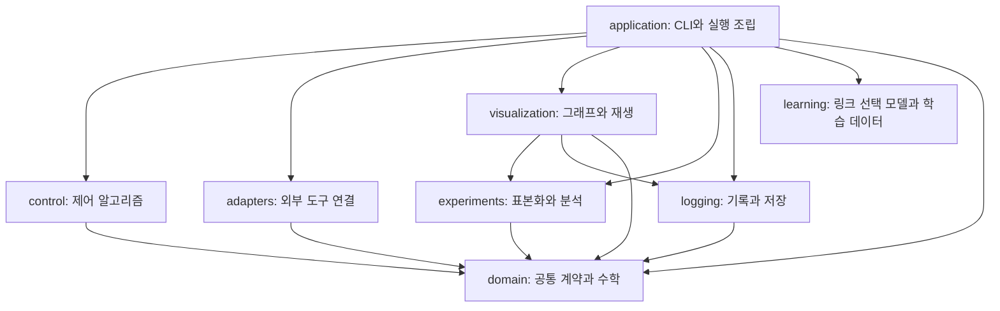

# 코드 의존성 구조

현재 코드는 공통 데이터와 계약을 아래에 두고, 계산·저장·표시 기능이 이를 사용하며,
`application`이 실행을 조립한다. 이 문서의 화살표 `A → B`는 A가 B를 import한다는 뜻이다.
실행 순서나 데이터가 반환되는 방향과는 다르다.

## 전체 의존 방향



| 계층 | import를 허용하는 다른 계층 |
|---|---|
| `domain` | 없음 |
| `learning` | 없음; 같은 계층의 모델·데이터 모듈만 사용 |
| `control`, `adapters`, `logging`, `experiments` | `domain` |
| `visualization` | `domain`, `logging`, `experiments` |
| `application` | 위 모든 계층 |

같은 계층의 모듈끼리도 순환해서는 안 된다. `domain`과 `control`에서는 NumPy·SciPy
수치 계산을 사용할 수 있지만, MuJoCo·Pinocchio·OSQP·Torch·YAML·시각화 도구를 직접 import하지 않는다.
하위 계층이 상위 계층의 구현을 필요로 하면 공통 계약으로 표현하고 실행 계층에서 객체를 전달한다.

## 공통 데이터와 계약

| 모듈 | 정의하는 값과 인터페이스 |
|---|---|
| [types](../../src/safe_ik/domain/types.py) | `QPProblem`, `QPSolution`, `QPStatus`, `SafetyDiagnostics`, `SimulationStep` |
| [interfaces](../../src/safe_ik/domain/interfaces.py) | `QPSolver`, 기구학·plant·기록기 인터페이스 |
| [safety_contracts](../../src/safe_ik/domain/safety_contracts.py) | `BarrierEvaluation`, `SafetyEvaluator`, 안전성 집계 함수 |
| [ik_contracts](../../src/safe_ik/domain/ik_contracts.py) | IK 후보·결과·seed·진행 메시지, `PoseIKSearch` |
| [panda_types](../../src/safe_ik/domain/panda_types.py) | `PandaControlStatus`, `PandaControlTrace`, `PandaRunResult` |

이 모듈들은 IK 탐색, 제어기, 외부 도구, 파일 저장 구현을 가져오지 않는다.
따라서 그래프를 그리기 위해 결과 타입을 import해도 제어기가 함께 로드되지 않는다.

안전성 계산은 다음처럼 읽는다.

```text
PandaCapsuleSafety ──→ safety_contracts ←── PandaRDFSafety
                             ↑
                  SafePoseIKSolver와 제어기
```

`SafetyEvaluator`가 요구하는 메서드는 `evaluate(q)`다. 반환된 `BarrierEvaluation`에
장벽값과 미분이 있으며, IK는 그 결과의 `softmin(temperature)`을 호출한다.
두 구현의 `softmin(q, temperature)`은 기존 호출자용 wrapper로 유지하지만, 둘 다 공통
`evaluate_softmin`에 위임한다. RDF가 Capsule 클래스의 메서드를 가져오지 않는다.

## 실행 조립과 병렬 IK

[panda_components](../../src/safe_ik/application/panda_components.py)는 설정에서 기구학과
안전성 평가기를 만든다. [panda_setup](../../src/safe_ik/application/panda_setup.py)은 이 함수와
병렬 IK 생성 함수를 이용해 runtime 전체를 조립한다. [parallel_ik](../../src/safe_ik/application/parallel_ik.py)의
worker도 `panda_components`만 사용해 자기 프로세스의 평가기를 만든다.

```text
panda_setup → parallel_ik → panda_components
     └───────────────────→ panda_components
```

worker에서 함수를 늦게 import하는 이유는 프로세스별 backend 초기화다.
조립 모듈로 돌아가는 순환 의존은 없다.

데이터 생성의 `panda_link_dataset_campaign`은 `panda_link_dataset_pipeline`에
검증·진행 기록 함수를 전달한다. Pipeline은 campaign 모듈을 역으로 import하지 않는다.
`learning`은 NumPy·SciPy·Torch로 모델과 데이터 처리를 구현하며, 실행·제어·시뮬레이터
계층을 import하지 않는다. 학습 실행과 결과 저장은 `application`이 조립한다.

## 기록과 표시

[Recorder](../../src/safe_ik/logging/recorder.py)는 데이터를 쌓고 NPZ·CSV로 저장한다.
[logging.panda_results](../../src/safe_ik/logging/panda_results.py)는 Panda 결과를 JSON용 값과 NPZ로 변환한다.
표시는 `visualization`이 맡고, 두 기능의 호출 순서는 `application`이 정한다.

```python
from safe_ik.logging.recorder import Recorder
from safe_ik.visualization.recording import plot, show_gui

recorder = Recorder.from_npz("outputs/example/trajectory.npz")
plot(recorder.arrays(), recorder.barrier_labels, path="outputs/example/control.png")
# GUI가 필요할 때만 호출한다.
show_gui(recorder.arrays(), recorder.barrier_labels)
```

`Recorder.plot()`과 `Recorder.show_gui()`는 제거했다. 위와 같이 명시적으로 표시 함수를
호출한다. 기존 CLI의 저장·그래프·GUI 옵션과 결과 파일 형식은 유지한다.

평면 로봇 비교의 실행·worker·backend 조립은
[application.comparison_runner](../../src/safe_ik/application/comparison_runner.py)에 둔다.
`experiments`에는 사례 타입, 표본화, 지표 계산, 보고서 작성이 남으며 실행 계층을 import하지 않는다.

## 기존 Python 호출 경로

| 기존 위치 또는 호출 | 새 코드에서 사용할 위치 또는 호출 |
|---|---|
| `domain.spatial_safety.BarrierEvaluation`, `SafetyEvaluator` | `domain.safety_contracts` |
| `domain.safe_pose_ik`의 IK 타입·인터페이스 | `domain.ik_contracts` |
| `control.panda_controller.PandaControlStatus` | `domain.panda_types` |
| `application.panda_results`의 결과 타입 | `domain.panda_types`; 이전 호환 모듈은 제거 |
| `application.panda_results`의 저장·직렬화 함수 | `logging.panda_results`; 이전 호환 모듈은 제거 |
| `control.solver.QPSolver` | `domain.interfaces.QPSolver`; 이전 호환 모듈은 제거 |
| `application.panda_setup.build_panda_components` | `application.panda_components.build_panda_components` |
| `experiments.runner` | `application.comparison_runner`; 이전 모듈은 제거 |
| `recorder.plot(...)`, `recorder.show_gui()` | `visualization.recording.plot(...)`, `show_gui(...)`; 위 예시 참고 |

import를 다시 내보내기만 하던 `control/solver.py`와 `application/panda_results.py`는
삭제했다. 해당 경로를 사용하던 테스트도 새 정의 위치를 직접 import한다.
다른 구현 모듈에 남아 있는 타입 import를 외부에서 가져오는 대신, 새 코드에서는 위 표의
정의 위치를 사용한다. 실제 계산을 수행하는 안전성 `softmin` wrapper는 이번 호환 파일 삭제와 별개다.
Make 명령, 설치된 CLI 이름, YAML 설정, 모델 파일은 이 정리에서 변경하지 않았다.

## 구조를 확인하는 방법

```bash
uv run python -m unittest discover -s tests -p test_architecture.py -v
make check
```

[아키텍처 테스트](../../tests/test_architecture.py)는 패키지 아래의 모든 Python 파일을 검사한다.
절대·상대 import, 함수 내부 import, `TYPE_CHECKING` 블록의 import도 검사 대상이다.
계층 규칙, 파일 사이 순환, 공통 계약의 구현 의존 금지를 확인하고, 별도 Python 프로세스에서
데이터 소비자가 제어기·실행 계층을 로드하지 않는지도 확인한다.
문자열로 수행하는 동적 import까지 추론하는 분석은 아니다.

2026-10-05 의존성 정리 후 호환 파일 두 개를 제거하여 Python 모듈은 85개다.
정적 import 관계에 순환과 계층 규칙 위반이 없는지 아키텍처 테스트로 확인한다.
전체 332개 테스트 중 319개가 통과했고, CUDA가 없는 환경이라 GPU 관련 13개는 건너뛰었다.
isort와 Black 포맷 검사도 통과했다. 이동한 데이터 정의·객체 생성·직렬화 함수와 기존
IK·제어기·Panda 실행 루프의 AST 본문을 비교해 계산 코드가 유지되었음을 확인했다.

Panda direct와 평면 로봇을 각각 0.05초 실행하고, 평면 비교를 2개 사례·2개 worker로
실행해 결과 저장을 확인했다. 저장된 평면 궤적의 그래프 재생성과 CSV 재출력도 확인했다.
이 짧은 실행은 연결과 입출력 검증이며 목표 수렴 성능을 검증하지 않는다. GUI의 수동 조작은
이번 검증에 포함하지 않았다.
