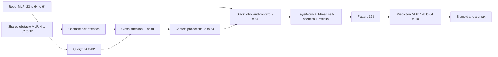

# Panda link-selection model

## Current experiment: softmax selection with successful completion time (2026-10-23)

The user requested rewarding faster successful link-pair choices and changing
the output to softmax. `LinkTimeSelectionNet` uses the same 24,234-parameter
small one-head backbone, inputs, joint-only normalization and dropout 0.1.
Its forward output is a ten-way softmax distribution, and inference chooses
its largest value. These are **selection probabilities**, not independent
per-combination success probabilities. Missing validated IK still bypasses
the model and selects Direct.

For outcome `y_j` and successful simulated completion time `t_j`, use
`r_j = y_j * exp(-t_j / 120 seconds)` and
`L = -log(sum_j softmax(z)_j * r_j)`. The implementation uses logsumexp for
numerical stability. Failed, unsafe and numerical-error outcomes have zero
reward regardless of how early they stop; they have no successful time target.
All-failure scenes contribute zero selection gradient and remain in the
all-scene loss mean and every evaluation denominator. With multiple successes,
the per-scene optimum assigns probability to the fastest successful pair;
equal fastest choices are equivalent. All-success scenes can now contribute
a timing gradient. BCE is absent from this objective. The positive reward for
every success does not guarantee that a fitted model's aggregate success rate
will be preserved: speed and success can trade off under uncertainty.

Preset: `configs/training/panda_link_time_selection.yaml`.
Training entry point: `python -m safe_ik.application.train_link_time_selection`.
The existing success-only preset/trainer and schema-11/12/13 checkpoints remain
available for the comparison. New checkpoints use schema 16, explicitly record
softmax semantics and the time scale, and load through the common `load_model`
and `predict_selection` APIs. Retired architecture variants are not restored.

This trial reuses all **21,423 training / 1,000 validation / 1,000 test scenes**
from `combined-21423-fixed-evaluation-2000-20261023T003319Z`. Source NPZs omit
timing, so the loader joins six hashed source result CSVs by scene ID and pair,
checking original inputs, outcome labels, fixed IK and successful completion
times. All 234,230 outcomes and 127,344 successful times passed preflight;
successful times range from 3.88 to 119.96 simulated seconds. Original datasets
are unchanged; a separate `time_targets.npz` records the joined targets.
Historical and corrected-QP data remain mixed exactly as in the baseline.

Use AdamW (lr .001, weight decay .0001), batch 64, at most 500 epochs,
patience 50 and fresh seeds 11/23/37/53/71. Checkpoint and seed selection use
maximum validation **argmax-choice reward**, with ties resolved by more
successes, lower validation loss, then earlier epoch/lower seed. Choices are
frozen before test inference. The comparison changes the loss, output
semantics and validation criterion together. The repeatedly used holdouts
support exploratory comparison, not fresh independent confirmation.

Local and lab-server suites pass all 22 selector tests, including analytic
reward/gradient checks, all-failure and extreme-logit behavior, successful-time
validation, shuffled CSV joins, identical backbone initialization, softmax
checkpoint/inference round trips and unchanged baseline regression tests.

Lab run:
`outputs/panda_link_selection/runs/softmax-time-21423-20261023T093500Z/`.
Local derived comparison:
`outputs/panda_link_selection/softmax_time/softmax-time-21423-20261023T093500Z/`.
The five existing baseline checkpoints from
`adamw-combined-21423-20261023T003319Z/training` are reused after hash checks.
Evaluation includes success rate, selected reward, fastest-success selection,
common-success paired completion time and a 120-second failure-penalized cost.
That penalty is a scoring convention, not a completion-time estimate for failures.

All five models completed on lab-server's RTX 4070 in **282.94 seconds**
(4 minutes 43 seconds). The new validation-selected checkpoint is seed 11,
epoch 35. The baseline remains its previously selected seed 11, epoch 20.

| Metric, mean over five seeds | Existing BCE + 3 selection | Softmax + time reward |
|---|---:|---:|
| Training success | 64.80% | 64.98% |
| Validation success | 61.02% | 60.54% |
| Test success | 60.70% | 59.88% |
| Test selected time reward | 0.44475 | 0.44050 |
| Test fastest-success choice rate, all 1,000 scenes | 6.84% | 9.60% |
| Test failure-penalized mean cost | 70.440 s | 70.841 s |
| Test common-success mean completion time | 37.258 s | 37.009 s |

The last row pools 2,699 seed-scene observations where both matched-seed
models succeed, spanning 663 distinct scenes. Its paired difference is
**−0.250 s**, with scene-bootstrap 95% interval **[−0.683, +0.189] s**.
The test success change is **−0.82 percentage points**, interval
**[−1.98, +0.36] pp**; the reward change is −0.00425, interval
[−0.01242, +0.00405]. Intervals jointly resample the same scenes across five
fixed seeds, with 10,000 replicates. They do not cover training-data or
hyperparameter-selection uncertainty. Neither success nor speed shows a
conclusive held-out improvement in this trial.

| Seed | New best / stopping epoch | New validation successes /1,000 | Existing test successes /1,000 | New test successes /1,000 |
|---:|---:|---:|---:|---:|
| 11 | 35 / 85 | 608 | 609 | 594 |
| 23 | 10 / 60 | 602 | 600 | 597 |
| 37 | 26 / 76 | 606 | 597 | 604 |
| 53 | 11 / 61 | 604 | 616 | 605 |
| 71 | 31 / 81 | 607 | 613 | 594 |

The validation-selected new model succeeds on 594/1,000 test scenes versus
609/1,000 for the selected baseline. More exact fastest choices therefore
did not compensate for the lost successes under the specified reward. This
does not establish that other timing objectives cannot work; no additional
reward-scale sweep or automatic replacement of the baseline preset was made.

Verification checked 68 artifact hashes, reloaded all ten checkpoints on CPU,
and reproduced all **234,230** saved scene choices. Maximum CPU/GPU probability
difference was 3.58e-7; every argmax matched. NumPy float64 recomputation of
the time loss and reward, frozen split/normalization equality, source/CSV
hashes, and epoch/seed selection all passed. Local checks independently
recomputed successes, rewards and paired times from 20,000 held-out CSV rows.
The checkpoints remain on lab-server under the run's `training/seed-*/best.pt`.
Derived `comparison.json`, `comparison_by_seed.csv`, `heldout_choices.csv`,
verification records and learning curves are copied to the local run folder;
raw datasets remain on lab-server.

## Previous state: baseline-only rollback (2026-10-23)

At the user's request, the one-hot and FK-position pair-query experiments
were removed from the supported training/inference code. The learning module,
trainer and regression tests are restored byte-for-byte from the verified
`adamw-combined-21423-20261023T003319Z` baseline source snapshot. The two variant
training YAMLs and FK-specific tests are removed. The baseline YAML and data
generation/controller code are unchanged.

The sole supported model is `LinkSuccessNet`: robot MLP 23→64→64, obstacle
MLP 4→32→32, one 32D cross-attention head, context projection 32→64 and
concatenated prediction MLP 128→64→10 (24,234 parameters). Hidden dropout 0.1,
AdamW and BCE + 3 × successful-softmax-mass loss remain unchanged. Only joint
angles are standardized. Baseline checkpoints (schemas 11–13) remain supported;
experimental schemas 14–15 and variant configuration switches are not accepted.

The two sections below are archived experiment records, not current setup
instructions. All datasets, experimental source snapshots, reports and
checkpoints remain intact in their existing output folders. Reproduction of
a retired experiment uses its frozen source, not the restored baseline code.
No new training or simulation is started by this rollback.

The lab-server working repository now contains the same baseline source/config.
Both local and server regression suites pass all 17 tests. Reloading the
original selected baseline checkpoint through the restored server code
reproduces all 2,000 validation/test choices exactly (maximum probability
difference 1.79e-7). Both retired configuration switches and experimental
checkpoint schemas are rejected by the supported baseline code. Verification
records are saved under `outputs/panda_link_selection/rollbacks/baseline-only-20261023T022722Z/`.

## Archived: FK-position pair queries (2026-10-23)

The user requested replacing the ordered link one-hot codes in **both** the
pair-query projection and shared prediction head with FK positions, keeping
all other training conditions fixed. The opt-in preset is
`configs/training/panda_link_selection_fk_pair_query.yaml`, with
`model: fk_pair_query`. The shared-query baseline and one-hot pair-query
implementations and their existing checkpoints remain unchanged.

For ordered pair `(a,b)`, the 12 inputs are
`[p_a(q), p_a(q_IK), p_b(q), p_b(q_IK)]`, using frame origins in the common
world/base coordinates, in raw metres. There are no pair IDs, one-hot codes,
learned pair embeddings, orientations, relative distances or displacement
features. FK is calculated from the unstandardized source joint angles using
the existing Pinocchio adapter and the hashed Panda model. The original
23-feature robot encoder is unchanged. A 30-value suffix stores the current
and selected-IK positions for link2..6; it is gathered into each ordered pair,
and never enters the robot encoder. Joint-only normalization still fits only
on the frozen training split.

The query projection is **76→32 (ReLU)**, combining robot features (64) and
pair geometry (12). One-head 32D cross-attention and the 32→64 context
projection are unchanged. The shared scorer is **140→64→1**, combining robot
features (64), the pair's obstacle context (64) and the same geometry (12).
The five hidden encoder/scorer dropout sites remain at 0.1, with no attention
dropout. Parameter count is **24,801**, compared with 24,609 for one-hot pair
queries and 24,234 for the baseline. Common encoder, attention and context
weights have identical matched-seed initialization. Query/scorer weights
cannot match exactly because their input dimensions change.

**Known representation alias:** Panda link5 and link6 have coincident frame
origins at every configuration. Thus `(2,5)/(2,6)`, `(3,5)/(3,6)` and
`(4,5)/(4,6)` have identical geometry inputs and inference scores in this
position-only model. The existing lowest-index argmax tie rule chooses the
former in each group. The experiment deliberately retains this limitation,
without silently adding orientation or identity. Analysis reports the actual
label disagreements and the oracle success ceiling under this tie rule;
these are representation diagnostics, not additional trained models.

The experiment uses the same 21,423 training scenes, fixed 1,000 validation /
1,000 test scenes, numerical-error-as-failure policy, BCE + 3 × successful
softmax-mass loss, AdamW (lr .001, weight decay .0001), batch 64, maximum 500
epochs, patience 50 and seeds 11/23/37/53/71. Five new FK models are trained;
the previous five shared-query and five one-hot pair-query models are reused
after integrity checks. Source AST checks verify unchanged baseline classes,
input preparation, labels, normalization, loss, optimizer, checkpoint rank
and the complete training/stopping epoch loop. Validation selects both epoch
and seed before test inference. These repeatedly used holdouts remain an
exploratory comparison, not fresh independent confirmation.

Checkpoint schema 15 records the exact FK input order, coordinate convention,
model SHA256 and architecture. Offline inference computes the same FK inputs;
a missing validated IK returns Direct before any FK/network call. Schemas
11–14 remain supported. Deterministic training FK inputs and case IDs are
saved as `training/fk_positions.npz`, hashed in the manifest and completion
record. Source dataset files are never modified.

Twenty-eight targeted tests passed, including independent MuJoCo/Pinocchio
frame-origin agreement, coincident-origin score equality, ordered-pair
permutation equivariance, raw geometry in both branches, common-weight
initialization, masked/empty obstacle sets, finite gradients, model-hash
rejection, checkpoint round trips and full training/export/reload. Prelaunch
verification additionally compared 64 actual dataset configurations with
MuJoCo on lab-server.

Lab-server run:
`/home/cdsl/jinoo_ws/safe-inv-clbf-robot-arm-panda-gpu/outputs/panda_link_selection/runs/fk-pair-query-21423-20261023T020010Z/`.

Local comparison artifacts:
`outputs/panda_link_selection/fk_pair_query/fk-pair-query-21423-20261023T020010Z/`.

All five FK models completed on lab-server in **463.82 seconds** (7 minutes
44 seconds, including runner verification). The comparison reuses the ten
verified prior checkpoints. Means are over five initialization seeds, not an
ensemble; the selected checkpoint in each family is seed 11.

| Model | Mean train success | Mean validation success | Mean test success | Mean test BCE | Validation-selected checkpoint test |
| --- | ---: | ---: | ---: | ---: | ---: |
| Baseline shared query | 64.80% | 61.02% | 60.70% | 0.5244 | 609/1,000 |
| One-hot pair query | 64.17% | 61.16% | 60.62% | 0.5202 | 599/1,000 |
| FK-position pair query | 63.65% | 62.12% | 58.86% | 0.5355 | 595/1,000 |

| Seed | FK best / stopping epoch | FK validation /1,000 | FK test /1,000 | One-hot test /1,000 | Baseline test /1,000 |
| ---: | ---: | ---: | ---: | ---: | ---: |
| 11 | 120 / 170 | 634 | 595 | 599 | 609 |
| 23 | 47 / 97 | 619 | 584 | 622 | 600 |
| 37 | 37 / 87 | 614 | 593 | 604 | 597 |
| 53 | 22 / 72 | 616 | 579 | 620 | 616 |
| 71 | 58 / 108 | 623 | 592 | 586 | 613 |

The FK mean test difference is **−1.76 pp versus one-hot** (paired-scene
bootstrap 95% interval **[−3.24, −0.28] pp**) and **−1.84 pp versus baseline**
(interval **[−3.40, −0.26] pp**). Mean validation changes are +0.96 and +1.10 pp,
respectively. Intervals resample 1,000 scenes 10,000 times after averaging the
fixed five seeds; they do not capture training-sample uncertainty and have no
multiple-comparison correction. All five FK seeds score below their matched
baseline on test. This trial does not support replacing the baseline with
the FK-position model despite the higher validation result.

Validation selects FK seed 11 at epoch 120: **634/1,000 validation successes**
but **595/1,000 test successes**. The selected one-hot checkpoint gets 599 and
the baseline 609. Against the selected one-hot model the FK model succeeds
alone on 78 scenes and fails where one-hot succeeds on 82; 517 succeed under
both and 323 under neither. Against the selected baseline those counts are
71 / 85 / 524 / 320. Thus the selected-checkpoint differences alone are small
and uncertain (−0.4 pp vs one-hot; −1.4 pp vs baseline).

The saved FK probabilities for each of the three aliased pair groups are
**exactly identical across all 23,423 scenes in all five models**. No model
selects `(2,6)`, `(3,6)` or `(4,6)` because of the existing lowest-index tie rule.
The following counts refer to different outcomes for otherwise identical
pair geometry within the same scene; group counts can overlap.

| Indistinguishable pair group | Conflicting training scenes /21,423 | Conflicting validation scenes /1,000 | Conflicting test scenes /1,000 |
| --- | ---: | ---: | ---: |
| (2,5) / (2,6) | 3,335 | 139 | 158 |
| (3,5) / (3,6) | 2,248 | 104 | 95 |
| (4,5) / (4,6) | 1,434 | 59 | 61 |
| Any of these groups, unique scenes | 5,403 | 231 | 226 |

On test, an unrestricted oracle can succeed on 802 scenes. Restricting it to
the seven choices accessible under identical scores and the current tie rule
reduces that to **785**: **17 additional scenes cannot be selected successfully**
even with perfect knowledge of the labels. The corresponding losses are
362 training scenes and 13 validation scenes. This proves a representation
and tie-rule limitation; it does not establish that those 17 scenes explain
the entire observed performance decrease. Geometry alone is insufficient to
distinguish these controller choices. No orientation or link identity is
silently added after seeing the result, and no additional variant is trained.

Independent verification checked **106 artifact hashes**, reloaded all
**15 checkpoints on CPU**, and reproduced **30,000 held-out predictions**.
CPU/GPU argmax matches exactly, with maximum probability difference 2.99e-7.
The entire FK cache was recomputed from raw joint inputs and matched exactly;
source hashes, labels, split IDs, joint statistics, objective, optimizer and
epoch/seed selection all passed. Existing baseline/one-hot results remain
unchanged. Checkpoints stay under the lab run's `training/seed-*/best.pt`;
aggregate comparison CSV/JSON, the diagram and protocol are saved locally
and on lab-server.


## Archived: Pair-conditioned obstacle queries (2026-10-23)

The user requested a separate obstacle-attention query for each link pair.
`PairQueryLinkSuccessNet` is an opt-in experiment; `LinkSuccessNet`, its default
configuration and existing checkpoints remain available as the baseline.
Use `model: pair_query` at the top level of the training YAML. The dedicated
preset is `configs/training/panda_link_selection_pair_query.yaml`.

For pair `(a,b)` in the established ascending stage order, concatenate two
five-dimensional one-hot codes, `e_ab = [onehot(a), onehot(b)]` (10D). Keep the
robot MLP 23→64→64 and shared obstacle MLP 4→32→32. Each pair forms its query
as `u_ab = ReLU(W_query [robot_features, e_ab] + b_query)`, a 74→32 projection.
One shared one-head cross-attention module applies its usual learned Q/K/V
projections to the ten query tokens and obstacle tokens. Each query receives
its own 32D context, projected to 64D. A shared scorer computes one logit per
pair from `[robot_features_64, context_ab_64, e_ab_10]`, using 138→64→1 with
ReLU and dropout 0.1 at its hidden layer. Sigmoid gives ten success scores.
The same pair code reaches the scorer even when the obstacle set is empty.

The pair encoding contains stage/link identity, not additional FK positions
or distances. All ten contexts and logits are calculated in one batched
forward pass. Obstacle encoders, attention and the scorer share parameters
across pairs; no ten-model ensemble or pair self-attention is introduced.
Parameter count changes from **24,234 to 24,609 (+1.55%)**. This compares
pair-conditioned queries plus a shared pair scorer, not the query alone.
For a matched seed, robot/obstacle encoders, attention and context-projection
initial weights are identical to the baseline. Query/scorer layers and
dropout draw shapes differ with the architecture.

Checkpoint schema 14 records the exact new model specification and output
link mapping. Schemas 11–13 remain supported for the chosen baseline. Twenty-one
tests pass, covering baseline compatibility, pair-specific contexts, pair-code
permutation equivariance, shared scoring, finite masked gradients, empty and
variable-count obstacle inputs, and end-to-end training/export/reloading.

The comparison uses the same frozen 21,423 training / 1,000 validation /
1,000 test scenes, effective failure labels, normalization, BCE + 3 × selection
loss, AdamW (learning rate 0.001, weight decay 0.0001), batch 64, maximum 500
epochs, patience 50 and seeds 11/23/37/53/71. The existing five full-size baseline
models are reused after artifact verification; five new pair-query models
are trained. Validation success then BCE selects epochs and seed before test
inference. Source AST checks confirm the baseline model, input preparation,
loss, optimizer and complete per-epoch training/stopping loop are unchanged.
These are previously inspected holdouts; this remains an exploratory comparison.

All five candidate runs completed on lab-server in **322.99 seconds** (about
5 minutes 23 seconds, including runner verification). Means below are across
initialization seeds, not an ensemble.

| Model | Mean training success | Mean validation success | Mean test success | Mean test BCE | Validation-selected model test success |
| --- | ---: | ---: | ---: | ---: | ---: |
| Baseline shared query | 64.80% | 61.02% | 60.70% | 0.5244 | 609/1,000 (60.9%) |
| Pair-conditioned queries | 64.17% | 61.16% | 60.62% | 0.5202 | 599/1,000 (59.9%) |

| Seed | Baseline validation /1,000 | Pair-query validation /1,000 | Baseline test /1,000 | Pair-query test /1,000 | Candidate best epoch / stopping epoch |
| ---: | ---: | ---: | ---: | ---: | ---: |
| 11 | 613 | 617 | 609 | 599 | 11 / 61 |
| 23 | 611 | 612 | 600 | 622 | 46 / 96 |
| 37 | 605 | 613 | 597 | 604 | 25 / 75 |
| 53 | 611 | 612 | 616 | 620 | 35 / 85 |
| 71 | 611 | 604 | 613 | 586 | 7 / 57 |

The mean test difference is **−0.08 percentage points**, with paired-scene
bootstrap 95% interval **[−1.12, +1.00] pp**. The validation difference is
+0.14 pp, interval [−0.90, +1.18] pp. Intervals use 10,000 scene resamples after
averaging the fixed five seeds; they do not include training-draw uncertainty
or adjust for the previous model searches. Both configurations select seed 11
using validation. On test, the new selected model succeeds alone on 52 scenes
and the baseline alone on 62; 547 succeed under both and 339 under neither.
Their −1.0 pp selected-model difference has interval [−3.1, +1.1] pp.

The new model does learn distinct pair contexts: on the first 128 validation
scenes, query/context shapes are [128,10,32] and [128,10,64], with mean context
standard deviation across pairs 0.01318. Mean attention-weight L1 difference
between each other pair and the first pair is 0.26795. This confirms distinct
attention behavior, not a causal explanation of success. The current trial
shows no clear improvement in selection success despite slightly lower BCE.
The baseline remains the default; the new preset/checkpoints are retained for
inspection. No additional variants are tuned using these test results.

Independent verification checked **70 artifact hashes**, reloaded all ten
baseline/candidate checkpoints on CPU and reproduced **20,000 held-out
predictions**. CPU/GPU argmax choices match exactly (maximum probability
difference 2.39e-7). Dataset/split/label/normalization identity, optimizer/loss,
epoch/seed selection and preservation of baseline artifacts all passed.

Lab-server run:
`/home/cdsl/jinoo_ws/safe-inv-clbf-robot-arm-panda-gpu/outputs/panda_link_selection/runs/pair-query-21423-20261023T012651Z/`.
Local aggregate results:
`outputs/panda_link_selection/pair_query/pair-query-21423-20261023T012651Z/`.

## Mixed-outcome 300-scene training-fit diagnostic (2026-10-23)

At the user's request, test whether the unchanged small model can select a
successful pair on a small set of scenes it has learned. From the latest
21,423-scene training pool, 11,959 scenes have between one and nine successful
pairs. Select 300 with sampling seed 2026102301, proportionally stratified by
generation source × successful-pair count. All five initialization seeds use
the same scenes. No validation/test scenes overlap, and neither holdout is
evaluated in this diagnostic.

The subset contains 120 historical, 49 corrected-QP 3,423-source and 131 latest
9,000-source scenes. The counts for one through nine successful pairs are
29 / 27 / 33 / 32 / 29 / 36 / 36 / 32 / 46. Numerical errors remain failures:
105 pair outcomes across 70 scenes. All 300 scenes have at least one success;
the best fixed pair (2,5) succeeds on 184/300 (61.33%), and uniform random
selection has expected success 53.10%.

Use the exact frozen model/loss source from the controlled AdamW size study:
24,234 parameters, one attention head, hidden dropout 0.1, BCE + 3 × successful
softmax-mass loss, AdamW learning rate 0.001 / weight decay 0.0001, batch 64,
and seeds 11/23/37/53/71. Fit joint normalization on these 300 scenes only.
Replace validation early stopping with a maximum 3,000 epochs or 50 consecutive
epochs selecting a successful pair on all 300 training scenes. Evaluate with
dropout disabled after each epoch. Save the best training-success checkpoint,
breaking ties by lower training BCE, and also save the final checkpoint.
This is an isolated diagnostic runner, not a change to the production trainer.

| Seed | First 300/300 epoch | Stopping epoch | Best/final selection success | Best BCE | Best selection loss | Binary label accuracy at 0.5 |
| ---: | ---: | ---: | ---: | ---: | ---: | ---: |
| 11 | 74 | 156 | 300/300 | 0.5529 | 0.01547 | 69.67% |
| 23 | 83 | 146 | 300/300 | 0.5638 | 0.01673 | 68.90% |
| 37 | 125 | 223 | 300/300 | 0.4994 | 0.00888 | 73.77% |
| 53 | 83 | 167 | 300/300 | 0.5438 | 0.01141 | 69.83% |
| 71 | 87 | 136 | 300/300 | 0.5641 | 0.01742 | 70.03% |

All five runs sustain 100% training selection success for 50 consecutive
epochs; total training/runner elapsed time is 12.55 seconds on lab-server's
RTX 4070. Independent verification checked 36 artifact hashes, seven frozen
source hashes, original array/label identity, train-only membership and
normalization, and all ten best/final checkpoints reloaded on CPU. CPU/GPU
choices match exactly; maximum probability difference is 5.07e-7.

The current model and objective can fit the successful-choice task on these
300 scenes. This does not establish generalization, capacity to fit the full
training pool, or exact prediction of all ten outcomes: binary label accuracy
at threshold 0.5 is only 68.90–73.77%. Small-set selection fitting therefore
passes; this result alone does not justify increasing capacity or replacing
the loss. Existing production checkpoints and settings are preserved.

Local aggregate results and figure:
`outputs/panda_link_selection/diagnostics/mixed300-memorization-20261023T011748Z/`.
Lab-server inputs, frozen source, membership, histories and checkpoints:
`/home/cdsl/jinoo_ws/safe-inv-clbf-robot-arm-panda-gpu/outputs/panda_link_selection/runs/mixed300-memorization-20261023T011748Z/`.

## AdamW training-size comparison from one 21,423-scene pool (2026-10-23)

At the user's request, vary only training size: **1,000 / 2,000 / 4,000 /
8,700 / 12,423 / 21,423** scenes from the same latest training pool, retaining
the exact existing **1,000 validation and 1,000 test scenes**. The smaller
8,700/12,423 arms are new subsets of this pool, not the earlier chronological
training datasets with those sizes.

With sampling seed 20261023, shuffle scenes once within generation-source ×
successful-pair-count strata. Allocate exact-size proportional quotas by largest
remainders and take prefixes of the same shuffled strata at each size. Verify
strict nesting, original array/label identity and no holdout membership.
This is one nested dataset draw, shared by all five model initialization seeds.
The three sources are historical 9,000, corrected-QP 3,423 and latest 9,000;
their proportions stay approximately 42% / 16% / 42% at every size.

| Training scenes | Historical source | Corrected-QP 3,423 source | Latest 9,000 source |
| ---: | ---: | ---: | ---: |
| 1,000 | 420 | 159 | 421 |
| 2,000 | 841 | 320 | 839 |
| 4,000 | 1,680 | 639 | 1,681 |
| 8,700 | 3,656 | 1,390 | 3,654 |
| 12,423 | 5,216 | 1,987 | 5,220 |
| 21,423 | 9,000 | 3,423 | 9,000 |

Use the unchanged source snapshot and settings from
`adamw-combined-21423-20261023T003319Z`: the 24,234-parameter small one-head
model, dropout 0.1, BCE + 3 × successful-mass selection loss, AdamW learning
rate 0.001, weight decay 0.0001, batch 64, maximum 500 epochs, patience 50,
and seeds 11/23/37/53/71. Normalize only the 14 joint inputs using each subset's
training statistics. Numerical failures remain failures. Validation success
then BCE selects epochs and seed before test inference. The fixed epoch cap
and patience imply different optimizer-step budgets as dataset size changes.

Train 25 new models for the five smaller sizes and reuse the five exact
full-size checkpoints, after verifying the complete source/config/environment/
split/data match and all prior artifact hashes. No new robot simulations,
model variants or loss changes are introduced. Existing runs are preserved.
The comparison ran on lab-server from **09:55:00 to 10:03:04 KST**, taking
**483.48 seconds**, including new training and independent result checks.

All reported means are across the five model seeds, not an ensemble. The
selected model in each row is chosen using validation, never test success.

| Training scenes | Mean train success | Mean validation success | Mean test success | Selected seed | Selected-model test success |
| ---: | ---: | ---: | ---: | ---: | ---: |
| 1,000 | 76.36% | 58.44% | 56.56% | 37 | 55.8% |
| 2,000 | 69.17% | 58.94% | 57.90% | 11 | 57.5% |
| 4,000 | 67.62% | 59.32% | 58.70% | 37 | 57.8% |
| 8,700 | 67.26% | 60.24% | 61.00% | 53 | 62.5% |
| 12,423 | 67.43% | 61.58% | 60.86% | 53 | 61.1% |
| 21,423 | 64.80% | 61.02% | 60.70% | 11 | 60.9% |

Test successes per seed (11/23/37/53/71), each out of 1,000:

| Training scenes | 11 | 23 | 37 | 53 | 71 |
| ---: | ---: | ---: | ---: | ---: | ---: |
| 1,000 | 564 | 567 | 558 | 567 | 572 |
| 2,000 | 575 | 589 | 588 | 561 | 582 |
| 4,000 | 591 | 591 | 578 | 582 | 593 |
| 8,700 | 596 | 619 | 614 | 625 | 596 |
| 12,423 | 603 | 616 | 612 | 611 | 601 |
| 21,423 | 609 | 600 | 597 | 616 | 613 |

| Training-size contrast | Mean test change | Paired scene-bootstrap 95% interval |
| --- | ---: | ---: |
| 1,000 → 2,000 | +1.34 pp | approximately 0.00 to +2.68 pp |
| 2,000 → 4,000 | +0.80 pp | −0.54 to +2.20 pp |
| 4,000 → 8,700 | +2.30 pp | +0.94 to +3.66 pp |
| 8,700 → 12,423 | −0.14 pp | −1.18 to +0.92 pp |
| 12,423 → 21,423 | −0.16 pp | −1.34 to +1.04 pp |
| 1,000 → 21,423 | +4.14 pp | +2.24 to +6.00 pp |
| 8,700 → 21,423 | −0.30 pp | −1.46 to +0.88 pp |

There is an observed benefit from increasing the smaller datasets, while
mean test success is approximately flat near 61% from 8,700 scenes onward
in this experiment. The small decline in that range does not establish that
additional data harms performance. Test BCE continues to improve across sizes:
0.8139 / 0.7206 / 0.6627 / 0.5602 / 0.5531 / 0.5244. Better probability loss
therefore does not necessarily produce higher top-one selection success.
The train-selected fixed pair is (3,5) for every size and scores 58.7% on test.
No model/default is replaced based on the test-best size.

Bootstrap intervals use 10,000 paired resamples of the same test scenes,
averaging differences over the five fixed seeds before resampling. They do
not include uncertainty from independently redrawing training subsets, are
not adjusted for multiple comparisons and reuse previously inspected holdouts.
Source QP versions remain mixed in fixed proportions; the holdouts retain
historical outcomes. These results do not establish a permanent data ceiling.

Verification checked **210 artifact hashes**, raw arrays and nested membership,
train-only normalization, all validation-selected epochs/seeds, and the full
reference run remaining unchanged. All 30 checkpoints were reloaded on CPU;
their 60,000 validation/test probabilities match saved GPU predictions within
floating-point tolerance and their selected combinations agree exactly.

Lab-server run:
`outputs/panda_link_selection/runs/adamw-size-comparison-21423-20261023T005045Z/`.
The run contains `plan.json`, `subsets.json`, per-size datasets/configs,
`train-{size}/seed-*/best.pt`, `comparison.json`, `summary.csv`, `per_seed.csv`,
`verification.json` and `complete.json`; full-size checkpoints remain in the
referenced earlier run. Local aggregate results and PNG/SVG figures are under
`outputs/panda_link_selection/learning_curves/adamw-size-comparison-21423-20261023T005045Z/`.
Original datasets and checkpoints remain on lab-server. Figure error bars are
±1 sample standard deviation across seeds, not confidence intervals.

## Combined 21,423-scene AdamW training (2026-10-23)

The completed UBAI campaign `production-9000-20261021T215851Z` supplies
**9,000 additional training scenes / 90,000 outcomes**. All three Slurm array
1033054 elements and the export job completed normally. The export finished
at **2026-10-23 05:05:39 KST**. Its four data hashes and completion chain were
verified, and the five export files were streamed directly to lab-server without
storing a local dataset copy. Full trajectories remain on UBAI.

Append all 9,000 scenes to the previous 12,423 training scenes, giving
**21,423 training / 1,000 validation / 1,000 test scenes**. The old arrays are
unchanged and keep their positions in the archive; new rows follow them.
The frozen split preserves the exact old validation/test IDs, order and labels.
All 23,423 scene IDs and canonical initial-configuration/goal/obstacle
fingerprints are unique. CSV results and eligible context records match the
new NPZ inputs and labels exactly. The 402 no-IK attempts remain in the raw
context audit and are excluded from the eligible archive, as before.

The new outcomes include 2,884 numerical solver failures (3.20%), affecting
1,974 scenes; all are failures for learning. There are 1,663 new all-failure
scenes. Cumulative training now includes 4,130 numerical failures and 4,179
all-failure scenes. No IK switching occurred in the new data. The generation
runtime retains corrected QP and original clipped IK, not the rolled-back
experimental IK barrier.

Use the exact frozen source of `adamw-combined-12423-20261021T224247Z`, with
the same small one-head cross-attention model, dropout 0.1, BCE + 3 × selection
loss, AdamW learning rate 0.001 and decay 0.0001, batch size 64, max 500 epochs,
patience 50 and seeds 11/23/37/53/71. As in the previous data-size comparison,
train from fresh seed initializations on the cumulative data; do not warm-start
old checkpoints. Joint standardization is fitted on training only. Select the
best epoch and seed by validation success, breaking ties by validation BCE.
The model, loss, optimizer settings, source and software environment match the
previous run; the number of optimizer steps changes with dataset size.

Lab-server run:
`outputs/panda_link_selection/runs/adamw-combined-21423-20261023T003319Z/`.
Raw new export:
`datasets/production-9000-20261021T215851Z/`.
Combined archive:
`datasets/combined-21423-fixed-evaluation-2000-20261023T003319Z/`.
Combined NPZ SHA256:
`31a1d0aaa720345b497cd3830b25492ffb4ebd7ed33547d128da54bc35f5b212`.
Frozen split SHA256:
`4c4753ce75c1c764495dd4421681a8347341c66275a6a310ece7f2e1efde13a0`.

Training finished at **2026-10-23 09:41:39 KST**, taking **303.65 seconds**.
Both old and new runs select seed 11; the new selected epoch is 20.
Verification checks all 35 recorded artifact hashes in each run, recounts
successes from saved predictions, checks best epochs against validation
histories and verifies unchanged holdout labels. All five new `best.pt`
checkpoints are saved; previous runs and checkpoints remain unchanged.

| Seed | Previous validation / 1,000 | New validation / 1,000 | Previous test / 1,000 | New test / 1,000 |
| --- | ---: | ---: | ---: | ---: |
| 11 (selected in both) | 614 | 613 | 596 | 609 |
| 23 | 607 | 611 | 590 | 600 |
| 37 | 601 | 605 | 601 | 597 |
| 53 | 613 | 611 | 572 | 616 |
| 71 | 610 | 611 | 596 | 613 |

The validation-selected model improves test success from **59.6% to 60.9%**
(+1.3 percentage points): 53 previously failed scenes improve and 40 regress.
The paired scene-bootstrap 95% interval is **-0.6 to +3.2 points**. Five-seed
mean test success rises from **59.10% to 60.70%** (+1.60 points), with a paired
scene-bootstrap interval of **+0.50 to +2.70 points**, averaging the five fixed
seeds before resampling scenes. This latter interval measures scene sampling,
not uncertainty over all possible initialization seeds. Mean validation success
is 60.90% → 61.02%; selected-model validation is 61.4% → 61.3%.

The selected model scores 13,765/21,423 on training (64.25%), 613/1,000 on
validation and 609/1,000 on test; test BCE is 0.5163 (previously 0.5408).
The train-chosen fixed pair remains (3,5), scoring 576/1,000 validation and
587/1,000 test. The test-best seed 53 is not substituted for the
validation-selected seed 11. Repeatedly inspected holdouts and the mix of
historical/corrected-QP training outcomes remain limitations; holdout labels
still come from historical QP. The observed gain is encouraging but does not
establish a guaranteed gain on a fresh external evaluation set.

Preparation and comparison scripts are in the run directory alongside
`data_preparation.json`, `source_sha256.json`, `launch.json`,
`training_config.yaml`, `comparison.json` and `comparison.csv`.
Selected checkpoint on lab-server:
`training/seed-11/best.pt`; the training report is `training/report.md`.
Only operational scripts and this aggregate report are stored locally for
this run; the transferred dataset and new checkpoints are on lab-server.

## Combined 12,423-scene AdamW training (2026-10-22)

At the user's request, concatenate all 9,000 historical scenes and all 3,423
completed corrected-QP scenes into **12,423 training scenes / 124,230 outcomes**.
The original 150/150 holdouts inside the 9,000-scene archive now join training;
only the separate, preassigned 1,000 validation and 1,000 test scenes remain
holdouts. Their exact scene IDs, order and labels match the previous
`adamw-completed-3423-20261021T222229Z` run. All 14,423 scene IDs and canonical
initial-configuration/goal/obstacle fingerprints are unique across sources.
Every source array, including original invalid labels, is preserved unchanged.

All 1,246 numerical-error outcomes in training are mapped to failure, as before.
The combined training set includes 2,516 all-failure scenes. It mixes historical
and corrected-QP outcomes, while the external holdouts retain historical QP
outcomes; this generation difference is recorded in source provenance.

Run on lab-server from the exact previous AdamW source snapshot, with the
same small one-head model, dropout 0.1, BCE + 3 × selection loss, AdamW
learning rate 0.001, decay 0.0001, batch size 64, max 500 epochs, patience 50,
and seeds 11/23/37/53/71. Fit joint normalization and the fixed-pair baseline
only on the combined training rows. Models start from fresh initialization,
and validation success then BCE select epochs/seed before test inference.
The epoch budget stays fixed, so the number of optimizer steps increases.

Lab-server run:
`outputs/panda_link_selection/runs/adamw-combined-12423-20261021T224247Z/`.
Derived archive:
`datasets/combined-12423-fixed-evaluation-2000-20261021T224247Z/`.
Dataset SHA256:
`eee3dad5e78eda3e052265309183be7844f8d5a01c8b3f8065e14a60ef8580bb`.
Frozen split SHA256:
`9800244a23f25cf96b8de90d3c3f32f1e4ad2132cb6a9c8968a18113ad034ee5`.
`prepare_and_launch.py`, `data_preparation.json`, `source_sha256.json`,
`training_config.yaml` and `launch.json` preserve preparation and execution.
Earlier datasets, runs and checkpoints are unchanged.

Training completed at **2026-10-22 07:46:39 KST**, taking 164.4 seconds.
The verification compares exact source/environment/training settings and
holdout labels, checks 35 artifact hashes in each run, recounts predictions
and checks every selected epoch against saved validation histories. Both runs
select seed 11 using validation only; the combined run selects epoch 11.

| Seed | Previous validation / 1,000 | Combined validation / 1,000 | Previous test / 1,000 | Combined test / 1,000 |
| --- | ---: | ---: | ---: | ---: |
| 11 (selected in both runs) | 602 | 614 | 579 | 596 |
| 23 | 594 | 607 | 589 | 590 |
| 37 | 591 | 601 | 588 | 601 |
| 53 | 594 | 613 | 583 | 572 |
| 71 | 592 | 610 | 597 | 596 |

Selected-model test success improves by 1.7 percentage points, with 83 wins
and 66 losses on identical scenes; the paired bootstrap 95% interval is
**-0.7 to +4.1 points**. Five-seed mean test success is **58.72% → 59.10%**
(+0.38 points, paired scene-bootstrap interval **-1.06 to +1.82 points**).
Mean validation success is 59.46% → 60.90%. These reused evaluation sets
support a small observed gain, not a clear improvement claim.

The selected model scores 7,655/12,423 on training, 614/1,000 on validation,
and 596/1,000 on test; test BCE is 0.5408 (previously 0.6320). The fixed
pair chosen from combined training labels is (3,5), with 576/1,000 validation
and 587/1,000 test successes. Earlier fixed-pair selection used (4,5), so
baseline differences should not be mistaken for changes to the holdout data.

The local copy is
`outputs/panda_link_selection/adamw-combined-12423-20261021T224247Z/`,
including `comparison.json`, `comparison.csv`, `compare_results.py`,
`training/report.md`, and all five checkpoints under `training/seed-*/best.pt`.

## AdamW comparison on completed scenes (2026-10-22)

At the user's request the supported optimizer is now AdamW. The explicit
`training.weight_decay: 0.0001` matches the earlier AdamW experiments; learning
rate remains 0.001. Decay applies to all trainable parameters and is decoupled
from the unchanged BCE + 3 × successful-mass task loss. Dropout remains 0.1.
The optimizer name and decay coefficient are recorded in progress, manifest,
evaluation, checkpoints and the report. Invalid or missing decay is rejected.

The new lab-server run is
`outputs/panda_link_selection/runs/adamw-completed-3423-20261021T222229Z/`.
It uses all 3,423 completed scenes for training and the exact existing
1,000/1,000 validation/test split, numerical-error-as-failure labels, five
initialization seeds, early stopping and validation-only model selection of
`runs/completed-3423-20261021T215851Z/`. Models train from scratch; the Adam
run's files and isolated source snapshot remain unchanged. The historical
evaluation-label/QP-version limitation described below still applies.

New checkpoints use schema 13 with AdamW and explicit weight decay. Selected
schema-11/12 Adam checkpoints remain loadable for inference. All 17 focused
tests pass locally and on lab-server, covering zero-gradient decoupled decay,
legacy/current checkpoint inference and end-to-end training/export with frozen
splits. No retired architecture or loss variant is restored.

The five runs completed at **2026-10-22 07:24:16 KST** in 66.0 seconds.
All 35 artifact hashes passed for both the Adam and AdamW runs. Dataset,
effective labels, scene split, normalization, training budget and environment
are identical; only optimizer/decay and their checkpoint metadata change.

| Seed | Adam validation / 1,000 | AdamW validation / 1,000 | Adam test / 1,000 | AdamW test / 1,000 |
| --- | ---: | ---: | ---: | ---: |
| 11 (selected by each run) | 602 | 602 | 577 | 579 |
| 23 | 597 | 594 | 590 | 589 |
| 37 | 595 | 591 | 581 | 588 |
| 53 | 592 | 594 | 593 | 583 |
| 71 | 600 | 592 | 598 | 597 |

Selected-model test success changes from 57.7% to 57.9%; AdamW alone succeeds
on 36 scenes and Adam alone on 34. The paired-bootstrap 95% interval for
AdamW minus Adam is **-1.4 to +1.8 percentage points**, so this comparison
does not establish improvement. Mean test success across five seeds is
58.78% versus 58.72%. Selected-model training success is 67.22% versus
72.25%, with different validation-selected epochs (21 versus 36). Selection
uses validation success/BCE, not training success or test success.

Local artifacts are under
`outputs/panda_link_selection/adamw-completed-3423-20261021T222229Z/`:
`comparison.json`, `comparison.csv`, `training/report.md`, and five
`training/seed-*/best.pt` checkpoints. All candidates were frozen before this
run's test inference, but the evaluation sets have already been inspected in
earlier experiments; this is an exploratory comparison.

## Completed-scene retraining with fixed external holdouts (2026-10-22)

The interrupted corrected-QP UBAI campaign supplied **3,423 complete scenes**
(34,230 outcomes). A separate export verifies all 68 completed batches and
recovers 23 additional scenes only after all ten saved trajectories, shared IK
and labels pass validation. All 1,046 numerical-failure outcomes are retained
and mapped to failure during training. Incomplete scenes are not given labels.

At the user's instruction, **all 3,423 scenes are training data**. The exact
preassigned **1,000 validation and 1,000 test scenes** from
`evaluations/evaluation-2000-20261020T003931Z/dataset` are reused. The original
`split.csv` hash is
`69829d542b5cef30d8dfceca28a90476685ae6cf9bdbcefcdeb1690dd4eb2283`.
Scene IDs and exact initial-q/goal/obstacle fingerprints are disjoint between
the new training scenes and both holdouts. No new scene is withheld from
training, and none of the older 9,000 training-pool scenes is added in this run.

The selected small one-head model, dropout 0.1, Adam and BCE + 3 × selection
loss are unchanged. Five initializations (11, 23, 37, 53, 71) train from scratch
with learning rate 0.001, batch size 64, a 500-epoch cap and patience 50.
The existing 1,000 validation scenes now select epochs and seed by selection
success then BCE; all candidates are frozen before test evaluation. Only the
new training scenes fit joint normalization and choose the fixed-link baseline.

Lab-server run:
`outputs/panda_link_selection/runs/completed-3423-20261021T215851Z/`.
Its `source/`, `training_config.yaml`, `data_preparation.json` and `launch.json`
record the exact model, split checks and process. The derived 5,423-row archive
is `datasets/completed-3423-fixed-evaluation-2000-20261021T215851Z/` with dataset
SHA256 `2db254a425acdaea3d783696f6c03a9b2dbf624d2c790fa0da2bb5cfaf0f05c9`
and frozen-split SHA256
`864ece503271f07c25d06553b889679f47779ad008366ef4bad32e395de0f1c5`.
The raw 3,423-scene export is `datasets/completed-3423-1030631-20261021T215851Z/`,
SHA256 `f613fbdd15cbbbc3e01580c4f4ec0d721b22ed19ac893d84eeb6278a89764d09`.

The reused evaluation outcomes predate the corrected QP implementation. They
are preserved as requested, so these scores evaluate prediction of historical
holdout outcomes and do not isolate the effect of training-data quantity or
establish performance of the corrected controller on those holdout scenes.

Training completed at **2026-10-22 07:12:43 KST** in 54.6 seconds. All 35
files listed by `training/complete.json`, including five checkpoints, passed
SHA256 verification on lab-server and after transfer to the local workspace.

| Seed | Selected epoch | Validation / 1,000 | Test / 1,000 |
| --- | ---: | ---: | ---: |
| 11 (selected on validation) | 21 | 602 | 577 |
| 23 | 24 | 597 | 590 |
| 37 | 30 | 595 | 581 |
| 53 | 52 | 592 | 593 |
| 71 | 35 | 600 | 598 |

The selected model achieves 2,301/3,423 on training scenes (67.22%). The
training-selected fixed pair (4,5) achieves 557/1,000 on validation and
564/1,000 on test. The selected model's test difference is +1.3 percentage
points (paired bootstrap 95% interval -1.50 to +4.00 points; exploratory
McNemar p=0.393). The five-seed test mean is 58.78%; seeds share scenes and
are not independent test datasets. Checkpoints and the full report are copied
locally under `outputs/panda_link_selection/completed-3423-20261021T215851Z/training/`.

## Supported model and workflow (optimizer updated 2026-10-22)

The link-selection learning code now supports only the selected small model:

- Robot/goal MLP: 23 → 64 → 64.
- Shared obstacle MLP: 4 → 32 → 32.
- One-head cross-attention with total Q/K/V dimension 32; context projection
  32 → 64; concatenate robot and context features.
- Prediction MLP: 128 → 64 → 10 logits. Apply sigmoid for inference and choose
  the highest probability, with the lowest index breaking exact ties.
- ReLU followed by dropout 0.1 at all five hidden MLP sites. Dropout is
  disabled for inference. There are 24,234 trainable parameters.
- Fixed objective: BCE + 3 × negative log successful softmax mass. Selection
  loss averages across every scene; all-failure and all-success scenes
  contribute zero to that term. Numerical errors remain failure labels.
- AdamW with explicit `training.weight_decay` (currently 0.0001). Select checkpoints by validation
  selection success, then BCE; retain the earlier epoch on exact ties.
  Seed selection follows the same criteria, with lower seed as the last tie
  breaker. Test outcomes never choose a checkpoint or seed.

The single configuration is `configs/training/panda_link_selection.yaml`.
It records the current 9,000-scene data hash, frozen 8,700/150/150 scene
split and training budget. Dataset, split and training-budget fields remain
configurable; model, dropout, optimizer family and loss variants have been
removed. Unknown settings are rejected, including obsolete options set to zero.
Only the 14 joint-angle inputs are standardized from the training partition.
Goal positions and obstacle geometry remain in metres; orientation uses the
first two rotation-matrix columns. Missing validated IK still returns Direct
from the offline inference interface without calling the network.

```bash
PYTHONPATH=src .venv/bin/python -m safe_ik.application.train_link_selection \
  --dataset /absolute/datasets/combined-9000-1009033-1020107-1020552 \
  --config configs/training/panda_link_selection.yaml \
  --output /absolute/new-output-directory --device cuda:0
```

Training retains checksummed data loading, frozen scene splits, per-seed
checkpoints/history, validation-based selection, post-selection evaluation,
prediction CSV/NPZ, metrics and reports. New checkpoints use schema 13 with
the fixed model specification and AdamW metadata. Existing schema-11/12 Adam
checkpoints are accepted only when they match this selected model and objective;
retired models are rejected rather than silently loaded as the selected model.

Removed executable variants include pooling, multiple heads, expanded/deeper
MLPs, obstacle and prediction self-attention, attention-only feature fusion,
FK features, partial/no-dropout variants, ranking and time losses, BCE-only
and selection-only objectives, and BCE-only checkpoint selection. AdamW was
restored as the sole training optimizer on October 22 at the user's request.
The corresponding experimental configuration files, helper modules and tests
were removed. Data generation/export and RDF/controller functionality remain
unchanged. Existing experiment results, checkpoints and isolated source
snapshots are preserved.

Cleanup verification: all 20 selected-model checkpoints from the four-size
learning curve produce bitwise-identical CPU logits on the same 1,000
external-validation scenes before and after the change. A fixed-seed,
three-epoch training regression also preserves every selected checkpoint
weight and the complete epoch-history CSV exactly. The 16 retained
learning/inference tests and 12 data-generation/campaign tests pass;
183 unrelated source/configuration/test/script files retain their hashes.

The following sections are historical experiment records. Old configuration
names and APIs in these records describe the archived runs and are not
supported entry points in the current source tree; use the corresponding
run's frozen source/configuration to reproduce a retired experiment.

## Initial baseline and historical experiments

From 2026-10-16, the user's selected policy is **single-head attention for future
attention training**. The model constructor and trainer default to one head,
and all current cross-attention YAML configurations explicitly set
`attention_heads: 1`. Historical four-head results below retain their original
meaning; use their archived run source/configuration to reproduce them. Existing
checkpoints load with their recorded head count (legacy schema-2 attention uses
four heads). Changing this default does not launch another training run.

This offline experiment uses the completed UBAI dataset
`production-1000-1009033` (1,000 scenes / 10,000 pair outcomes). Source NPZ data
and original completion hashes are preserved. Per the user's updated policy,
the 33 numerical-solver-error labels originally marked invalid/-1 are treated
as failures/0. All 1,000 scenes, including all-failure and all-success scenes,
are retained. This yields 196 all-failure, 260 all-success and 544 mixed scenes.

Inputs contain the initial seven joint angles, the selected validated IK's
seven angles, target EE position and orientation, and spherical obstacle
centers/radii. Joint angles alone use training-only per-column z-scores
(population standard deviation). Positions and radii remain in metres.
Quaternion inputs are scalar-first `[w,x,y,z]`; the model uses the first two
columns of the target rotation matrix, ordered column by column.

- Robot/goal encoder: 23 -> 64 -> 64, hidden ReLU activations.
- Shared obstacle encoder: 4 -> 32 -> 32, hidden ReLU activations.
- Obstacle features: masked elementwise mean and maximum, 64 values.
- Fusion: 128 -> 64 (ReLU) -> 10 logits; sigmoid gives ten success estimates.
- Output indices 0..9: (2,3), (2,4), (2,5), (2,6), (3,4), (3,5), (3,6),
  (4,5), (4,6), (5,6), applied in ascending stage order.
- Select argmax; exact ties use the lowest index. No threshold fallback is used.

The network has 15,818 trainable parameters. Variable obstacle counts and masks
are supported; an empty set has zero pooled features. All training scenes have
ten obstacles, so other counts are not validated. The selected IK never changes
within a data-generation trajectory. Arbitrary mid-trajectory states and other
IK candidate-selection policies are not covered by this dataset.

The 700/150/150 scene split is deterministic and stratified by the number of
successful pairs. Every pair from a scene stays in the same split. The fixed
pair baseline is chosen using training data only. Fit five random initializations
with AdamW (learning rate .001, weight decay .0001), batch size 64, maximum 500
epochs, and patience 50 on validation BCE. Save the lowest validation BCE
checkpoint. Freeze all checkpoints and the validation-selected candidate before
evaluating the test set. BCEWithLogitsLoss includes all ten labels without class
weighting or error masking. Each sigmoid estimates marginal success; outputs do
not sum to one and are not automatically calibrated probabilities.

Run on lab-server with its existing CUDA environment, in an isolated source
directory so active data-generation source fingerprints cannot change:

```bash
PYTHONPATH=/absolute/source/src .venv/bin/python -m safe_ik.application.train_link_selection \
  --dataset /absolute/datasets/production-1000-1009033 \
  --config /absolute/source/configs/training/panda_link_selection.yaml \
  --output /absolute/new-output-directory --device cuda:0
```

Outputs include source/data/config hashes, frozen scene IDs, normalization
statistics, separately derived effective labels, five checkpoints, epoch histories,
per-scene probabilities/choices, BCE/Brier/calibration metrics, paired wins and
losses against the fixed baseline, random-choice expectation and oracle upper
bound. The report provides paired scene-bootstrap intervals. Per-seed McNemar
tests are exploratory, unadjusted for multiple comparisons. Five seeds use one
test set and must not be treated as independent test samples.

`load_model` and `predict_selection` provide an offline inference interface.
Missing validated IK returns `method=direct` without calling the network.
The interface does not execute controllers: online integration and evaluation
of the no-IK fallback remain outside this first experiment.

## Cross-attention comparison

The original `configs/training/panda_link_selection_cross_attention.yaml` run replaced only the
mean/max obstacle aggregation with a single cross-attention block. The robot
encoder remains 23 -> 64 -> 64; the shared obstacle encoder remains 4 -> 32 -> 32.
The robot feature is projected 64 -> 32 to form one query. The obstacle features
provide keys and values to PyTorch MultiheadAttention (32 dimensions, four heads,
eight dimensions per head, no attention dropout). Its output is projected 32 -> 64
and concatenated with the original robot feature for the unchanged 128 -> 64 -> 10
head. ReLU remains in the encoders and prediction MLP; attention projections are
linear, with softmax across obstacles inside attention.

No obstacle positional/index embedding is used: permutation of obstacle rows
does not change the output. Padding is masked, and an empty obstacle set returns
zero context without all-masked-softmax NaNs. Raw geometry units, train-only
joint normalization, failure labels, scene split, optimizer, five seeds and
validation-BCE checkpoint selection are unchanged. The new model has 24,234
parameters vs 15,818 for pooling, so this is not a parameter-matched comparison.
Existing schema-1 pooling checkpoints still load; new schema-2 checkpoints record
the architecture to reconstruct the right model at inference.

The existing test scenes have already been inspected for the pooling model. Any
comparison on them is exploratory; model/checkpoint selection still uses only
validation BCE. A final claim of better generalization requires fresh scenes.

### 2026-10-16 comparison result

Both models used the same 700/150/150 scene split and five training seeds.
The pooling run is `20261016T071902Z`; the attention run is
`cross-attention-20261016T073838Z`, under lab-server's repository directory
`outputs/panda_link_selection/runs/`. The attention run contains the frozen
source/configuration, test log, checkpoints and training artifacts in `training/`,
plus `comparison/report.md`, `comparison/comparison.json`,
`comparison/per_seed.csv` and `comparison/paired_scenes.csv`.

| Seed | Pooling test successes /150 | Cross-attention /150 |
|---|---:|---:|
| 11 | 81 | 84 |
| 23 | 83 | 86 |
| 37 | 82 | 80 |
| 53 | 81 | 84 |
| 71 | 85 | 85 |

Five-seed mean test success: pooling 54.93% versus attention 55.87%, a gain of
0.93 percentage points. A paired scene bootstrap (5,000 resamples, seed
20261016; averaging the five seeds within each scene) gives a 95% gain interval
of [-1.47, 3.20] percentage points. These are 150 test scenes, not 750 independent
observations. Mean minimum validation BCE worsened from 0.6207 to 0.6361.

Validation selected seed 11 for each architecture. Their validation BCE values
were 0.6049 and 0.6200, with 88/150 and 85/150 validation selection successes.
Test success was 81/150 versus 84/150 (8 attention-only successes, 5 pooling-only
successes); the paired gain interval was [-2.67, 6.67] percentage points.
Attention therefore matched the training-selected fixed link2-5 baseline's
84/150 test successes. Test BCE was 0.6321 versus 0.6350.

This single architectural comparison does not establish a reliable improvement
or remove the observed overfitting. Attention training and artifact generation
took 8.92 seconds on the RTX 4070, excluding setup and deployment. Twelve tests
passed locally and on lab-server. Both candidates were reloaded and their
predictions reproduced; all 35 artifact hashes in each training run were verified.

## Expanded training data with fixed evaluation scenes

The second completed UBAI campaign, `production-1000-1020107`, supplies another
1,000 scenes / 10,000 outcomes. Its exported artifacts were copied to lab-server
and hash-verified. Both campaigns have identical controller configurations,
robot/RDF artifacts, sampling conditions, fixed-IK policy and success-label
definition. The optimized campaign uses iteration-state safety checks instead
of extra interpolation checks; training uses the iteration-state `success`
field in both datasets. Its 25 QP-solver failures join the original 33 as failure
labels, while raw invalid/-1 flags remain intact in the archived NPZ files.

The derived dataset `combined-2000-1009033-1020107` preserves all original arrays
and records source hashes and the generation differences. No duplicate scene IDs
or identical input fingerprints were found among 2,000 scenes. There are 393
all-failure, 517 all-success and 1,090 mixed scenes under the failure-label policy.

Keep the original 150 validation and 150 test scene IDs unchanged. Add every new
scene to the original 700 training scenes, giving **1,700 / 150 / 150**. A hashed
`frozen_split.json` maps IDs to the data rows, verifies disjoint exhaustive
membership, and prevents accidental repartitioning. The two `_2000.yaml` training
configs use that split. Joint-angle statistics are refit on the 1,700 training
scenes only; raw position/radius inputs and all training hyperparameters remain
unchanged. Each architecture is trained from scratch with the same five seeds.

This is a training-data expansion comparison on previously inspected evaluation
scenes, not a fresh final test. More scenes per epoch also mean more optimizer
steps per epoch at the unchanged batch size; early stopping still uses validation
BCE. The fixed-link baseline is chosen using the expanded training labels only.

### Expanded-data results (2026-10-16)

Lab-server run: `outputs/panda_link_selection/runs/expanded-2000-20261016T095546Z`.
The `pooling/` and `cross_attention/` directories contain the five checkpoints,
predictions and learning curves; `comparison/` contains the aggregate report,
JSON, per-seed CSV and paired before/after CSV. Both models were fit from scratch.

The following are means over five validation-best checkpoints, evaluated on the
same frozen holdouts. The mean success is descriptive across seeds, not an
ensemble prediction or the success of the validation-selected final candidate.

| Architecture | Training scenes | Train BCE | Validation BCE | Gap | Test success |
|---|---:|---:|---:|---:|---:|
| Pooling | 700 | 0.4524 | 0.6207 | 0.1683 | 54.93% |
| Pooling | 1,700 | 0.4447 | 0.5165 | 0.0718 | 59.60% |
| Cross-attention | 700 | 0.4667 | 0.6361 | 0.1694 | 55.87% |
| Cross-attention | 1,700 | 0.4353 | 0.5149 | 0.0796 | 56.40% |

Pooling test successes for seeds 11/23/37/53/71: 88/97/89/88/85 out of 150;
attention: 88/95/78/84/78. Mean paired improvement from additional training data
was +4.67 percentage points for pooling (scene-bootstrap 95% CI [0.93, 8.67])
and +0.53 points for attention ([-2.67, 3.60]). Bootstrap resamples the 150 scenes
and averages the five seed outcomes within a scene; it does not treat seeds as
independent scenes.

Validation BCE selected seed 71 for both expanded models, before their test
evaluation. The selected pooling model achieved 85/150 (56.67%) and the selected
attention model 78/150 (52.00%). The fixed link2-5 baseline remains 84/150 (56%).
Candidate-versus-fixed gain intervals were [-6.00, 7.33] and [-10.00, 2.00]
percentage points respectively. The test-best seeds were not substituted for
these candidates. Candidate train/validation/test BCE values were
0.4152/0.5015/0.6402 (pooling) and 0.4199/0.4854/0.6347 (attention).

Additional training data improved average predictive losses and narrowed the
training/validation gap, but selection performance and validation-based model
choice remain unstable. This is exploratory evidence on reused holdouts.
Training plus artifact generation took 12.41 seconds (pooling) and 20.00 seconds
(attention), excluding preparation/deployment. Fourteen tests passed locally and
on lab-server. Both new selected checkpoints reproduced their saved predictions;
all 35 artifact hashes in each of the four compared runs were verified.

## Single-head attention experiment

`configs/training/panda_link_selection_cross_attention_1head_2000.yaml` sets
`attention_heads: 1`. All other settings are identical to the expanded 4-head
attention configuration: 2,000 scenes, the frozen 1,700/150/150 split, five
training seeds, normalization, failure labels, optimizer and early stopping.
The total attention dimension stays 32, so the head dimension changes from 8
to 32; the trainable parameter count stays **24,234**. Both variants are trained
from scratch. No data-generation or online-controller settings are changed.

This comparison used a four-head default; subsequent training now defaults to
one head per the user's choice. New schema-3
checkpoints store the head count explicitly because attention weight shapes do
not identify it. Legacy schema-2 attention checkpoints still load with four
heads, and schema-1 pooling checkpoints remain supported. The manifest and
evaluation report record the head count. Tests cover both head counts' obstacle
permutation invariance, padding/empty-set masks, finite gradients, faithful
checkpoint reloads and end-to-end single-head training with frozen holdouts.

### Single-head results (2026-10-16)

Lab-server run:
`outputs/panda_link_selection/runs/cross-attention-1head-2000-20261016T103248Z`.
`source/` holds the isolated deployment, `training/` the five checkpoints and
predictions, and `comparison/` the JSON report, per-seed CSV and paired scene CSV.
Training plus artifact generation took 19.10 seconds on the RTX 4070, excluding
deployment and verification. The concurrent UBAI generation job was not modified.

| Model | Mean train BCE | Mean validation BCE | Gap | Mean test BCE | Mean test selection success |
|---|---:|---:|---:|---:|---:|
| Attention, 4 heads | 0.4353 | 0.5149 | 0.0796 | 0.5977 | 56.40% |
| Attention, 1 head | 0.4536 | 0.5221 | 0.0684 | 0.5963 | 58.93% |
| Mean/max pooling | 0.4447 | 0.5165 | 0.0718 | 0.5872 | 59.60% |

The means describe five separately trained, validation-best checkpoints, not
an ensemble. Single-head test successes for seeds 11/23/37/53/71 were
**91/95/88/87/81** out of 150, versus **88/95/78/84/78** with four heads.
The paired five-seed mean gain is +2.53 percentage points; a scene bootstrap
(5,000 resamples, seed 20261016, averaging seeds within each scene) gives a
95% interval of [0.80, 4.27] points. These remain the same 150 inspected test
scenes, not 750 independent observations or a fresh confirmatory evaluation.

Validation BCE selected seed 71 for both attention variants before their test
evaluation. The single-head candidate scored **81/150 (54%)**, compared with
78/150 (52%) for four heads, 85/150 (56.67%) for pooling, and 84/150 (56%) for
the training-selected fixed link2-5 baseline. Single-head versus four-head
candidate wins/losses were 6/3, giving a +2 point paired gain with a [-2, 6]
point interval. Against the fixed baseline, the gain was -2 points with an
[-8, 4] interval. The single-head candidate's train/validation/test BCE values
were 0.4169/0.5014/0.6698. The test-best seed was not substituted for this model.

Single-head attention improved average link-selection success in this comparison,
while validation BCE worsened slightly and mean test BCE stayed similar. The
smaller train/validation gap partly reflects the higher training loss; it does
not establish better generalization by itself. Pooling remains ahead on mean
test selection success and test BCE.

Sixteen tests passed locally and on lab-server. All 35 artifact hashes for each
of the three compared runs were verified. Frozen splits, effective labels and
normalization statistics matched exactly, and the only training configuration
difference from the 4-head run was `attention_heads: 1`. All five new checkpoints
and both older selected models reproduced their saved 2,000-scene predictions
after reload. Identical random initialization at seed 11 was also verified across
the two head counts, confirming unchanged weight shapes and initialization.

## 9,000-scene single-head retraining (2026-10-19)

UBAI job `1020552` completed 7,000 additional scenes / 70,000 trajectories on
October 18 at 21:21:59 KST (50 h 12 min 48 s). The six exported dataset/metadata
files were transferred directly to lab-server under
`outputs/panda_link_selection/datasets/production-7000-20261016T100910Z` and the
five recorded artifact hashes were verified. The 302 attempted scenes without
validated IK were excluded and replenished by the generator. The 142 new
QP-solver-error outcomes remain in the dataset and become failure labels in
training, joining 58 such outcomes from the previous datasets.

The derived dataset `combined-9000-1009033-1020107-1020552` preserves the original
arrays and metadata. The new generation identity exactly matches the preceding
optimized 1,000-scene campaign. Controller/model/sampling/label settings also
match the first campaign; its historical five-subdivision checking difference
is recorded in provenance, while labels consistently use iteration-state
success. All 90,000 CSV outcomes were checked against their NPZ labels, and all
recorded candidate-switch counts were zero. All 9,000 scene IDs and exact input
feature fingerprints were unique. There are 1,827 all-failure, 2,373 all-success
and 4,800 mixed scenes under the failure-label policy. The 200 numerical errors
occur across 87 scenes; no such scenes are dropped.

`configs/training/panda_link_selection_cross_attention_1head_9000.yaml` keeps
the original 150 validation and 150 test scene IDs unchanged and adds every new
scene to training, giving **8,700 / 150 / 150**. The model remains 1-head,
32-dimensional cross-attention with 24,234 parameters. The same five seeds and
optimizer/early-stopping settings are used, training from scratch for a data-size
comparison. Joint statistics are refit only on the expanded training set.
Positions and obstacle radii remain unstandardized. The 25 previously saved
checkpoints, including all five prior 1-head models, were hash-verified before
this retraining and retained in their original run directories.

This comparison continues to reuse the previously inspected evaluation scenes.
Five seeds share those scenes and are not independent evaluation samples;
expanding the data also increases optimizer steps per epoch at fixed batch size.

### 9,000-scene results

Lab-server run:
`outputs/panda_link_selection/runs/cross-attention-1head-9000-20261018T230616Z`.
Training and artifact generation completed on October 19 at 08:08:15 KST in
**86.49 seconds** on the RTX 4070, excluding transfer and verification.
`training/` contains all five checkpoints, `comparison/` contains the prior/new
comparison JSON, per-seed CSV and paired scene CSV, and `prior_checkpoints.json`
records the 25 preserved checkpoints and their hashes.

| Dataset scenes | Training scenes | Mean train BCE | Mean validation BCE | Validation minus train | Mean test BCE | Mean test selection success |
|---|---:|---:|---:|---:|---:|---:|
| 2,000 | 1,700 | 0.4536 | 0.5221 | 0.0684 | 0.5963 | 58.93% |
| 9,000 | 8,700 | 0.4740 | 0.4642 | -0.0097 | 0.5232 | 57.20% |

These means describe five independently initialized models, not an ensemble.
Test successes for seeds 11/23/37/53/71 changed from **91/95/88/87/81** to
**87/86/88/87/81** out of the same 150 scenes. The scene-paired mean change was
-1.73 percentage points, with a 95% bootstrap interval of [-5.33, 1.73] points
(5,000 resamples, seed 20261019, averaging seeds within each scene).

Minimum validation BCE selected **seed 11, epoch 12** for the new run. Its
checkpoint is `training/seed-11/best.pt`, with train/validation/test BCE
**0.4714/0.4510/0.5166** and **87/150 (58%)** test selection success.
The earlier validation-selected seed-71 model scored **81/150 (54%)**.
The paired change is +4 percentage points, 15 wins versus 9 losses, with a
[-2.00, 10.67] point interval. The test-best seed was not substituted for the
validation-selected model.

The fixed pair selected using the expanded training set is **link3-5**, scoring
80/150 (53.33%) on test. The new selected model wins 14 scenes and loses 7
against that baseline (+4.67 points; interval [-1.33, 10.67]). The previous
training-selected fixed pair, link2-5, still scores 84/150 (56%) on the unchanged
test scenes. Oracle selection remains 121/150 (80.67%).

The additional data improved BCE on the held-out scenes, but did not improve
mean argmax selection success. The small negative validation/training loss gap
alone does not establish that overfitting is absent: these sets differ in size
and scene difficulty. The reused test set and the intervals above do not support
a clear selection-success improvement.

All 16 learning tests passed on lab-server before training. All 35 artifacts
in each compared training run were hash-verified, as were all 25 earlier
checkpoints. The unchanged held-out IDs and labels, previous training IDs,
architecture and hyperparameters were checked; joint normalization was
independently recomputed using only the 8,700 training scenes. All five new
checkpoints reproduced their saved predictions across 9,000 scenes after reload;
the prior selected checkpoint reproduced its 2,000-scene predictions. No active
training process or GPU compute process remained after verification.

## 9,000-scene pooling comparison (2026-10-19)

At the user's request, mean/max pooling was also trained on the expanded dataset.
`configs/training/panda_link_selection_pooling_9000.yaml` changes only the model
architecture from the 9,000-scene attention configuration (and omits its unused
head-count setting). The 8,700/150/150 split, effective labels, input features,
normalization, five seeds, optimizer, stopping criteria, source code and runtime
environment match the attention run. The pooling model has 15,818 parameters;
the attention model has 24,234, so this is not a parameter-matched comparison.

Lab-server run:
`outputs/panda_link_selection/runs/pooling-9000-20261018T231414Z`.
All five models trained from scratch. Training and artifact generation completed
on October 19 at 08:16:06 KST in **55.05 seconds** on the RTX 4070. No controller
or simulator changes were made. Previously saved checkpoints were retained.

| Model | Dataset scenes | Mean train BCE | Mean validation BCE | Validation minus train | Mean test BCE | Mean test selection success |
|---|---:|---:|---:|---:|---:|---:|
| Pooling, previous | 2,000 | 0.4447 | 0.5165 | 0.0718 | 0.5872 | 59.60% |
| Attention, 1 head | 9,000 | 0.4740 | 0.4642 | -0.0097 | 0.5232 | 57.20% |
| Pooling, new | 9,000 | 0.4679 | 0.4608 | -0.0071 | 0.5320 | 57.20% |

The means describe five separate models rather than an ensemble. Pooling test
successes for seeds 11/23/37/53/71 were **81/89/91/83/85** out of 150, compared
with **87/86/88/87/81** for attention. The paired mean success difference is
0.00 percentage points, with a 95% scene-bootstrap interval of [-1.73, 1.73]
points (5,000 resamples, seed 20261019, averaging seeds within each scene).
Compared with previous pooling, the new mean success changed by -2.40 points
with an interval of [-6.27, 1.47], despite improved validation and test BCE.

Minimum validation BCE selected **seed 11, epoch 16**, before test evaluation.
The new pooling checkpoint is `training/seed-11/best.pt`. Its train/validation/
test BCE values are **0.4592/0.4472/0.5252** and its test selection success is
**81/150 (54%)**, versus **87/150 (58%)** for the selected attention model.
Pooling wins 5 and loses 11 test scenes against that attention model, for a
-4.00 point change with interval [-9.33, 1.33]. The old selected pooling model
scored 85/150 (56.67%); new versus old wins/losses are 11/15, with a -2.67 point
change and interval [-9.33, 4.00]. The test-best seed was not substituted for
the validation-selected model.

The shared training-selected fixed link3-5 baseline scores 80/150 (53.33%).
The selected pooling model wins 8 and loses 7 scenes against it: +0.67 points,
interval [-4.00, 6.00]. Oracle selection remains 121/150 (80.67%). These results
do not establish a selection-success advantage for either architecture on the
reused 150 test scenes. Improved marginal probability loss alone has not yielded
better argmax link selection.

All 35 artifacts in each of the three compared training runs were hash-verified.
The five new pooling checkpoints reproduced their saved 9,000-scene predictions
after reload. The two older validation-selected checkpoints also reproduced
their predictions. Frozen splits, labels, train-only joint normalization and
the architecture-only configuration change were checked. All **30** prior
checkpoints remained unchanged, and **5** new checkpoints were saved, for
**35** total. `prior_checkpoints.json` records the preservation inventory;
`comparison/` contains `comparison.json`, `per_seed.csv`, `paired_scenes.csv`,
`report.md` and the artifact hash manifest.

## 9,000-scene four-head attention comparison (2026-10-19)

The user requested a multi-head comparison after the single-head and pooling
runs. `configs/training/panda_link_selection_cross_attention_4head_9000.yaml`
changes only `attention_heads: 1` to `attention_heads: 4` relative to the
9,000-scene single-head configuration. The total attention dimension remains
32, with 8 dimensions per head, and the parameter count remains **24,234**.
Identical initial weights between the two head counts were verified for each
of the five seeds before launch.

Lab-server run:
`outputs/panda_link_selection/runs/cross-attention-4head-9000-20261018T232230Z`.
The run uses the same **8,700/150/150** frozen split, input features, raw metre
coordinates/radii, train-only joint normalization, numerical-errors-as-failures
policy, optimizer and stopping criteria. The source files match the archived
single-head deployment exactly. Each seed trains from scratch on the RTX 4070.
The existing default remains single-head; this run explicitly selects four
heads in its own configuration. All 35 previously saved checkpoints were
hash-verified and recorded in `prior_checkpoints.json` before training.

Training and artifact generation finished on October 19 at 08:24:03 KST in
**89.02 seconds**. All five seeds completed normally.

| Model | Dataset scenes | Mean train BCE | Mean validation BCE | Validation minus train | Mean test BCE | Mean test selection success |
|---|---:|---:|---:|---:|---:|---:|
| Attention, 4 heads, previous | 2,000 | 0.4353 | 0.5149 | 0.0796 | 0.5977 | 56.40% |
| Pooling | 9,000 | 0.4679 | 0.4608 | -0.0071 | 0.5320 | 57.20% |
| Attention, 1 head | 9,000 | 0.4740 | 0.4642 | -0.0097 | 0.5232 | 57.20% |
| Attention, 4 heads, new | 9,000 | 0.4679 | 0.4646 | -0.0033 | 0.5249 | 57.87% |

The means describe five separately initialized models, not an ensemble.
Four-head test successes for seeds 11/23/37/53/71 were **88/89/88/87/82** out
of 150, compared with **87/86/88/87/81** for one head. The paired mean change
is +0.67 percentage points, with a 95% scene-bootstrap interval of [-0.93, 2.40]
points. Against pooling, the mean change is also +0.67 points, with interval
[-1.07, 2.40]. These use 5,000 resamples, seed 20261019, averaging seed outcomes
within each scene before resampling the 150 scenes.

Minimum validation BCE selected **seed 11, epoch 15**, before test evaluation.
Its checkpoint is `training/seed-11/best.pt`, with train/validation/test BCE
**0.4587/0.4528/0.5218**, and test selection success **88/150 (58.67%)**.
The selected one-head model scores 87/150 (58%) and selected pooling scores
81/150 (54%). Four-head versus one-head wins/losses are 6/5 (+0.67 points,
interval [-3.33, 4.67]); versus pooling they are 9/2 (+4.67 points, interval
[0.67, 8.67]). These are exploratory comparisons on repeatedly inspected test
scenes, without multiple-comparison adjustment. The test-best seed was not
substituted for the validation-selected model.

The shared training-selected fixed link3-5 baseline scores 80/150 (53.33%).
The selected four-head model wins 16 and loses 8 scenes against it: +5.33
points, interval [-0.67, 12.00]. Oracle selection remains 121/150 (80.67%).
Compared with the old 2,000-scene four-head run, mean test BCE improved from
0.5977 to 0.5249 and mean selection success rose by 1.47 points (interval
[-2.13, 5.20]); selected-model success changed from 78 to 88 of 150.

The four-head model has a slightly higher observed selection success, while
one head has slightly lower validation and test BCE. The average head-count
comparison does not establish a clear success advantage from using four heads.

All 35 artifacts in each of the four compared runs were hash-verified. All five
new four-head checkpoints reproduced their saved 9,000-scene predictions after
reload, as did the three older validation-selected models on their respective
datasets. Head counts, frozen splits, labels, normalization, runtime environment,
source hashes and the head-count-only configuration difference were verified.
All **35** prior checkpoints remained unchanged; **5** new checkpoints bring the
total to **40**. `comparison/` contains `comparison.json`, `per_seed.csv`,
`paired_scenes.csv`, `report.md` and the completion hash manifest.

## Validation selection-success criterion (2026-10-19)

The user requested selecting models by validation link-selection success.
`training.selection_metric: validation_selected_success_rate` now selects the
epoch checkpoint with the greatest validation selected-success count, breaking
ties with lower validation BCE. Exact ties retain the earlier epoch. The final
seed is chosen by the same ordered criteria, with lower seed as the last tie
breaker. Every candidate uses the same validation scenes, so count and rate
produce the same ordering. Probability argmax matches saved inference results,
including finite-precision sigmoid ties.

The optimization loss remains BCE, and all labels remain unchanged. Early
stopping uses the same ordered success/BCE criteria with patience 50; the epoch
cap remains 500. This therefore compares checkpoint/seed selection together
with the corresponding stopping rule, rather than holding epoch counts fixed.
`best_validation_bce` remains a compatibility field recording the BCE at the
selected checkpoint; it need not be the minimum BCE of the training history.
`minimum_validation_bce`, validation successes and the selection metric are
recorded separately. Omitting `selection_metric` retains the old BCE behavior.

The three new configurations are:

- `configs/training/panda_link_selection_pooling_success_9000.yaml`
- `configs/training/panda_link_selection_cross_attention_1head_success_9000.yaml`
- `configs/training/panda_link_selection_cross_attention_4head_success_9000.yaml`

Each differs from its matching 9,000-scene baseline only by the selection metric.
The same 8,700/150/150 split, seeds 11/23/37/53/71, normalization, architectures,
AdamW settings and batch size are retained. Prior runs saved only their BCE-best
checkpoint per seed; all three models are retrained from scratch to recover
the alternate epoch checkpoints. No test metric is used for epoch, stopping or
seed selection. The held-out scenes have nevertheless been inspected in earlier
experiments, so this comparison remains exploratory.

Lab-server run:
`outputs/panda_link_selection/runs/selection-success-9000-20261019T003054Z`.
The isolated `source/` holds code, tests and configurations; `pooling/`, `head1/`
and `head4/` hold training artifacts. All 40 prior checkpoints were hash-verified
before launch. Nineteen tests passed locally and on lab-server, including a
controlled epoch sequence where a lower-BCE but lower-success checkpoint must
not displace the selected checkpoint or reset patience. Tests also cover BCE
tie breaking, deterministic ties, legacy BCE behavior, rejection of unsupported
criteria and end-to-end exports/reloads for all three architectures.

All 15 runs completed on 2026-10-19. Total training/artifact time was about
5 minutes 41 seconds, excluding tests, verification and gaps between model
launches. Both sides of the following comparison use the same 9,000 scenes;
the arrows go from BCE selection to validation-success selection. Test success
means selecting a successful combination among the ten choices on each scene.

| Model | Five-seed mean test success | Validation-selected model test successes /150 | Mean test BCE |
| --- | ---: | ---: | ---: |
| Pooling | 57.20% → 58.40% | 81 → 86 | 0.5320 → 0.5468 |
| Attention, 1 head | 57.20% → 58.93% | 87 → 89 | 0.5232 → 0.5863 |
| Attention, 4 heads | 57.87% → 58.67% | 88 → 87 | 0.5249 → 0.5699 |

The five-seed mean describes separately initialized models, not an ensemble
or 750 independent test scenes. Scene-bootstrap 95% intervals for the change
in mean test success are [-1.60, 4.00], [-2.40, 5.87] and [-2.80, 4.27]
percentage points for pooling, one head and four heads respectively. All
include zero. Thus observed mean selection success rose slightly, while mean
test BCE worsened; this reused test set does not establish a clear improvement
from changing the selection/stopping criterion.

All three final models use seed 37. Their selected epochs, validation successes
and test successes are:

| Model | Epoch | Validation successes /150 | Test successes /150 | Test BCE |
| --- | ---: | ---: | ---: | ---: |
| Pooling | 19 | 93 | 86 | 0.5157 |
| Attention, 1 head | 39 | 97 | 89 | 0.5595 |
| Attention, 4 heads | 51 | 97 | 87 | 0.5270 |

The checkpoints are `pooling/seed-37/best.pt`, `head1/seed-37/best.pt` and
`head4/seed-37/best.pt` under the run directory above. The training-selected
fixed link3-5 baseline remains 80/150 (53.33%); oracle success is 121/150
(80.67%). Test scores were not used to choose epochs or seeds.

Every new checkpoint reproduced all 9,000 saved scene predictions after CPU
reload within 1e-6. Artifact hashes, identical labels/splits/normalization,
selection rankings and patience behavior were verified. For every seed, the
training and validation BCE histories match the old run exactly throughout
their shared epoch prefix, confirming that the optimization path was unchanged.
All **40** prior checkpoints remain unchanged; **15** new checkpoints bring the
total to **55**. The training processes have exited and released GPU memory.
`verification/` contains per-model checks. `comparison/` contains
`comparison.json`, `per_seed.csv`, `paired_scenes.csv`, `report.md` and a hash
manifest; the run-level `complete.json` records completion and artifact hashes.

## Successful-mass selection loss, lambda 1 (2026-10-19)

The user approved adding a selection objective with lambda 1, retaining the
network architectures and validation-success model selection. For logits z,
binary success labels y and p = softmax(z), the per-scene selection loss is
`-log(sum_i y_i * p_i)`. All-failure scenes contribute zero to this term and
continue to train with BCE; all-success scenes also have zero selection loss.
Both terms are averaged over all scenes in each batch (BCE also averages the
ten outputs), so lambda does not depend on the proportion of eligible scenes.
The combined optimization objective is `BCE + 1.0 * selection_loss`.

The implementation uses a difference of logsumexp values, with a safe full
mask on all-failure rows, to avoid underflow and undefined gradients. It does
not append softmax after sigmoid or change network parameters. Sigmoid outputs
retain their interpretation as per-combination success predictions; separately
saved softmax outputs are a distribution over combination choices. Inference
keeps the existing argmax rule. Epoch and seed selection and early stopping
continue to prioritize validation success, then validation BCE, not combined
loss. Training/validation histories and evaluation metrics record BCE,
selection loss and combined loss separately. Omitted or zero
`training.selection_loss_weight` preserves BCE-only optimization.

Three new configurations, with the same 9,000 scenes, 8,700/150/150 frozen split,
five seeds and optimizer settings as the preceding experiment, are:

- `configs/training/panda_link_selection_pooling_selection_loss1_9000.yaml`
- `configs/training/panda_link_selection_cross_attention_1head_selection_loss1_9000.yaml`
- `configs/training/panda_link_selection_cross_attention_4head_selection_loss1_9000.yaml`

Lab-server run:
`outputs/panda_link_selection/runs/selection-loss1-9000-20261019T005936Z`.
Its isolated `source/` contains code, configurations and tests. The comparison
reference is `selection-success-9000-20261019T003054Z`, which uses BCE alone but
the same validation-success selection/stopping rule. Prior checkpoints are
preserved. The reused test set remains exploratory and is not used for tuning.

Twenty-four tests passed locally and on lab-server, including analytic loss/gradient checks,
equal-success-mass invariance, extreme logits, all-failure/all-success batches,
lambda-zero BCE equivalence, invalid weights, and end-to-end training/export
checks for pooling, one-head attention and four-head attention.

All 15 training runs completed, using about 5 minutes 22 seconds in total for
training and artifact export. Arrows below compare BCE-only optimization with
the combined loss; both use the same validation-success selection rule.

| Model | Five-seed mean test success | Validation-selected model test successes /150 | Mean test BCE |
| --- | ---: | ---: | ---: |
| Pooling | 58.40% → 59.47% | 86 → 90 | 0.5468 → 0.5405 |
| Attention, 1 head | 58.93% → 60.00% | 89 → 91 | 0.5863 → 0.5740 |
| Attention, 4 heads | 58.67% → 61.73% | 87 → 92 | 0.5699 → 0.5788 |

The mean improvements are +1.07, +1.07 and +3.07 percentage points. Their
95% scene-bootstrap intervals are [-2.00, 4.00], [-2.40, 4.67] and
[-0.40, 6.53] points respectively, all including zero. The five models are
averaged within each scene before resampling the 150 test scenes (5,000
resamples, seed 20261019); they are not 750 independent observations or an
ensemble. These results show observed gains, especially for four heads, but
do not establish a clear improvement over BCE on these repeatedly inspected
holdouts. Mean test BCE improves for pooling/one head and worsens for four heads.

| Model | Selected seed | Epoch | Validation successes /150 | Test successes /150 | Test BCE |
| --- | ---: | ---: | ---: | ---: | ---: |
| Pooling | 71 | 27 | 95 | 90 | 0.5577 |
| Attention, 1 head | 71 | 24 | 97 | 91 | 0.5403 |
| Attention, 4 heads | 23 | 39 | 98 | 92 | 0.5724 |

The selected checkpoint paths under this run are `pooling/seed-71/best.pt`,
`head1/seed-71/best.pt` and `head4/seed-23/best.pt`. Test successes across seeds
11/23/37/53/71 are 87/92/89/88/90 for pooling, 91/84/91/93/91 for one head,
and 93/92/90/96/92 for four heads. The test-best seed was not substituted for
the validation-selected candidate. The fixed link3-5 baseline remains 80/150;
the test oracle remains 121/150.

All 15 checkpoints reproduced both sigmoid and softmax predictions for all
9,000 scenes after CPU reload within 1e-6. Their two argmax choices agree on
every scene. Artifact hashes, unchanged labels/splits/normalization/model,
loss composition, validation-only selection and stopping rules were verified.
All **55** prior checkpoints remain unchanged and **15** new checkpoints bring
the total to **70**. Verification records, paired comparisons and completion
hash manifests are saved under `verification/`, `comparison/` and
`complete.json` in the run directory.

## Training-set fit of the lambda-1 models (2026-10-19)

The user requested evaluation on the training data. The three previously
validation-selected checkpoints were reloaded on CPU and reproduced their
saved predictions on all 9,000 scenes. Counts were also recomputed from saved
predictions for all 15 seeds. No retraining, checkpoint reselection or new
robot simulation was performed. These are in-sample fit measurements, not an
independent validation of generalization.

| Validation-selected model | Seed / epoch | Train success /8700 | Validation success /150 | Test success /150 | Train / validation / test BCE |
| --- | --- | ---: | ---: | ---: | --- |
| Pooling | 71 / 27 | 5824 (66.94%) | 95 (63.33%) | 90 (60.00%) | 0.4649 / 0.5052 / 0.5577 |
| Attention, 1 head | 71 / 24 | 5815 (66.84%) | 97 (64.67%) | 91 (60.67%) | 0.4505 / 0.5149 / 0.5403 |
| Attention, 4 heads | 23 / 39 | 6151 (70.70%) | 98 (65.33%) | 92 (61.33%) | 0.4376 / 0.5252 / 0.5724 |

Training includes 1,769 all-failure scenes, so even an oracle selector reaches
at most 6,931/8,700 (79.67%). Validation and test each have an oracle ceiling
of 121/150 (80.67%). The fixed link3-5 baseline scores 4,969/8,700 (57.11%)
on training, 85/150 (56.67%) on validation and 80/150 (53.33%) on test.

Among scenes with both successful and unsuccessful choices (4,636 training
and 82 test scenes), the selected models score:

| Model | Mixed-scene train success | Mixed-scene test success |
| --- | ---: | ---: |
| Pooling | 3529/4636 (76.12%) | 51/82 (62.20%) |
| Attention, 1 head | 3520/4636 (75.93%) | 52/82 (63.41%) |
| Attention, 4 heads | 3856/4636 (83.18%) | 53/82 (64.63%) |

Five-seed mean success rates (separate models, not an ensemble) are:

| Model | Train | Validation | Test |
| --- | ---: | ---: | ---: |
| Pooling | 63.98% | 62.13% | 59.47% |
| Attention, 1 head | 67.83% | 62.80% | 60.00% |
| Attention, 4 heads | 67.50% | 63.20% | 61.73% |

The selected four-head model fits training better than the selected one-head
model, but the test difference is only one scene. The train/test gap is
consistent with a generalization gap; it does not establish that the architecture
is inadequate or that more capacity will help. Training success remains below
the oracle ceiling at these validation-selected checkpoints, so this is not
evidence of perfect memorization either.

## Training-size learning curves with lambda 1 (2026-10-19)

The user approved measuring learning curves before generating additional data.
Pooling, one-head attention and four-head attention use training sizes
1,000/2,000/4,000/8,700, with the same five initialization seeds
11/23/37/53/71, BCE plus successful-mass loss (lambda 1), optimizer, batch size,
500-epoch cap, 50-epoch patience and validation-success selection/BCE tie breaker.
The previous 8,700-scene runs are reused; nine new runs train 45 checkpoints
from scratch. No new robot simulations or model/trainer changes are required.

Lab-server campaign:
`outputs/panda_link_selection/runs/learning-curve-loss1-20261019T011721Z`.
The exact previously tested source is archived in `source/`; `campaign.json`
records configurations, commands, PIDs, timestamps and reused run locations.
All 70 earlier checkpoints are inventoried before launch.

Subset seed 20261019 draws 4,000 from the original 8,700 training scenes, then
2,000 from those 4,000 and 1,000 from those 2,000, stratified by data-generation
batch and effective successful-combination count. This keeps the sets nested
and their composition approximately proportional. The same subset is used by
all three architectures and five initialization seeds. Source features and raw
labels are copied unchanged; numerical errors remain failure targets. All
150 validation and 150 test scene IDs and their order stay fixed. The joint
normalization method is unchanged, but its statistics are fit only on each
training subset. No unused training scene contributes to those statistics.

| Training scenes | Source-batch counts | All-failure scenes | All-success scenes | Mixed scenes |
| ---: | --- | ---: | ---: | ---: |
| 1,000 | 83 / 118 / 799 | 203 | 264 | 533 |
| 2,000 | 163 / 231 / 1,606 | 407 | 527 | 1,066 |
| 4,000 | 321 / 460 / 3,219 | 813 | 1,055 | 2,132 |
| 8,700 | 700 / 1,000 / 7,000 | 1,769 | 2,295 | 4,636 |

All copied arrays, nested membership, split completeness and absence of holdout
overlap were checked before training. This is one fixed nested data draw with
five initialization seeds, not five independent dataset draws. All sizes use
the same epoch cap/patience, so their gradient-step budgets differ. The existing
holdouts have already been inspected repeatedly; the curves are exploratory
and no test result is used to alter the specified experiment or select a seed.

All nine new runs completed. Their combined trainer wall time was 273.84 seconds
(4.56 minutes), excluding preparation, verification and time between launches.
All 60 evaluated checkpoints include the 15 reused full-training checkpoints;
these are separate models, not an ensemble. Mean selection success across the
five initialization seeds is:

| Training scenes | Pooling validation / test | 1-head validation / test | 4-head validation / test |
| ---: | ---: | ---: | ---: |
| 1,000 | 57.07% / 57.87% | 59.20% / 57.87% | 59.33% / 57.47% |
| 2,000 | 63.20% / 60.00% | 63.07% / 60.27% | 62.40% / 58.00% |
| 4,000 | 62.53% / 61.20% | 62.53% / 58.00% | 62.80% / 59.60% |
| 8,700 | 62.13% / 59.47% | 62.80% / 60.00% | 63.20% / 61.73% |

Validation success improves from 1,000 to 2,000 training scenes, then remains
around 62–63% across architectures. Test success is not monotonic for pooling
or one head; four heads show a rising mean from 57.47% to 61.73%. For four
heads, the exploratory 1,000-to-8,700 test gain is +4.27 percentage points
(paired scene-bootstrap 95% interval +0.27 to +8.27). This is suggestive evidence
within the current evaluation, not a confirmatory result after repeated use of
the holdouts and multiple comparisons.

The latest 4,000-to-8,700 test changes are:

| Model | Mean test change (percentage points) | Paired scene-bootstrap 95% interval |
| --- | ---: | --- |
| Pooling | -1.73 | [-4.40, +0.80] |
| Attention, 1 head | +2.00 | [-0.53, +4.53] |
| Attention, 4 heads | +2.13 | [-1.07, +5.20] |

All three intervals include zero. They use 5,000 paired bootstrap resamples
(seed 20261019), averaging initialization outcomes within each scene before
resampling the 150 scenes. They do not treat 750 seed/scene results as independent
observations, capture different training-subset draws, or correct for checkpoint
selection and repeated comparisons.

More data still reduces mean test BCE between 1,000 and 8,700 scenes:
pooling 0.7788 to 0.5405, one head 0.7131 to 0.5740, and four heads 0.8754 to
0.5788. Better probability loss therefore does not necessarily yield a better
argmax choice. The current evidence does not justify assuming that another
large random data batch will produce a substantial selection-success gain.
It also does not prove that additional data cannot help. A useful next diagnosis
would examine the ranking errors in scenes with both successful and unsuccessful
choices, followed by confirmation on a fresh holdout once the procedure is fixed.
Neither additional dataset generation nor this further diagnosis was launched.

Artifacts on lab-server are in the campaign's `analysis/` directory:
`learning_curve.png`, `learning_curve.svg`, `learning_curve.csv`, `per_seed.csv`,
`comparison.json`, `report.md`, and their `complete.json` hash manifest. An
identical local copy is under
`outputs/panda_link_selection/learning_curves/learning-curve-loss1-20261019T011721Z/`.
The plot shows five-seed means with ±1 standard deviation across initializations;
the CSVs preserve both individual seeds and the validation-selected single model.

All 70 previous checkpoint hashes remain unchanged, and 45 new checkpoints bring
the total to 115. All 60 evaluated checkpoints reproduce the saved sigmoid and
softmax predictions bitwise on the original GPU. CPU replay differences are
recorded separately; a float32 discrepancy of about 4.3e-6 required checking on
the original GPU rather than assuming a 1e-6 CPU/GPU tolerance. Configuration,
source, output, normalization, split and downloaded-artifact hashes were checked.
The final campaign completion manifest is saved, with no training process left
running.

## Additional prediction-head layer, one-head attention (2026-10-19)

To test whether a more expressive nonlinear predictor improves selection,
the post-fusion MLP gains one 64-unit hidden layer with ReLU:
`128 -> 64 -> 10` becomes `128 -> 64 -> 64 -> 10`. The existing network already
contains ReLU nonlinearities and attention; extra depth expands the model class
but does not guarantee better optimization or generalization. The obstacle and
robot encoders, attention dimension and head count remain unchanged. Trainable
parameters increase from 24,234 to 28,394, so this is a depth-and-capacity change,
not a parameter-matched isolation of depth.

The setting `head_hidden_layers` is the number of 64-unit ReLU hidden layers in
the prediction MLP. It defaults to 1, preserving old state-dictionary keys,
parameter initialization order and predictions. Schema-4 checkpoints explicitly
record this setting; the loader retains schemas 1–3 with their original depth
and attention-head semantics. The new experiment configuration is
`configs/training/panda_link_selection_cross_attention_1head_deeper_loss1_9000.yaml`.

The experiment uses the same 8,700 training, 150 validation and 150 test scenes,
seeds 11/23/37/53/71, lambda 1, optimizer, stopping rules and validation-success
checkpoint/seed selection as the earlier one-head lambda-1 model. Infeasible and
numerical-error outcomes remain failure labels. Its only YAML setting difference
is `head_hidden_layers: 2`; geometry remains raw and joint normalization uses
training scenes only. The original five checkpoints serve as the reference.

Lab-server campaign:
`outputs/panda_link_selection/runs/head-depth-loss1-9000-20261019T020531Z`.
Tested code is archived under `source/` and launched using that source path.
All 115 existing checkpoints were inventoried and hash-verified before launch.
The unchanged default initialization was compared against the archived model
for pooling and both attention head counts; all five reference checkpoints also
reproduced their saved GPU sigmoid and softmax predictions bitwise with the
updated loader. All 26 link-selection tests passed, including new deeper-head
training/export/reload, masked obstacles and finite-gradient checks. The training
configuration and dataset splits were checked against the reference before launch.

These are exploratory comparisons on repeatedly inspected holdouts. Five seeds
measure initialization variation on the same scenes, not independent test sets.

All five deeper-head runs completed in 137.27 seconds of trainer wall time.
Five-seed means are:

| Prediction MLP | Train success | Validation success | Test success | Train / validation / test BCE |
| --- | ---: | ---: | ---: | --- |
| 128 -> 64 -> 10 (reference) | 67.83% | 62.80% | 60.00% | 0.4548 / 0.5268 / 0.5740 |
| 128 -> 64 -> 64 -> 10 | 67.79% | 62.80% | 59.47% | 0.4432 / 0.5396 / 0.6338 |

The paired scene-bootstrap mean test change is -0.53 percentage points, with
a 95% interval of [-3.33, +2.27] (5,000 resamples, seed 20261019). Initialization
outcomes are averaged within each of the 150 scenes before resampling; this is
not a bootstrap over 750 independent observations. The unchanged validation
mean has an analogous interval of [-2.53, +2.53] points. These intervals do not
correct for checkpoint selection or earlier comparisons on the same holdouts.

Validation selects seed 71, epoch 24 for both architectures. Its validation
success changes from 97/150 to 96/150 and test success from 91/150 to 89/150.
The individual selected deeper model has lower test BCE (0.5316 versus 0.5403),
whereas the five-seed mean test BCE is worse; these are different summaries.
Mean training BCE improves slightly without a selection-success gain. This
experiment does not support adopting the extra prediction-head layer as an
improvement. It does not rule out other depth placements or architectures.
The default remains one prediction-head hidden layer; the deeper variant has
its own configuration and checkpoints.

All ten reference/new checkpoints reproduced the saved GPU sigmoid and softmax
predictions bitwise. Labels, scene splits, joint-normalization statistics,
training settings, validation-only model selection, stopping rules and artifact
hashes were checked. The previous 115 checkpoints remain unchanged and five
new checkpoints are saved under `training/seed-*/best.pt` in this campaign.
Comparisons are recorded in `comparison/comparison.json`, `comparison/per_seed.csv`
and `comparison/report.md`, with verification and completion hash manifests.
The local copy of the comparison files is under
`outputs/panda_link_selection/head_depth/head-depth-loss1-9000-20261019T020531Z/`.

## Obstacle self-attention before cross-attention (2026-10-19)

The user requested adding self-attention in an intermediate layer. A single
one-head self-attention block now contextualizes the 32-dimensional obstacle
tokens before the existing one-head robot-query cross-attention:

`obstacle MLP -> obstacle self-attention block -> robot-query cross-attention -> prediction MLP`.

For obstacle embeddings E, the block computes
`E + MHA(LayerNorm(E), LayerNorm(E), LayerNorm(E))`, with one head, no dropout
and no obstacle-index positional encoding. The obstacle coordinates and radii
still enter in raw metres. LayerNorm operates on learned token features and
does not fit statistics on the input coordinates. Token padding is excluded
from attention keys, padded token outputs are zeroed, and empty obstacle sets
return zero context. The residual retains each obstacle's original embedding
while the attention branch can incorporate other obstacles. No extra prediction
MLP layer or feed-forward sublayer is added in this comparison.

`obstacle_self_attention: true` enables this block with `architecture: cross_attention`;
the default is false. The prediction MLP remains `128 -> 64 -> 10`. Trainable
parameters increase from 24,234 to 28,522. This comparison tests the complete
pre-normalized residual self-attention block, including its extra parameters;
it does not isolate attention from normalization or match parameter counts.

Schema-5 checkpoints record the flag; schemas 1–4 retain their original models.
The new modules are constructed after existing modules, preserving the common
parameters' seeded initialization even when self-attention is enabled. All 29
link-selection tests passed, covering obstacle-token interaction, permutation
invariance, masked/empty inputs, finite gradients, residual identity, old
checkpoint loading and full training/export/reload.

Configuration:
`configs/training/panda_link_selection_self_attention_1head_loss1_9000.yaml`.
Lab-server campaign:
`outputs/panda_link_selection/runs/self-attention-loss1-9000-20261019T021356Z`.
The only YAML setting difference from the original one-head lambda-1 run is
`obstacle_self_attention: true`. The same 8,700/150/150 split, joint statistics,
failure labels, five seeds 11/23/37/53/71, optimizer, lambda 1 and validation-success
selection rule are used. The original five one-head checkpoints are the primary
reference. The unsuccessful deeper-MLP variant is not enabled.

The tested source is archived in the campaign's `source/`. Preflight verified
all 120 existing checkpoint hashes, unchanged default initializations, identical
common-parameter initialization with the block enabled, and bitwise GPU sigmoid
and softmax predictions for all ten original/deeper reference checkpoints under
the updated loader. These comparisons reuse previously inspected holdouts and
are exploratory; five initializations do not create five independent test sets.

All five self-attention runs completed in 165.26 seconds of trainer wall time.
Five-seed means are:

| Architecture | Train success | Validation success | Test success | Train / validation / test BCE |
| --- | ---: | ---: | ---: | --- |
| Original one-head cross-attention | 67.83% | 62.80% | 60.00% | 0.4548 / 0.5268 / 0.5740 |
| Obstacle self-attention + one-head cross-attention | 68.29% | 63.60% | 62.00% | 0.4533 / 0.5237 / 0.5749 |

The observed mean validation gain is +0.80 percentage points (paired
scene-bootstrap 95% interval [-1.33, +3.07]); the test gain is +2.00 points
([-0.53, +4.53]). These intervals use 5,000 resamples, seed 20261019, resampling
the 150 scenes after averaging initialization outcomes within each scene. They
do not treat the five seeds as independent evaluation sets and do not correct
for repeated use of the holdouts or model selection. Mean test BCE is essentially
unchanged. The gain is promising within this experiment but does not establish
a generalization improvement.

Validation selects self-attention seed 37 at epoch 28: train success is
5,835/8,700, validation 96/150 and test 93/150 (62.00%). The reference selected
seed 71 at epoch 24 scores 5,815/8,700, 97/150 and 91/150 (60.67%), respectively.
Thus the selected single model has one fewer validation success and two more
test successes, despite the higher five-seed validation mean. Its test BCE is
0.5375 versus 0.5403 for the reference. Checkpoints were selected before test
evaluation, without substituting the test-best seed.

All ten reference/new checkpoints reproduced their saved GPU sigmoid and
softmax predictions bitwise. The same labels, scene splits, normalization,
optimizer/objective settings and stopping/selection rules were independently
verified. The prior 120 checkpoints remain unchanged, and five new checkpoints
are saved under `training/seed-*/best.pt`; the selected candidate is
`training/seed-37/best.pt`. The experiment flag is opt-in; existing configurations
continue to use the original architecture.

Comparisons and hashes are saved under `comparison/`, with detailed checks in
`verification/` and a campaign-level `complete.json`. A verified local copy of
the comparison files is under
`outputs/panda_link_selection/self_attention/self-attention-loss1-9000-20261019T021356Z/`.

## Cross-attention replaces feature concatenation (2026-10-19)

The user clarified that cross-attention should replace the robot/obstacle
concatenation. All previous cross-attention experiments instead replaced the
obstacle pooling step and still concatenated the 64-dimensional robot features
with the 64-dimensional attention context. Their reported results describe that
earlier architecture.

The new configuration
`configs/training/panda_link_selection_attention_fusion_1head_loss1_9000.yaml`
sets `feature_fusion: attention`. The robot MLP (23 -> 64 -> 64) supplies only
the query through the existing 64 -> 32 projection. Obstacle tokens come from
the shared 4 -> 32 -> 32 MLP and the one-head residual self-attention block.
One-head cross-attention returns a 32-dimensional context, projected to 64;
that context alone enters the 64 -> 64 -> 10 prediction MLP. There is no
concatenated or residual robot path into the prediction head. Sigmoid/argmax
inference and BCE plus successful-softmax-mass loss (lambda 1) are unchanged.
Trainable parameters decrease from 28,522 to 24,426. The original frozen data
split, numerical-error label policy and optimizer settings are retained.

Robot information in this variant acts only through attention weights over
obstacle values. With a single valid obstacle, its attention weight is always
one and the output cannot depend on the robot query. With no valid obstacles,
the context is zero and predictions depend only on head biases. No state-token
or residual fallback is silently added. The current dataset has ten obstacles;
the effect of this information bottleneck requires a new training comparison.

Historical configurations default to `feature_fusion: concatenate`. Schema-6
checkpoints explicitly record fusion mode, while schemas 1–5 reconstruct the
original concatenation. The trainer also records fusion mode in its manifest
and evaluation and reports the correct prediction-head input size. Tests cover
query dependence, absence of a robot bypass, permutation/padding behavior,
single/empty-obstacle behavior, legacy loading and training/export/reload.
All 34 link-selection tests pass. The corrected architecture was subsequently
trained on lab-server as described below; prior model results/checkpoints are
preserved.

### Attention-fusion training results

Lab-server campaign:
`outputs/panda_link_selection/runs/attention-fusion-loss1-9000-20261019T044221Z`.
The tested source is archived in the campaign's `source/`; the ordinary server
checkout was not replaced. The primary reference is the previous self-attention
campaign's `training/`, so the only YAML setting difference is
`feature_fusion: attention`. Both models retain obstacle self-attention,
one-head cross-attention, lambda 1, the same 8,700/150/150 scene split, numerical
errors counted as failures, optimizer and five seeds 11/23/37/53/71. Checkpoint
selection maximizes validation selection success, with validation BCE as the
tie breaker. The newly generated UBAI evaluation dataset is not used.

All five new seeds completed in 149.12 seconds of trainer wall time. Means
across the five separate models are:

| Model | Parameters | Train success | Validation success | Test success | Train / validation / test BCE |
| --- | ---: | ---: | ---: | ---: | --- |
| Self-attention + cross-attention + concatenation | 28,522 | 68.29% | 63.60% | 62.00% | 0.4533 / 0.5237 / 0.5749 |
| Self-attention + cross-attention context only | 24,426 | 59.37% | 60.93% | 56.53% | 0.4695 / 0.5037 / 0.5702 |

The new-minus-reference mean validation change is -2.67 percentage points
(paired scene-bootstrap 95% interval [-6.53, +1.20]); the test change is -5.47
points ([-10.14, -0.80]). The intervals use 5,000 resamples with seed 20261019,
averaging initialization outcomes within each scene before resampling scenes.
These are the same repeatedly inspected holdouts, and the intervals do not
correct for checkpoint selection or repeated model comparisons. The five seeds
are not five independent evaluation sets.

Validation selects new seed 23 at epoch 36: train 5,175/8,700, validation 94/150,
test 85/150 (56.67%), test BCE 0.5796. The reference selected seed 37 at epoch
28 scores train 5,835/8,700, validation 96/150 and test 93/150 (62.00%), test BCE
0.5375. The mean BCE table and these selected-candidate numbers describe
different summaries and should not be mixed.

This experiment does not support replacing concatenation with attention
context alone for selection success. The weaker training fit is consistent
with an information bottleneck through the query, but does not establish that
as the cause: the head size, parameter count and optimization also differ.
Mean test BCE is slightly lower despite worse selection success.

Preflight reran all 34 tests on lab-server and reproduced the five reference
models' saved GPU sigmoid and softmax predictions bitwise. Completion checks
reproduced all ten reference/new models' predictions, verified data/labels,
split, normalization, training conditions, checkpoint selection and artifact
hashes. All 125 prior checkpoint hashes remain unchanged; five new checkpoints
bring the preserved total to 130. The selected checkpoint is
`training/seed-23/best.pt`. The training process has exited normally with a
validated completion marker.

Reports are in the campaign's `comparison/`: `comparison.json`, `per_seed.csv`,
`report.md` and `complete.json`. A verified local copy is under
`outputs/panda_link_selection/attention_fusion/attention-fusion-loss1-9000-20261019T044221Z/`.

## Prediction self-attention over robot and context (2026-10-19)

The next candidate keeps the original robot/context concatenation and inserts
a one-head self-attention block immediately before the prediction MLP. The
two tokens have distinct sources: the 64-dimensional robot MLP output and the
64-dimensional projected cross-attention context. They are stacked as
`T = [robot, context]` with shape `[batch, 2, 64]`. The block computes
`T' = T + MHA(LayerNorm(T), LayerNorm(T), LayerNorm(T))`, then flattens the
updated tokens in robot/context order to 128 values. The prediction MLP remains
`128 -> 64 -> 10`, with ReLU in its hidden layer and sigmoid at inference.
Self-attention has one head and no dropout; no extra feed-forward block or
token-position embedding is introduced. The residual preserves the direct
robot-information path that was absent in the attention-only fusion variant.



Enable it with `prediction_self_attention: true`; the default is false. It
requires `architecture: cross_attention` and `feature_fusion: concatenate`.
It is independent of the existing `obstacle_self_attention` flag. Obstacle
self-attention relates individual obstacles; prediction self-attention relates
the robot representation to the already summarized obstacle context.

The prepared configuration is
`configs/training/panda_link_selection_prediction_self_attention_1head_loss1_9000.yaml`.
Relative to the 28,522-parameter obstacle-self-attention/concatenation reference,
it adds only this block (16,768 parameters), for 45,290 parameters in total.
The one-head cross-attention, obstacle self-attention, loss
`BCE + successful-softmax-mass loss` with lambda 1, frozen 8,700/150/150 split,
five seeds, optimizer and validation-success checkpoint selection are retained.
Any eventual comparison tests the whole block including normalization and
additional parameters, not attention alone at a matched parameter count.

Obstacle padding remains excluded upstream. With no valid obstacles, the
context token entering the new block is zero but is still a valid semantic
token; it may receive robot information through attention. Predictions remain
state-dependent with zero or one obstacle. LayerNorm acts on learned features;
raw positions/radii and training-only joint standardization are unchanged.

Schema-7 checkpoints explicitly store `prediction_self_attention`; schemas
1–6 reconstruct their original models with the block disabled. Modules are
appended after all existing modules so seeded common weights remain identical.
The trainer records the option in the checkpoint, manifest, evaluation and
human-readable report. This candidate was subsequently trained on the existing
9,000-scene dataset as described below. The fresh UBAI evaluation data is not
used.

All 39 link-selection tests pass, including bidirectional robot/context
interaction, obstacle permutation and padding, empty/single-obstacle inputs,
finite loss gradients, residual identity, checkpoint compatibility and small
synthetic training/export/reload runs. A separate comparison against the source
snapshot taken before this change verified bitwise-identical initialization,
outputs and schema-6 checkpoint reloads for 18 existing model configurations.

### Prediction self-attention training results

Lab-server campaign:
`outputs/panda_link_selection/runs/prediction-self-attention-loss1-9000-20261019T050112Z`.
The source/configuration are archived inside this new campaign; previous
results and the ordinary server checkout are preserved. Its primary reference
is the obstacle-self-attention campaign
`outputs/panda_link_selection/runs/self-attention-loss1-9000-20261019T021356Z/training`.
Only prediction self-attention is newly enabled; concatenate fusion is also
named explicitly instead of using the reference's default. The same 9,000
scenes, 8,700/150/150 split, numerical-error failure labels, normalization,
lambda 1 loss, optimizer and seeds 11/23/37/53/71 are retained. Selection uses
validation chosen-combination success, then validation BCE as a tie breaker.

All five seeds completed in 165.30 seconds (about 2 minutes 45 seconds).
The following numbers average five independently initialized models, not
ensemble predictions:

| Model | Parameters | Train success | Validation success | Test success | Train / validation / test BCE |
| --- | ---: | ---: | ---: | ---: | --- |
| Existing concatenation model | 28,522 | 68.29% | 63.60% | 62.00% | 0.4533 / 0.5237 / 0.5749 |
| Added prediction self-attention | 45,290 | 71.52% | 63.73% | 59.33% | 0.4285 / 0.5913 / 0.6481 |

The mean validation difference is +0.13 percentage points (paired scene
bootstrap 95% interval [-2.27, +2.53]); the test difference is -2.67 points
([-5.47, +0.13]). Intervals use 5,000 resamples, seed 20261019, averaging the
five model outcomes within each scene before resampling scenes. These are
repeatedly inspected 150-scene holdouts; the intervals do not correct for
checkpoint selection or multiple comparisons. Five seeds are not independent
evaluation datasets.

Validation selects new seed 71, epoch 12 (training stops at epoch 62):
train 5,912/8,700 (67.95%), validation 100/150 (66.67%), test 85/150 (56.67%).
Its train/validation/test BCE is 0.4610/0.5078/0.5801. The reference selected
seed 37, epoch 28, has 5,835/8,700, 96/150 and 93/150, respectively, with BCE
0.4457/0.4897/0.5375. Thus the new selected candidate improves validation
selection by four scenes but loses eight test successes. These selected-model
numbers are distinct from the five-seed means above.

The increased mean training fit, essentially unchanged mean validation
selection and worse held-out BCE are consistent with stronger overfitting;
this experiment does not establish its cause or a universal disadvantage of
self-attention. There is no demonstrated generalization benefit from adding
the block in this comparison. The larger parameter count and normalization
are part of the change. The existing concatenation model remains the reference;
the new candidate is not promoted based on its higher best validation score.

All 39 tests passed on lab-server. All ten reference/new checkpoints reproduce
their saved GPU sigmoid and softmax predictions bitwise. Data hashes, labels,
split, normalization, training objective, stopping/selection rules and archived
source/configuration hashes were verified. The 130 previous checkpoints remain
unchanged, and all five new checkpoints are saved (135 total). The selected new
checkpoint is `training/seed-71/best.pt`. The training process exited normally,
and a campaign-level completion marker records verification artifact hashes.

Detailed reports are in `comparison/{comparison.json,per_seed.csv,report.md}`.
A hash-verified local copy is under
`outputs/panda_link_selection/prediction_self_attention/prediction-self-attention-loss1-9000-20261019T050112Z/`.

## Fresh 2,000-scene evaluation (2026-10-20)

UBAI job 1024550 completed the new evaluation dataset. The six exported
data/metadata files were copied to lab-server and their completion hashes
verified. The pre-generation split plan is unchanged: even batch indices supply
1,000 validation scenes and odd indices supply 1,000 test scenes. All ten labels
for a scene remain together. The 90 no-IK attempts remain in raw metadata and
were replenished during generation; all 2,000 eligible scenes are evaluated.
The 66 numerical-error outcomes count as failures, including 26 on the test
split. Neither split was used for training or normalization fitting.

The evaluation covers 65 existing checkpoints, five seeds for each of 13
configurations trained on the same 8,700 scenes: pooling/one-head/four-head with
BCE and validation-BCE checkpoint selection; those three with BCE and
validation-success selection; those three with lambda-1 selection loss; and
the deeper prediction MLP, obstacle self-attention, attention-only fusion and
prediction self-attention variants. The dataset, checkpoint and source hashes,
candidate list, split membership and decision rule were frozen before computing
new validation performance. No training or simulation was performed.

Selection maximizes new-validation selected successes, then minimizes BCE,
with family ID and integer seed as deterministic final tie breakers. One seed
per family and one overall candidate are fixed before test inference. All
predeclared family comparisons remain secondary; test scores do not replace
the selected candidate. The fixed link3-5 baseline is chosen solely from the
original 8,700 training labels.

New validation selected prediction-self-attention seed 23 with 609/1,000
successes and BCE 0.570115. The selection record was written at
2026-10-20T00:43:35.336825+00:00 before test inference. This candidate achieved
596/1,000 test successes (59.6%), versus 587/1,000 (58.7%) for fixed link3-5.
The paired difference is +0.9 percentage points, with a 5,000-resample paired
scene-bootstrap 95% interval of [-1.8, +3.5] points and exact McNemar p=0.5384
(89 model-only and 80 fixed-only successes). This does not establish an
advantage over the fixed combination.

| Configuration | New-validation-selected seed | Validation /1,000 | Test /1,000 | Five-seed mean test success |
| --- | ---: | ---: | ---: | ---: |
| Pooling, BCE, old validation-BCE checkpoint rule | 53 | 594 | 597 | 59.10% |
| One-head, BCE, old validation-BCE checkpoint rule | 23 | 588 | 587 | 58.88% |
| Four-head, BCE, old validation-BCE checkpoint rule | 11 | 599 | 590 | 58.98% |
| Pooling, BCE, old validation-success checkpoint rule | 23 | 600 | 616 | 59.72% |
| One-head, BCE, old validation-success checkpoint rule | 11 | 595 | 590 | 59.58% |
| Four-head, BCE, old validation-success checkpoint rule | 53 | 592 | 592 | 59.26% |
| Pooling, lambda 1 | 23 | 606 | 605 | 59.98% |
| One-head, lambda 1 | 53 | 593 | 596 | 59.40% |
| Four-head, lambda 1 | 11 | 595 | 598 | 59.30% |
| Deeper prediction MLP, lambda 1 | 71 | 594 | 606 | 59.24% |
| Obstacle self-attention, lambda 1 | 37 | 592 | 601 | 59.20% |
| Attention-only fusion, lambda 1 | 37 | 590 | 576 | 57.22% |
| Prediction self-attention, lambda 1 | 23 | 609 | 596 | 58.56% |

The historical reference, obstacle-self-attention seed 37, remains unchanged
and achieved 601/1,000 (60.1%). Its gain over fixed is +1.4 points, interval
[-1.1, +4.0]. The new selected model differs from that reference by -0.5 points,
interval [-2.7, +1.7]. Pooling/BCE seed 23 has 616 test successes in the secondary
comparison; it was not substituted as the winner after seeing the test result.
The five-seed means are descriptive initialization averages, not ensembles or
5,000 independent test scenes. Secondary comparisons are not multiplicity-adjusted.

On test, a successful combination exists for 802/1,000 scenes; 198 scenes fail
for all ten combinations and 267 succeed for all ten. Uniform random choice
has expected success 55.2%. The selected model misses 206 of the 802 scenes
with a successful choice. BCE is 0.581955 for the selected model and 0.551859
for the historical reference. These outcomes are conditional on a validated
fixed IK; the no-IK Direct fallback is not evaluated here.

Verification found no shared scene IDs or exact input fingerprints with any
of the previous 9,000 scenes, including an additional check excluding selected
IK. Every checkpoint's normalization matches the original training statistics.
All checkpoint/source/data hashes were unchanged after evaluation. CPU reload
predictions on representative scenes matched GPU results within 1e-6 for each
of the 65 models on each split. Counts were independently recomputed from the
130,000 exported per-model/per-scene CSV rows.

The labels were generated before QP failure-handling fix 7c7e280. This evaluates
selection of historical simulator outcomes; it does not validate the corrected
controller or certify velocity/acceleration constraints. The fresh test set has
now been inspected and should not become a tuning target for another final claim.

Lab-server artifacts:
`outputs/panda_link_selection/evaluations/evaluation-2000-20261020T003931Z/`.
The hash-verified local copy is under
`outputs/panda_link_selection/fresh_evaluation/evaluation-2000-20261020T003931Z/`.
Both contain `evaluation_plan.json`, `selection.json`, `report.json`,
`model_comparison.csv`, per-split metrics, predictions and probabilities,
`split.csv`, the evaluation code and a completion hash manifest. Original
checkpoints and historical reports remain unchanged.

## One-head lambda sweep (2026-10-20)

The user requested the recommended lambda comparison after the fresh evaluation.
The frozen plan compares lambda **0, 1, 3, 10**, each trained from scratch with
seeds **11, 23, 37, 53, 71**, on lab-server's RTX 4070. The architecture is the
original one-head cross-attention model with robot/context concatenation, one
hidden prediction layer, and neither obstacle nor prediction self-attention.
Only the successful-softmax-mass loss weight changes. Joint-only normalization,
raw obstacle/goal coordinates, numerical-error-as-failure labels, optimizer,
batch size, maximum 500 epochs and patience 50 remain unchanged.

The original 9,000-scene archive and frozen 8,700/150/150 split are retained.
Only the 8,700 training scenes receive gradient updates. Checkpoint selection
and early stopping still use the original 150 validation scenes, maximizing
selection successes, with lower BCE and then earlier epoch as tie breakers.
The separately assigned 1,000 validation scenes from the recent 2,000-scene
evaluation select lambda by **mean selection success across the five seeds**,
then lower mean BCE, then lower lambda. Within that lambda, the candidate seed
uses maximum validation successes, then lower BCE and lower seed. These rules
were saved before training. Neither the historical 150 test scenes nor the
recent 1,000 test scenes receive inference or metric computation in this sweep.
The source archives are read to validate and slice the prescribed rows.

The campaign uses the unchanged existing `train_seed` implementation through
an experiment-local driver. It records training and both validation metrics,
including selection performance restricted to mixed-outcome scenes, successful
softmax mass, and paired wins/losses against fixed link3-5 (chosen from the
training labels). All-failure and all-success scenes remain in training and
overall evaluation. Lambda 0/1 checkpoints are compared against their historical
counterparts for exact reproducibility. Original checkpoints are preserved.
The source snapshot, datasets and splits are hashed; CPU checkpoint reloads
are checked against GPU predictions.

All labels in this experiment are historical, generated before the QP fix.
The ongoing 3,000-scene corrected-QP campaign is excluded. Results are validation
comparisons for model development, not a new independent test claim.

Lab-server campaign:
`outputs/panda_link_selection/runs/lambda-sweep-one-head-9000-20261020T010427Z/`.
Local artifacts:
`outputs/panda_link_selection/lambda_sweep/one-head-9000-20261020T010427Z/`.
The launch record, frozen `plan.json`, configs, source snapshot and driver
preserve the complete procedure.

All **20 models** completed in **504.21 seconds**, ending at
2026-10-20T01:15:16.930147+00:00. Results below are means over the five separate
initializations, not an ensemble. Training rates use the saved best checkpoint,
not the last epoch. Validation here means the separate 1,000-scene set used for
lambda selection, rather than the original 150-scene epoch-selection set.

| Lambda | Train success /8,700 | Validation success /1,000 | Mixed-scene success /562 | Validation BCE |
| ---: | ---: | ---: | ---: | ---: |
| 0 | 63.76% | 58.24% | 57.72% | 0.5933 |
| 1 | 67.83% | 58.74% | 58.61% | 0.5710 |
| 3 | 71.79% | **59.34%** | **59.68%** | 0.6520 |
| 10 | 66.10% | 58.70% | 58.54% | 0.7690 |

The 1,000 validation scenes contain 562 mixed-outcome, 258 all-success and
180 all-failure scenes. Fixed link3-5 succeeds on 576/1,000 overall and 318/562
mixed scenes. The oracle succeeds on 820/1,000. Per-seed validation successes
(seeds 11/23/37/53/71) are respectively **595/584/579/583/571** for lambda 0,
**589/590/582/593/583** for lambda 1, **604/588/585/601/589** for lambda 3,
and **595/591/585/591/573** for lambda 10.

The predeclared selection rule chooses **lambda 3**, then **seed 11, epoch 14**
as its single candidate (`lambda-3/seed-11/best.pt`). That candidate scores
604/1,000 overall and 346/562 mixed scenes, with BCE 0.5663; it has 125 wins and
97 losses against fixed link3-5. This selected-model result is distinct from
the five-seed mean. Existing configuration defaults and deployed models were
not changed.

Lambda 3 improves the mean by **0.60 percentage points** over lambda 1, with
an exploratory 5,000-resample paired scene-bootstrap 95% interval of
**[-0.36, +1.56] points**. Against lambda 0 the gain is **1.10 points**, interval
**[-0.20, +2.42]**. Seed outcomes are averaged within each scene before resampling;
these intervals do not adjust for selecting lambda or for multiple comparisons.
Lambda 10 gains no further selection accuracy and has worse validation BCE.
Lambda 3's training gain over lambda 1 is 3.95 points, while validation improves
only 0.60 points. Thus the sweep identifies a modest validation candidate,
without establishing a reliable generalization benefit from raising lambda.
No test inference or final independent test claim is made.

Verification checked **167 artifact hashes**, all **60** saved prediction sets
(20 models times three train/validation partitions), normalization, architecture,
config differences, selection rules and independently recomputed counts/means.
All **10** retrained lambda-0/1 checkpoints reproduce the historical weights and
best epochs exactly. Dataset, split, source and historical checkpoint hashes
remain unchanged; CPU reloads agree with GPU probabilities within 1e-6.
One historical lambda-0/seed-23 training row has a finite-precision sigmoid tie
whose argmax differs from softmax; the existing sigmoid-argmax inference rule is
preserved. No such disagreement occurs in either validation set or at higher
lambdas, and it does not affect lambda selection.

`comparison.json`, `comparison.csv`, `per_seed.csv`, `selection.json`,
`verification.json` and `complete.json` contain the results and audit. All 20
checkpoints, training histories and per-scene predictions are retained in both
the local artifact copy and the lab-server campaign directory.

## FK input ablation (2026-10-20)

The first geometry experiment appends forward-kinematics poses to the existing
one-head concatenation model, without per-link attention or a new pair-scoring
head. For each of link2 through link6, it computes the world position (3 values,
metres) and first two rotation-matrix columns (6 values), at both the initial
configuration and the selected, fixed IK configuration. Order is current q,
then selected IK, and within each group link2 through link6. This adds 90
features: the robot encoder becomes **113 → 64 → 64**, replacing 23 → 64 → 64.
All 14 original joint-angle inputs retain training-only z-score normalization.
Goal, obstacle and FK positions/radii remain raw metres; rotation columns
remain unstandardized.

The obstacle encoder, one-head cross attention, concatenation, prediction MLP,
sigmoid output and BCE + 3 × successful-softmax-mass loss remain unchanged.
Parameter count increases from **24,234 to 29,994**. For each matched seed the
common initial weights/biases are preserved; the 90 new first-layer columns
start at zero and receive gradients normally. This controls the initial
prediction function while allowing geometric features to be learned. It is
not a parameter-count-matched architecture comparison.

Enable with `fk_features: true` in the training YAML. An optional
`fk_model_path` selects the MJCF; otherwise the repository Panda model is used.
The new preset is
`configs/training/panda_link_selection_cross_attention_1head_fk_loss3_9000.yaml`.
FK-enabled checkpoints use schema 8 and include frame order, encoding, feature
dimension and model SHA256. `load_model` retains schemas 1–7; `predict_selection`
computes FK automatically for schema 8, with an optional `fk_model_path`.
A model hash mismatch is rejected. Missing IK still returns Direct before FK.
The controller's deployed selection policy is not changed by this experiment.

Five seeds (11, 23, 37, 53, 71) train on the same 8,700 scenes with the same
150-scene epoch-selection set (maximize successful choices, then lower BCE;
patience 50, maximum 500 epochs, AdamW lr .001, weight decay .0001, batch 64).
The preassigned 1,000-scene validation subset of the recent 2,000 scenes compares
against the frozen lambda-3 checkpoints from the preceding sweep. Their
predictions are recomputed with the updated, FK-disabled implementation and
checked against saved predictions. Neither the old 150-scene test set nor the
new 1,000-scene test set receives inference. Numerical errors remain failures;
the ongoing corrected-QP 3,000-scene campaign remains excluded.

The 43 targeted tests cover independent MuJoCo/Pinocchio world-pose agreement,
feature ordering, raw geometry, trainable added columns, identical common
initialization, checkpoint/inference round trips, no-IK fallback, legacy
architecture/checkpoint behavior and training-selection rules. The launch also
checks FK against MuJoCo for 32 configurations. The MJCF hash matches the
historical generator:
`dc003017680e3446429f3c38f8aff532be59800abdadbb5dea22a61b72f987c9`.

Lab-server campaign:
`outputs/panda_link_selection/runs/fk-one-head-9000-20261020T013610Z/`.
Local artifacts:
`outputs/panda_link_selection/fk_features/one-head-9000-20261020T013610Z/`.
The source, configuration, input features, split IDs, launch record, per-seed
checkpoints, predictions and training histories are retained.

All five models completed at **2026-10-20T01:43:10Z**. Training itself took
**132.16 seconds** across the five seeds; generating 9,850 FK input vectors took
0.35 seconds. Overall elapsed time including the reload check investigation
was 271.14 seconds. Means below are across separate models, not an ensemble.

| Model | Train selection success /8,700 | Validation selection success /1,000 | Mixed validation /562 | Validation BCE |
| --- | ---: | ---: | ---: | ---: |
| Original one-head, lambda 3 | 71.79% | **59.34%** | **59.68%** | **0.6520** |
| Same model plus FK inputs | **75.88%** | 58.06% | 57.40% | 0.7785 |

| Seed | Original validation successes | FK validation successes | Difference | FK best epoch |
| ---: | ---: | ---: | ---: | ---: |
| 11 | 604 | 587 | -17 | 24 |
| 23 | 588 | 580 | -8 | 46 |
| 37 | 585 | 576 | -9 | 41 |
| 53 | 601 | 574 | -27 | 65 |
| 71 | 589 | 586 | -3 | 7 |

The FK variant falls **1.28 percentage points** below the baseline, with an
exploratory paired scene-bootstrap 95% interval **[-2.46, -0.08] points**.
Seed outcomes are averaged within scenes; 10,000 scene resamples are used.
These intervals do not adjust for the preceding architecture/lambda search.
The FK mean is also essentially equal to validation-best fixed link2-5
(58.10%); the difference is -0.04 points, interval [-2.02, +1.88].
Training improves by 4.09 points while validation selection and BCE worsen,
consistent with more overfitting in this feature-concatenation variant.
This does not establish that FK or geometry-aware architectures in general
are unhelpful. It does not justify replacing the current baseline. The highest
FK validation candidate is seed 11, epoch 24, at 587/1,000; all five checkpoints
are saved, with no controller deployment or test-set inference.

The initial execution stopped after seed 53 had finished training because the
CPU/GPU probability check required atol/rtol 1e-6; a difference of 2.3e-6
exceeded it. Float64 comparison confirmed float32 roundoff, with unchanged
pair choices. The verification tolerance was changed to 1e-5 with an exact
argmax check. The four completed checkpoints were reused without retraining,
and only seed 71 was newly trained. Original attempt records and the numerical
diagnosis are retained; scientific settings and outcomes were not changed.

Independent verification checked **62 artifact hashes** and **15 prediction
sets**, reproduced FK inputs exactly, and ran all five models on all 1,000
validation scenes on CPU. GPU/CPU pair indices agree exactly. Validation BCE
was independently recomputed from logits: rounded float32 sigmoid probabilities
cannot accurately recover BCE near saturation. All 43 targeted tests pass.
The original dataset, splits, sources and reference checkpoint hashes remain
unchanged. See `comparison.json`, `per_seed.csv`, `verification.json`,
`complete.json` and `fk/seed-*/best.pt` in the campaign artifacts.

## Direct baseline on the 1,000 validation scenes (2026-10-20)

At the user's request, UBAI job **1025724** (`panda-direct-val1000`) runs Direct
on the exact 1,000 validation rows of the fresh 2,000-scene evaluation export.
The predeclared even-batch validation split is unchanged; no test scene is run.
Initial joint angles, target position/quaternion and all obstacle positions and
radii are reused exactly. No scenes are regenerated, no IK search is performed,
and no intermediate link stage or candidate switch is used by Direct.

The run imports all 95 Python files from the original evaluation's archived
source snapshot, including its historical QP behavior. This deliberately
matches the existing Sequential labels; it is separate from the ongoing
3,000-scene campaign with corrected QP error handling. All 40 original batch
manifests have matching source, controller, model and scoring identities.
Controller configuration, model/RDF resources and five library versions are
checked before execution and again at completion. Only trajectory mode changes
to Direct. Settings remain 120 s, dt 0.02 s, slack weight 5,000, alpha 0.2,
RDF gain 1.0, 1 mm barrier tolerance and hard joint-position stops. Goal
tolerances are the dataset's 0.01 m position and 0.01 orientation error.
Safety is checked at every integration state, with no extra interpolated checks.

The Slurm job uses four RTX 3090 GPUs on n014 and 17 CPUs, with four workers
per GPU (16 independent rollouts). It started on October 20 at about 11:10 KST.
The first 16 scenes form a pilot, retained in the final 1,000, and the remaining
984 start after all pilot traces pass identity and scoring checks. Existing
outputs cannot be overwritten. Numerical failures count as failures and remain
in the denominator; infrastructure or validation errors produce a failure
marker. Completion requires 1,000 unique saved results with verified hashes and
trace-derived labels. The final analysis also pairs Direct outcomes with all ten
existing fixed Sequential choices on the same scenes.

Local preparation and submission:
`outputs/panda_link_selection/direct_comparison/validation-1000-20261020T020700Z/`.

UBAI execution and results:
`/home1/jinu1423/workspace/safe-inv-clbf-robot-arm/outputs/panda_direct_validation/validation-1000-20261020T020700Z/`.
The campaign-local `evaluate_direct.py` calls the archived rollout/scoring code;
controller source and shared configuration files are unchanged. Results will
be under `run/`, with `progress.json`, per-scene traces and summaries,
`results.csv`, `analysis.json` and a hash-bearing `complete.json`.

Startup verification passed: all 16 GPU workers are ready (four per GPU), and
the first 16 production trajectories passed identity/safety-label validation
after 70.68 seconds including startup. The pilot had nine successes, six
timeouts and one stalled outcome; this small initial subset is not the final
success estimate. The job then continued with the remaining validation scenes.
See `startup_verification.json` alongside the local submission record.

### Completed Direct validation baseline

Job 1025724 completed normally (exit 0:0) at **2026-10-20 11:52:41 KST**,
after **42 min 23 s**, including final verification. All **1,000** validation
scenes have unique, matching results. Independent completion verification
checked **3,022 artifact hashes** and reconfirmed frozen input/source hashes.
The final summaries, CSV and hash records were also copied locally. Full
trajectories remain on UBAI.

Direct succeeds on **456/1,000 = 45.6%**. The disjoint outcomes are 456 safe
successes, 448 timeouts, 86 stalled cases, nine goal-reaching cases that violate
the 1 mm barrier tolerance, and one QP solver failure. Thus 465 scenes reach the
goal before safety filtering. All nine unsafe goal-reaching cases violate the
barrier criterion; none violate joint-position limits. Numerical failures stay
in the denominator. This is an IK-eligible, safe-random-start validation set,
so its denominator and conditions differ from the historical fixed-start
300-scene Direct experiments.

| Sequential fixed pair | Sequential success / 1,000 | Direct only | Sequential only |
| --- | ---: | ---: | ---: |
| 2–3 | 533 | 115 | 192 |
| 2–4 | 539 | 127 | 210 |
| 2–5 | 581 | 121 | 246 |
| 2–6 | 530 | 127 | 201 |
| 3–4 | 511 | 126 | 181 |
| 3–5 | 576 | 116 | 236 |
| 3–6 | 548 | 127 | 219 |
| 4–5 | 557 | 114 | 215 |
| 4–6 | 558 | 111 | 213 |
| 5–6 | 540 | 113 | 197 |

The existing ten Sequential labels yield **54.73% expected success** for uniform
random pair selection, 9.13 percentage points above Direct. This expectation
uses all ten recorded outcomes, not a new random simulation. Fixed link4–5 is
55.7%, and validation-best fixed link2–5 is 58.1% (selected on this validation
set). These comparisons do not yet establish a neural selector's advantage
over a fixed Sequential choice. See `run/analysis.json`, `run/results.csv` and
`completion_verification.json` in the local campaign directory.

## Successful-time loss ablation (2026-10-20)

The user authorized adding convergence time to the existing selector objective.
This comparison keeps the one-head cross-attention model, concatenate fusion,
lambda=3, optimizer, fixed 8,700/150/150 split and seeds 11/23/37/53/71. It
compares mu=0 with mu=0.1, using the same historical 9,000-scene dataset. No
new simulation is needed, and the newer QP-corrected generation is not mixed in.

For a scene with successful pairs S, the new term is
`sum(softmax(logits restricted to S) * completion_time[S] / 120)`; scenes
with no successful pair contribute zero. The training objective is
`BCE + 3 * negative_log_successful_softmax_mass + mu * successful_time`.
Both selection terms are averaged over all scenes. Failed pairs, including
unsafe goal hits and numerical errors, remain failure labels in BCE and the
success-selection term. Their early termination times are not treated as
successful completion times. Only simulation time to the first goal-tolerance
hit is used, not compute wall time. The time term has no gradient when there
is only one successful pair, and never directly rewards a failed pair.

Time targets are joined by scene ID and link pair from hash-verified source
CSV files. The fixed checkpoint rule still maximizes selection successes on
the original 150 epoch-validation scenes, breaking ties by lower BCE and then
earlier epoch. The existing 1,000 fresh validation scenes are used for the
paired comparison; neither test split is evaluated. Time differences are
reported on scenes where both models with the same seed succeed. Exploratory
bootstrap intervals resample scenes jointly across seeds, not individual
seed-scene rows. The mu=0 checkpoints must reproduce the original lambda=3
checkpoints exactly, including every weight and selected epoch.

Preset: `configs/training/panda_link_selection_cross_attention_1head_time01_9000.yaml`.
Local campaign: `outputs/panda_link_selection/time_loss/one-head-9000-20261020T032310Z/`.
Lab campaign: `outputs/panda_link_selection/runs/time-loss-one-head-9000-20261020T032310Z/`.
Code is isolated in the campaign directory. The default training objective
remains unchanged unless `training.time_loss_weight` is explicitly set.
All 48 selector tests pass. An initial metadata path error stopped before any
training; its launch record and log are preserved in `setup-attempt-1/`.

### Completed time-loss comparison

All ten models completed on lab-server's RTX 4070 in **251 seconds** on
2026-10-20. Every mu=0 checkpoint is tensor-for-tensor identical to its frozen
reference. Independent verification checked 98 artifact hashes, 21 input and
reference hashes, 30 prediction sets, objective arithmetic from logits and
time targets, and the paired results. CPU/GPU validation choices agree exactly.
Checkpoints, predictions and verification records have also been copied locally.

| Seed | mu=0 successes / 1,000 | mu=0.1 successes / 1,000 | Both succeed | Time change on those scenes (s) |
| --- | ---: | ---: | ---: | ---: |
| 11 | 604 | 590 | 564 | -0.249 |
| 23 | 588 | 583 | 527 | +0.004 |
| 37 | 585 | 584 | 534 | -0.764 |
| 53 | 601 | 587 | 525 | -0.388 |
| 71 | 589 | 581 | 535 | -0.551 |

Mean validation success falls from **59.34% to 58.50%**, a difference of
**-0.84 percentage points**. The exploratory scene-bootstrap 95% interval is
[-1.78, +0.08] pp; this does not establish a statistically clear population
decrease. All five seeds nevertheless have fewer selected successes in this
validation comparison. Mean validation BCE improves from 0.6520 to 0.6023,
showing that this improvement alone does not establish better pair selection.

Across the 2,685 common-success seed-scene pairs, mean simulation time changes
from **36.002 to 35.613 seconds**, saving **0.389 seconds (1.08%)**. These are
repeated observations of the same validation scenes across seeds, not 2,685
independent scenes. The scene-bootstrap interval for the time change is
[-0.664, -0.110] seconds. There are 659 faster, 619 slower and 1,407 unchanged
times (a 0.01 s comparison tolerance); the per-seed median change is zero.
Using 120 s as an evaluation penalty for every failed selection, mean cost
increases from 70.604 to 71.080 s; this is a scoring convention, not a claim
about unobserved completion time on failures.

This ablation shows a small time benefit without a success-rate improvement.
Retain the original objective when success is the priority. The weighted time
term is not a hard guarantee that success will be preserved, and these are
validation findings rather than an untouched-test claim. See `comparison.json`,
`paired_by_seed.csv`, `verification.json` and `mu-*/seed-*/best.pt` in the local
campaign directory.

## BCE removal ablation (2026-10-20)

The user authorized comparing `BCE + 3 * selection_loss` with
`3 * selection_loss`, with the time term disabled. The configurable
`training.bce_loss_weight` defaults to 1; setting it to 0 removes BCE from
the optimization graph. The one-head cross-attention architecture, concatenate
fusion, original fixed splits, optimizer, learning rate, batch order and five
seeds 11/23/37/53/71 remain identical. Both conditions are retrained, and the
five BCE-included checkpoints must exactly match the historical lambda=3
checkpoint tensors and selected epochs.

The original checkpoint rule is deliberately retained in both conditions:
maximum selected successes on the 150 epoch-validation scenes, then lower BCE
on ties, then earlier epoch. Thus BCE is still recorded as a diagnostic and
used for checkpoint tie-breaking, but contributes no training gradient in
the selection-only condition. This isolates removal from the training loss
without also changing the selection procedure. Sigmoid argmax matches current
inference; any difference from raw-logit argmax is counted explicitly to detect
floating-point saturation. Selection-only scores should not be interpreted
as calibrated success probabilities.

All 8,700 training scenes remain included: 4,636 mixed-success scenes, 2,295
all-success scenes and 1,769 all-failure scenes. The latter two categories have
zero selection gradient; the loss still averages over all scenes. Numerical
errors remain failures. Evaluation uses only the existing fresh 1,000-scene
validation subset. No test inference, extra simulation or new data generation
is performed. Success differences are paired by scene and seed; bootstrap
resampling uses scenes jointly across seeds.

Preset: `configs/training/panda_link_selection_cross_attention_1head_selection_only_9000.yaml`.
Local campaign: `outputs/panda_link_selection/selection_only/one-head-9000-20261020T033811Z/`.
Lab campaign: `outputs/panda_link_selection/runs/selection-only-one-head-9000-20261020T033811Z/`.
The run uses an isolated code snapshot. All 53 selector tests pass, including
checks that the zero BCE coefficient removes its gradient, preserves the
default arithmetic, and survives training and checkpoint reload. The fixed
dataset/split hashes and CUDA execution passed preflight before launch.

### Completed BCE removal comparison

All ten models completed on lab-server's RTX 4070 in **246.84 seconds** on
2026-10-20. The five baseline models exactly reproduce the prior checkpoint
tensors and epochs. Independent verification passed for 97 artifact hashes,
12 watched input/reference hashes, 30 prediction sets, all ten selected epochs,
loss arithmetic, paired successes and choice distributions. All validation
CPU/GPU choices match, and sigmoid/logit argmax disagree on **zero** validation
predictions in either condition. Checkpoints and results are preserved locally
and on lab-server.

| Seed | BCE + 3 selection successes / 1,000 | 3 selection only successes / 1,000 | Difference |
| --- | ---: | ---: | ---: |
| 11 | 604 | 583 | -21 |
| 23 | 588 | 579 | -9 |
| 37 | 585 | 589 | +4 |
| 53 | 601 | 583 | -18 |
| 71 | 589 | 583 | -6 |
| Mean success rate | 59.34% | 58.34% | -1.00 pp |

Four of five seeds have lower validation success. The exploratory scene-paired
bootstrap 95% interval for the mean difference is **[-2.16, +0.12] pp**; it
includes zero, so this is not a conclusive population-level decrease. It gives
no validation evidence for replacing the existing objective. On the 562 mixed
validation scenes, success changes from **59.68% to 57.90%**. All-success and
all-failure scenes contribute the same fixed outcomes in both conditions.

At the selected checkpoints, training success changes from **71.79% to 69.25%**.
Mean diagnostic validation BCE changes from 0.6520 to 1.6666, and validation
selection loss from 0.5745 to 0.8526. Since BCE is no longer optimized and the
selection-only objective is invariant to a common logit shift, its sigmoid
scores must not be presented as calibrated per-pair success probabilities.

| Pair | Baseline choice share | Selection-only choice share |
| --- | ---: | ---: |
| 2–3 | 7.42% | 8.40% |
| 2–4 | 7.30% | 16.96% |
| 2–5 | 35.46% | 20.10% |
| 2–6 | 6.02% | 7.68% |
| 3–4 | 3.62% | 4.04% |
| 3–5 | 13.80% | 12.24% |
| 3–6 | 3.52% | 2.80% |
| 4–5 | 10.48% | 14.32% |
| 4–6 | 2.98% | 4.34% |
| 5–6 | 9.40% | 9.12% |

Shares pool the same 1,000 scenes over five seeds (5,000 selections, not 5,000
independent scenes). On mixed scenes alone, link2–5 decreases from 32.46% to
20.46%. The reduced concentration on link2–5 does not yield better success in
this comparison. Retain the BCE-containing objective for now; do not infer
from this ablation that all possible BCE-free losses or hyperparameters must
perform worse. No test set has been evaluated and no further training was
started. See `comparison.json`, `paired_by_seed.csv`,
`selection_distribution.csv`, `verification.json` and `bce-*/seed-*/best.pt`.

## Within-scene pairwise ranking ablation (2026-10-20)

The user authorized comparing the previous `BCE + 3 * selection_loss` with
`BCE + 1 * ranking_loss`. Successful-mass and time terms are disabled in the
ranking condition. The added `training.ranking_loss_weight` defaults to zero,
which preserves the previous objective and its arithmetic exactly.

For each scene, let S contain successful link pairs and F failed link pairs.
Ranking loss is the mean of `softplus(z_f - z_s)` over all `(s, f)` in `S x F`,
using raw logits. The batch objective averages these per-scene means over all
scenes. All-success and all-failure scenes have zero ranking loss, but still
contribute to BCE. Thus mixed scenes with more success/failure comparisons
receive the same scene weight. This does not impose an ordering among successful
choices or use convergence time. Unlike successful-mass loss, it asks every
successful output to outrank every failed output within that scene.

The same one-head cross-attention network with concatenate fusion, AdamW,
learning rate 0.001, weight decay 0.0001, batch size 64 and five seeds
11/23/37/53/71 are used. All 8,700 original training scenes remain included,
including numerical failures. Joint-angle normalization uses training data;
positions and radii stay in raw metres. Checkpoints maximize selected successes
on the same 150 epoch-validation scenes, breaking ties by lower BCE then earlier
epoch; maximum 500 epochs and patience 50 are unchanged. Final comparison uses
only the existing 1,000 fresh validation scenes. Neither test subset is inferred.

Preset: `configs/training/panda_link_selection_cross_attention_1head_rank1_9000.yaml`.
Local campaign: `outputs/panda_link_selection/ranking/one-head-9000-20261020T035535Z/`.
Lab campaign: `outputs/panda_link_selection/runs/ranking-one-head-9000-20261020T035535Z/`.
The lab run uses an isolated source snapshot with data, split and source hashes
declared in `plan.json`. Both arms are retrained; each baseline checkpoint must
exactly reproduce its historical lambda=3 tensors and selected epoch. The new
loss passes an independent pair-loop check, gradient direction and gradcheck,
uniform-label zero gradients, extreme-logit stability, permutation/common-shift
invariance, default-loss compatibility and training/checkpoint integration.
All 58 link-selection tests passed before launch.

### Completed pairwise ranking comparison

All ten models completed on lab-server's RTX 4070 in **310.14 seconds**.
Independent verification passed for 100 artifact hashes, 12 watched data and
reference hashes, 30 prediction sets, all ten selected epochs, loss arithmetic
and paired outcomes. All five baseline checkpoint tensors exactly reproduce
their historical counterparts. CPU/GPU validation choices are identical and
there are zero sigmoid/logit argmax differences. All results and ten checkpoints
were downloaded and their artifact hashes verified locally.

| Seed | BCE + 3 selection successes / 1,000 | BCE + 1 ranking successes / 1,000 | Difference | Ranking-only / baseline-only successes |
| --- | ---: | ---: | ---: | ---: |
| 11 | 604 | 571 | -33 | 56 / 89 |
| 23 | 588 | 580 | -8 | 62 / 70 |
| 37 | 585 | 583 | -2 | 78 / 80 |
| 53 | 601 | 583 | -18 | 69 / 87 |
| 71 | 589 | 588 | -1 | 67 / 68 |
| Mean success rate | 59.34% | 58.10% | -1.24 pp | |

Every seed has fewer selected successes. The exploratory scene-bootstrap 95%
interval for the mean difference is **[-2.4805, +0.02] percentage points**;
it includes zero, so the population difference is not established. This is a
comparison on a validation set reused for prior ablations, not an untouched
test assessment. No test inference was performed in this experiment.

| Metric (mean over five seeds) | Existing objective | Pairwise ranking objective |
| --- | ---: | ---: |
| Training selection success | 71.79% | 68.94% |
| Fresh validation selection success | 59.34% | 58.10% |
| Success on 562 mixed validation scenes | 59.68% | 57.47% |
| Validation BCE | 0.6520 | 0.5932 |
| Validation pairwise loss | 0.5180 | 0.4319 |
| Validation successful-mass loss | 0.5745 | 0.4995 |

Both BCE and average pairwise loss improve on validation, but top-one selection
success does not. These aggregate surrogate losses can improve without
improving the actual chosen action. This observation alone does not establish
why the selected outputs changed; the ranking objective also imposes more
ordering requirements than selecting any one successful choice. Different
objectives' combined total losses are not directly comparable.

| Pair | Existing choice share | Pairwise ranking choice share |
| --- | ---: | ---: |
| 2–3 | 7.42% | 7.36% |
| 2–4 | 7.30% | 10.44% |
| 2–5 | 35.46% | 15.68% |
| 2–6 | 6.02% | 6.36% |
| 3–4 | 3.62% | 6.70% |
| 3–5 | 13.80% | 16.92% |
| 3–6 | 3.52% | 2.42% |
| 4–5 | 10.48% | 19.98% |
| 4–6 | 2.98% | 4.94% |
| 5–6 | 9.40% | 9.20% |

Choice shares pool the same 1,000 scenes over five seeds, not 5,000 independent
scenes. On mixed scenes alone, link2–5 choice share falls from 32.46% to 16.23%.
Less concentration on link2–5 again does not improve selected success. Retain
`BCE + 3 * selection_loss` as the current reference; this experiment does not
support replacing it with the tested ranking objective and coefficient.
See `comparison.json`, `paired_by_seed.csv`, `selection_distribution.csv`,
`verification.json`, and `{baseline,ranking}/seed-*/best.pt` in the campaign.

## Ranking-only ablation (2026-10-20)

The user authorized removing BCE from the pairwise ranking objective:
`bce_loss_weight=0`, `ranking_loss_weight=1`, `selection_loss_weight=0`,
`time_loss_weight=0`. The ranking formula and all-scene mean are unchanged.
All 8,700 scenes remain in training; 4,636 mixed scenes supply ranking gradients,
while 2,295 all-success and 1,769 all-failure scenes have zero ranking loss.
Numerical errors remain failures. Sigmoid scores in this condition are not
trained as per-pair success probabilities; they are recorded for compatibility
and diagnostics, with argmax audited against raw logits.

Only the five ranking-only models (seeds 11/23/37/53/71) are newly trained.
The two previous conditions, `BCE + 3 * selection_loss` and
`BCE + 1 * ranking_loss`, reuse all ten checkpoints from the completed ranking
campaign, whose complete marker and artifact hashes are verified before use.
All reference train, epoch-validation and external-validation predictions must
exactly reproduce their saved arrays; the checkpoints and original training
histories are copied unchanged to the new campaign for review.

Architecture, initialization seeds, batches, normalization, AdamW settings and
the 8,700/150/150 original split remain fixed. The same checkpoint rule is used:
maximize selection success on the original 150 validation scenes, with lower
BCE as tie-break, then earlier epoch; patience 50, maximum 500 epochs. BCE has
no optimization gradient in the new condition, but remains a checkpoint tie-break
to isolate removing it from training. Final comparisons use the same prescribed
1,000 fresh validation scenes; neither test subset is inferred. Paired outcomes
are compared against both reference conditions, with 5,000 scene bootstrap draws
jointly across seeds. This is an exploratory reuse of validation data.

Preset: `configs/training/panda_link_selection_cross_attention_1head_ranking_only_9000.yaml`.
Local campaign: `outputs/panda_link_selection/ranking_only/one-head-9000-20261020T040818Z/`.
Lab campaign: `outputs/panda_link_selection/runs/ranking-only-one-head-9000-20261020T040818Z/`.
The lab run uses an isolated source snapshot. All 60 selector tests pass,
including exact equality of ranking-only values/gradients to the standalone
ranking term and a train/save/reload check of the ranking-only objective.

### Completed ranking-only comparison

The five new models and reevaluation of ten frozen reference models completed
on lab-server's RTX 4070 in **121.55 seconds**. Independent verification passed
for 136 artifact hashes, 113 watched input/reference hashes, 45 prediction sets,
all 15 selected epochs, loss arithmetic and paired comparisons. All ten reused
reference models exactly reproduced their original prediction arrays. Validation
CPU/GPU choices match and sigmoid/logit argmax disagree on zero predictions.

| Seed | BCE + 3 selection / 1,000 | BCE + 1 ranking / 1,000 | Ranking only / 1,000 |
| --- | ---: | ---: | ---: |
| 11 | 604 | 571 | 579 |
| 23 | 588 | 580 | 574 |
| 37 | 585 | 583 | 585 |
| 53 | 601 | 583 | 575 |
| 71 | 589 | 588 | 577 |
| Mean success rate | 59.34% | 58.10% | 57.80% |

Removing BCE from the ranking objective changes mean success by **-0.30 pp**,
with an exploratory scene-bootstrap 95% interval of **[-1.44, +0.76] pp**.
Two seeds improve and three decrease; there is no demonstrated improvement
from removing BCE. Relative to the original BCE + 3 selection reference, ranking
alone changes success by **-1.54 pp**, with an exploratory interval of
**[-2.68, -0.38] pp**. Four seeds decrease and one ties. The latter interval is
below zero for this comparison, but the validation set has been repeatedly
used for ablations and the bootstrap conditions on these five seeds; it is
not an untouched-test generalization claim or a correction for model search.

| Metric (mean over five seeds) | BCE + 3 selection | BCE + ranking | Ranking only |
| --- | ---: | ---: | ---: |
| Training selection success | 71.79% | 68.94% | 66.43% |
| Fresh validation selection success | 59.34% | 58.10% | 57.80% |
| Success on 562 mixed validation scenes | 59.68% | 57.47% | 56.94% |
| Validation BCE, diagnostic | 0.6520 | 0.5932 | 0.7590 |
| Validation pairwise ranking loss | 0.5180 | 0.4319 | 0.4332 |
| Validation successful-mass loss | 0.5745 | 0.4995 | 0.5045 |
| Link2–5 selection share | 35.46% | 15.68% | 17.88% |

The ranking-only validation surrogate is close to BCE + ranking, while actual
top-one success is slightly lower on average. These results do not support
replacing the current `BCE + 3 * selection_loss` reference or attributing the
ranking variant's lower success solely to BCE. No further loss sweep was run.
Ranking-only sigmoid values remain diagnostics rather than trained absolute
success probabilities. Both test subsets remain unevaluated in this comparison.

| Pair | BCE + 3 selection choice share | BCE + ranking choice share | Ranking-only choice share |
| --- | ---: | ---: | ---: |
| 2–3 | 7.42% | 7.36% | 7.34% |
| 2–4 | 7.30% | 10.44% | 16.38% |
| 2–5 | 35.46% | 15.68% | 17.88% |
| 2–6 | 6.02% | 6.36% | 7.60% |
| 3–4 | 3.62% | 6.70% | 4.92% |
| 3–5 | 13.80% | 16.92% | 14.86% |
| 3–6 | 3.52% | 2.42% | 2.82% |
| 4–5 | 10.48% | 19.98% | 13.74% |
| 4–6 | 2.98% | 4.94% | 7.08% |
| 5–6 | 9.40% | 9.20% | 7.38% |

Shares pool the same 1,000 scenes over five seeds, not 5,000 independent scenes.
The campaign preserves the new `ranking_only/seed-*/best.pt` checkpoints and
unchanged reference checkpoints under `baseline/` and `bce_ranking/`, alongside
`comparison.json`, `paired_by_seed.csv`, `selection_distribution.csv`, and
`verification.json`.

## FK features with MLP Dropout (2026-10-20)

The authorized comparison has four conditions: no FK/no Dropout, FK/no Dropout,
no FK/Dropout, and FK/Dropout. Each uses seeds 11, 23, 37, 53 and 71. The first
two conditions reuse the ten frozen reference checkpoints; the two Dropout
conditions train ten new models. No additional dropout-rate or loss sweep is
included.

`mlp_dropout: 0.1` inserts Dropout immediately after the first ReLU in the robot
MLP and the prediction MLP. Raw input features, the shared obstacle encoder,
cross-attention weights and the output layer receive no Dropout. Evaluation
disables both Dropout modules. Wrapping parameter-free ReLUs preserves existing
weight keys and seeded initialization; Dropout defaults to zero for existing
configs and checkpoints. New Dropout checkpoints use schema 9 and record both
the dropout probability and the optional FK feature specification.

The architecture remains 1-head cross attention with concatenated robot and
obstacle features. The objective is `BCE + 3 * successful_mass_loss`; ranking
and time weights remain zero. The original 8,700 training / 150 epoch-validation
/ 150 test split is unchanged. Checkpoints maximize original validation
selection success, then minimize BCE, then favor the earlier epoch, with
patience 50 and maximum 500 epochs. AdamW, learning rate 0.001, weight decay
0.0001 and batch size 64 are unchanged. The existing 1,000 external validation
scenes are evaluated; neither test subset is inferred.

All reported training and validation metrics are recomputed from the selected
checkpoint in evaluation mode, avoiding an artificial train/validation gap
from active Dropout. Joint normalization uses training data only; positions,
rotations, radii and the 90 FK features remain unstandardized. The campaign
checks identical FK feature arrays against the previous FK experiment, common
initial weights and initial outputs across all four conditions, and exact
reproduction of frozen reference predictions. Four paired contrasts and the
FK-by-Dropout interaction are evaluated with 5,000 scene-bootstrap samples,
jointly across the five seeds. This reused validation remains exploratory.

Presets:

- `configs/training/panda_link_selection_cross_attention_1head_dropout01_loss3_9000.yaml`
- `configs/training/panda_link_selection_cross_attention_1head_fk_dropout01_loss3_9000.yaml`

Local campaign: `outputs/panda_link_selection/fk_dropout/one-head-9000-20261020T041857Z/`.
Lab campaign: `outputs/panda_link_selection/runs/fk-dropout-one-head-9000-20261020T041857Z/`.
The lab campaign runs from an isolated source snapshot. All 64 selector tests
pass, including stochastic training/deterministic evaluation, exact legacy
initialization, placement checks and FK/non-FK checkpoint round trips.

### Completed FK/Dropout comparison

The ten new models and reevaluation of ten frozen references completed on
lab-server's RTX 4070 in **244.82 seconds**. Independent verification passed
for 180 artifact hashes, all 60 prediction sets, all 20 checkpoint-selection
epochs, loss arithmetic and paired comparisons. CPU/GPU validation choices
match, and all frozen reference predictions were reproduced. Twenty selected
checkpoints, per-scene predictions and verification records are preserved on
both lab-server and the local machine. A preflight-only Float64/Float32 input
check failure was corrected before training; its record is retained as
`preflight_dtype_failure.json`. No training run failed or was retried.

| Seed | Original / 1,000 | FK / 1,000 | Dropout / 1,000 | FK + Dropout / 1,000 |
| --- | ---: | ---: | ---: | ---: |
| 11 | 604 | 587 | 599 | 601 |
| 23 | 588 | 580 | 581 | 582 |
| 37 | 585 | 576 | 586 | 590 |
| 53 | 601 | 574 | 597 | 595 |
| 71 | 589 | 586 | 593 | 597 |
| Mean success rate | 59.34% | 58.06% | 59.12% | 59.30% |

All following metrics use evaluation mode, including training-set metrics.

| Metric (five-seed mean) | Original | FK | Dropout | FK + Dropout |
| --- | ---: | ---: | ---: | ---: |
| Training selection success | 71.79% | 75.88% | 67.30% | 72.19% |
| External validation selection success | 59.34% | 58.06% | 59.12% | 59.30% |
| Train minus validation success | 12.45 pp | 17.82 pp | 8.18 pp | 12.89 pp |
| Training BCE | 0.5345 | 0.5026 | 0.5048 | 0.4996 |
| External validation BCE | 0.6520 | 0.7785 | 0.5619 | 0.6284 |
| Success on 562 mixed validation scenes | 59.68% | 57.40% | 59.29% | 59.61% |
| External validation selection loss | 0.5745 | 0.7920 | 0.4775 | 0.5475 |
| Link2–5 selection share | 35.46% | 28.62% | 38.88% | 26.16% |

| Paired contrast | Success change | Exploratory scene-bootstrap 95% interval |
| --- | ---: | ---: |
| Dropout minus original | -0.22 pp | [-1.12, +0.68] pp |
| FK + Dropout minus FK | +1.24 pp | [+0.22, +2.30] pp |
| FK + Dropout minus Dropout | +0.18 pp | [-0.98, +1.38] pp |
| FK + Dropout minus original | -0.04 pp | [-1.22, +1.20] pp |

Dropout improves FK-model validation success for all five seeds (+14, +2,
+14, +21 and +11 successes per 1,000), reduces its success gap by 4.92 pp and
reduces validation BCE from 0.7785 to 0.6284. These observations support reduced
overfitting in the FK model. The interaction, defined as the Dropout effect with
FK minus its effect without FK, is +1.46 pp with interval [+0.12, +2.82] pp.
The intervals condition on these five seeds and are not corrected for multiple
comparisons or repeated use of this validation set.

However, FK + Dropout returns to essentially the original model's success rate
and does not establish an advantage from adding FK features. Dropout without
FK has the smallest BCE and success gap but does not improve top-one selection
success. The original model remains the success-rate reference; the default
training configuration is unchanged. No extra dropout rates or test-set
evaluations were run.

The campaign stores `comparison.json`, `summary.csv`, `paired_by_seed.csv`,
`selection_distribution.csv` and `verification.json`. New checkpoints are
`dropout/seed-*/best.pt` and `fk_dropout/seed-*/best.pt`; unchanged references
are under `baseline/` and `fk/`.

## Frozen FK/Dropout comparison on the existing test split (2026-10-20)

**Correction about test-set history:** the external 1,000 test scenes had
already been evaluated with 65 checkpoints in
`evaluation-2000-20261020T003931Z`, completed at 2026-10-20 00:44:12 UTC
(09:44:12 KST). The preceding statement in the conversation that this test set
had never been evaluated was incorrect. The FK/Dropout ablation itself used
only validation, but that does not make the test set historically untouched.
This section reports an additional comparison on an already inspected test
partition, not a first independent final test. This correction was disclosed
before running the new evaluation.

The user requested a test-set comparison. All four conditions and their five
checkpoints (seeds 11, 23, 37, 53, 71) were frozen by SHA256 before inference.
These are exactly the selected checkpoints from the preceding FK/Dropout
comparison; no retraining, checkpoint reselection, best-seed selection or
test-driven hyperparameter changes were performed. The existing odd-batch
test membership, label policy and normalization buffers are unchanged. A
five-seed mean is not an ensemble and does not represent 5,000 independent
test scenes.

The 1,000 test scenes are disjoint from all original 9,000 scenes by both
case ID and exact raw-input fingerprint, and from the external validation
scene IDs. All have a validated fixed IK. The 26 numerical-error labels
remain failures. The original 150-scene test partition is not evaluated in
this run. Input positions/radii/FK features and checkpoint joint normalization
are unchanged; all models are in evaluation mode with Dropout disabled.

| Seed | Original /1,000 | FK /1,000 | Dropout /1,000 | FK + Dropout /1,000 |
| --- | ---: | ---: | ---: | ---: |
| 11 | 591 | 581 | 591 | 590 |
| 23 | 603 | 587 | 586 | 591 |
| 37 | 602 | 590 | 578 | 594 |
| 53 | 595 | 586 | 609 | 615 |
| 71 | 598 | 599 | 608 | 583 |
| Mean success rate | 59.78% | 58.86% | 59.44% | 59.46% |

| Metric (five-seed mean) | Original | FK | Dropout | FK + Dropout |
| --- | ---: | ---: | ---: | ---: |
| Previous external validation success | 59.34% | 58.06% | 59.12% | 59.30% |
| Test success | 59.78% | 58.86% | 59.44% | 59.46% |
| Test BCE | 0.6628 | 0.7702 | 0.5694 | 0.6322 |
| Test successful-mass loss | 0.5054 | 0.6696 | 0.4249 | 0.4822 |
| Success on 535 mixed test scenes | 61.83% | 60.11% | 61.20% | 61.23% |
| Link2–5 selection share | 33.92% | 29.20% | 37.48% | 25.78% |

| Predeclared paired contrast | Mean success change | Descriptive scene-bootstrap 95% interval |
| --- | ---: | ---: |
| Dropout minus original | -0.34 pp | [-1.22, +0.52] pp |
| FK + Dropout minus FK | +0.60 pp | [-0.36, +1.58] pp |
| FK + Dropout minus Dropout | +0.02 pp | [-1.18, +1.24] pp |
| FK + Dropout minus original | -0.32 pp | [-1.56, +0.94] pp |

Intervals use 5,000 paired scene resamples, after averaging each scene's
success difference over the five frozen seeds. They condition on those seeds,
are not multiplicity-adjusted and do not account for earlier adaptive model
development on inspected evaluation data. All four intervals include zero.
The FK/Dropout gain seen on validation (+1.24 pp, positive in every seed)
shrinks to +0.60 pp here, with four seeds improving and one decreasing.
No test-set advantage over the original model is established. Dropout reduces
BCE in both architectures, but that does not establish improved top-one
selection success. The original model remains the success-rate reference;
no model or default configuration was changed after observing these results.

Context baselines were fixed before inference: always choosing link3–5
(chosen from training labels) achieves 587/1,000 (58.7%), while always choosing
link2–5 (chosen from prior validation labels) achieves 578/1,000 (57.8%).
Uniform random selection has expected success 55.2%. There are 267 scenes
where all ten pairs succeed, 198 where all fail, and 535 mixed scenes. An
oracle choosing a successful pair whenever one exists reaches 80.2%. These
do not measure the no-IK Direct fallback or corrected controller behavior;
the labels still come from the historical generator before QP failure-handling
fix 7c7e280.

Independent verification passed for 88 artifact hashes, 200 watched input and
reference hashes, all 20 unchanged checkpoints, all 20 prediction sets and
20,000 CSV prediction rows. Counts, BCE, selection loss and paired bootstrap
intervals were independently recalculated; CPU and GPU choices agree for all
models. Source code and all source checkpoints remained unchanged.

Local artifacts:
`outputs/panda_link_selection/fk_dropout_test/one-head-9000-20261020T043236Z/`.
Lab-server artifacts:
`outputs/panda_link_selection/evaluations/fk-dropout-test-one-head-9000-20261020T043236Z/`.
Both preserve the pre-inference `plan.json`, `report.json`, `summary.csv`,
`paired_by_seed.csv`, `test_predictions.csv`, all checkpoint/prediction files,
`verification.json` and the historical test-use records.

## Common factors in selections lost versus fixed link3–5 (2026-10-20)

The user's “84 scenes” refers to **83.8 lost selections per model seed**, not
a single fixed set. On the existing 1,000-scene test partition, the original
baseline checkpoints for seeds 11, 23, 37, 53 and 71 lose 95, 84, 76, 85 and
79 selections, respectively, relative to the fixed training-selected link3–5
baseline. This is 419 seed–scene events, **163 distinct scenes**, and **253
distinct scene–selected-pair rollouts**. Different seeds sometimes choose the
same failing pair; those duplicate rollouts are counted only once in the
physical-outcome analysis. Seeds are not independent simulation replicates.
The numbers of scenes lost by exactly 1, 2, 3, 4 and 5 seeds are 47, 42, 30,
22 and 22. The 22 scenes lost by all seeds contain 49 distinct failed pairs.

No model training, rollout, threshold tuning or configuration change was
performed. The historical fixed-IK, no-switch, 120-second generator results
were joined to the frozen predictions by exact scene ID and pair. Numerical
solver failures remain failures. All five source dataset hashes match
`complete.json`; the local Panda model matches the recorded model hash. All
10,000 final EE position and orientation errors were independently checked
against FK. Orientation error here is the **quaternion error vector norm**
`sin(theta/2)`, not an angle in radians. Intermediate errors were recomputed
with that same convention, using the selected fixed IK's link-frame targets.

| Terminal reason | Unique failed rollouts /253 | Percentage |
| --- | ---: | ---: |
| Timeout | 191 | 75.5% |
| Stalled | 48 | 19.0% |
| Goal reached, but safety criterion violated | 9 | 3.6% |
| Historical `qp_solver_failure` | 3 | 1.2% |
| Historical `qp_infeasible` | 2 | 0.8% |

The historical QP statuses precede the later failure-handling fix and do not
by themselves establish physical infeasibility. Of the 239 timeout/stalled
rollouts, 141 ended at an intermediate link and 98 at the EE stage. Across all
253 failed rollouts, 67 ended at the first selected link, 79 at the second,
and 107 at the EE. The median time spent in the final active stage among
239 timeout/stalled runs was 101.94 seconds. Fixed link3–5's median successful
completion time over the same 163 scenes was 40.52 seconds.

These losses are predominantly not just a small miss at the goal tolerance:
only 17/98 EE-stage timeout/stalled runs are within twice **both** EE error
limits, and the median final EE position error is 67.36 mm versus a 10 mm
threshold. For the 141 intermediate timeout/stalled runs, 90 violate both
position and orientation thresholds, 40 meet position but fail orientation,
and 11 fail position but meet orientation. Extending time would not guarantee
success; no additional-time counterfactual was simulated.

| Observation | Selected failed pair: 253 distinct rollouts | Successful link3–5: 163 distinct scenes |
| --- | ---: | ---: |
| Final distance to any joint limit ≤0.02 rad | 206 (81.4%) | 21 (12.9%) |
| Ever within 0.02 rad of a joint limit | 214 (84.6%) | 49 (30.1%) |
| At least one hard-limit clipping step | 157 (62.1%) | 3 (1.8%) |
| Minimum obstacle barrier ≤0.001 m | 94 (37.2%) | 5 (3.1%) |
| Minimum self-collision barrier ≤0.001 m | 77 (30.4%) | 21 (12.9%) |
| Negative joint margin | 0 | 0 |

The two columns deliberately have different denominators: a scene can have
multiple distinct selected failing pairs, but its link3–5 rollout exists
only once. As a paired sensitivity calculation, repeating each scene's
successful link3–5 result once per distinct failed selected pair gives
29/253 final-near-limit observations and 6/253 clipping observations. Thus
the marked contrast is not explained by that denominator choice. Tightening
the final-near-limit definition to 0.001 rad gives 180/253 failed pairs versus
6/253 matched, repeated successful link3–5 results. At the scene level, 139/163
have at least one selected failed pair ending within 0.02 rad, and 127/163
have all their selected failed pairs ending within that distance.

This is not a joint4-specific pattern. Final proximity counts for joints
1–7 are respectively 57, 49, 46, 52, 70, 58, 42 out of 253; multiple joints
may be near a limit in the same rollout. Of the 206 near-joint-limit failed
rollouts, 112 also have a path minimum self/obstacle barrier ≤0.001 m, while
94 do not. These minima can occur at different times. Neither joint proximity
nor small barrier values alone proves QP constraint activation, simultaneous
constraint conflict, or causation. Clipping establishes that a hard limit was
encountered, but not that it caused the eventual failure.

To examine input commonalities without comparing only against easy scenes,
use the 157 fixed35-success scenes that contain at least one failing pair
but are correctly selected by all five models. Exclude the 267 all-pairs-
success scenes from this comparison. Descriptive medians are:

| Input / scene property | At least one lost selection: 163 scenes | Mixed scenes retained by all seeds: 157 scenes |
| --- | ---: | ---: |
| Initial nearest joint-limit margin | 0.315 rad | 0.312 rad |
| Selected IK nearest joint-limit margin | 0.137 rad | 0.198 rad |
| Joint-space distance from start to selected IK | 4.112 rad | 3.669 rad |
| Initial EE position error | 0.839 m | 0.827 m |
| Initial minimum obstacle barrier | 0.0724 m | 0.0616 m |
| Mean obstacle radius | 0.1476 m | 0.1482 m |
| Number of successful pairs out of ten (outcome, not an input) | 6 | 8 |

Start-to-IK distance is somewhat greater and IK joint clearance somewhat
smaller in the lost group, with overlapping distributions. Initial joint
clearance, obstacle radius and initial EE distance do not provide an obvious
single-rule separation. The path-dependent contrast is much stronger than
these simple starting-state summaries. This does not establish that the full
inputs contain no useful predictive signal.

For the 419 lost-selection events, the chosen pair's sigmoid output has
median 0.8957; 208/419 are at least 0.9. The successful fixed35 pair is ranked
fifth at the median, with median predicted output 0.4633. For the 473 gained
selections (fixed35 fails, chosen pair succeeds), the chosen sigmoid median
is 0.8802. Therefore high sigmoid values also occur on losses; treating these
outputs as calibrated success probabilities, or assuming a simple confidence
threshold solves the tradeoff, is not supported. The joint BCE/selection
objective was not changed or recalibrated here.

Illustrative scenes lost by all five models (not a representative sample):

| Scene | Pair chosen by all five | Outcome / final stage | Nearest final joint limit | Successful fixed35 time |
| --- | --- | --- | --- | ---: |
| seed2026120009_0036 | 2–5 | Timeout / link5 | joint4, 0.000309 rad | 44.50 s |
| seed2026120117_0016 | 2–5 | Timeout / link5 | joint2, 0.000409 rad | 44.68 s |
| seed2026120081_0000 | 2–3 | Timeout / EE | joint6, 0.000029 rad | 37.20 s |
| seed2026120016_0003 | 2–4 | Timeout / link2 | joint7, 0.417759 rad | 24.50 s |

The last example illustrates an exception to the joint-limit pattern: it
never enters the second link stage, has minimum obstacle barrier -0.001634 m,
and has intermediate orientation-vector error 0.81956 versus threshold 0.05.
Its joint-limit margin stays at least 0.18636 rad throughout the trajectory.
A different persistent scene, seed2026120027_0030, is a historical solver
failure selected with mean sigmoid 0.989; it should not be conflated with a
physical joint-limit stall.

The main empirical finding is an association between the chosen intermediate
link route, joint-limit encounters, and failure to complete intermediate/EE
tasks. It is not proof that a particular CBF gain is wrong, that joint4 alone
explains the losses, or that every timeout would succeed with more time.
This is exploratory analysis on a previously inspected test set. Any new
risk predictor, confidence gate, input feature or controller change motivated
by these results needs separate development/validation and fresh evaluation.

Artifacts are in
`outputs/panda_link_selection/lost_selection_analysis/20261020/`:
`lost_selection_events.csv` (419), `lost_scenes.csv` (163),
`unique_failed_rollouts.csv` (253), `persistent_22_details.csv`,
`scene_features.csv`, `feature_comparison.csv`, `pair_selection_counts.csv`,
`joint_margin_thresholds.csv`, `summary.json`, `observations.json`,
`manifest.json`, and `verification.json`. The latter independently re-counts
the frozen predictions and verifies source/artifact hashes. `analyze.py` and
`report.py` reproduce the analysis without training or simulation.

## Wider and deeper encoders with four-head cross attention (2026-10-20)

At the user's request, enlarge both encoders and the Q/K/V space together.
This is a joint architecture change, not a controlled comparison of head
count alone. Configuration:
`configs/training/panda_link_selection_cross_attention_expanded_4head_loss3_9000.yaml`.

| Component | Frozen baseline | Expanded candidate |
| --- | --- | --- |
| Robot MLP | 23 → 64 → 64 | 23 → 128 → 128 → 128 |
| Shared obstacle MLP | 4 → 32 → 32 | 4 → 128 → 128 → 128 |
| Q/K/V total dimension | 32 | 128 |
| Attention heads / dimension per head | 1 / 32 | 4 / 32 |
| Attention context projection | 32 → 64 | 128 → 128 |
| Concatenated prediction MLP | 128 → 64 → 10 | 256 → 64 → 10 |
| Trainable parameters | 24,234 | 185,930 |

The robot embedding supplies the query; obstacle embeddings supply keys
and values through separate learned projections inside multi-head attention.
The robot embedding is also concatenated with the projected attention
context, preserving the baseline fusion. Hidden MLP activations remain
ReLU; inference applies ten independent sigmoids and selects their argmax.
There are no FK features, dropout, or additional self-attention blocks.

Keep BCE + 3 × negative-log successful softmax mass, numerical failures as
zero labels, all-success/all-failure rows, and training-only standardization
of the 14 joint inputs. Position and radius inputs remain raw. AdamW uses
learning rate 0.001, weight decay 0.0001, batch size 64, at most 500 epochs,
and patience 50. Seeds are 11, 23, 37, 53, 71.

Train on the same 8,700 scenes. Select checkpoints with the original 150
epoch-validation scenes, maximizing selected successes and breaking ties
by BCE, then earlier epoch. Compare the resulting checkpoints on the same
separate 1,000 external-validation scenes used previously. Neither the
original 150 test scenes nor the separate 1,000 test scenes are evaluated.
Frozen baseline checkpoints come from
`fk-dropout-one-head-9000-20261020T041857Z/baseline`; they are not retrained.
Their predictions are required to match the saved reference arrays exactly.
Only five new expanded models are trained.

| Metric, mean over five seeds | Baseline | Expanded |
| --- | ---: | ---: |
| Selected success, training 8,700 | 71.79% | 75.18% |
| Selected success, original epoch-validation 150 | 63.47% | 62.67% |
| Selected success, external validation 1,000 | 59.34% | 58.12% |
| Selected success, 562 mixed external-validation scenes | 59.68% | 57.51% |
| Training BCE | 0.5345 | 0.4174 |
| External-validation BCE | 0.6520 | 0.7531 |
| Training total loss | 1.1573 | 0.7767 |
| External-validation total loss | 2.3757 | 3.0775 |

The training-to-external-validation success gap grows from 12.45 to 17.06
percentage points. The training data's oracle ceiling remains 79.67%;
all-failure scenes make 100% overall training success impossible.

| Seed | Baseline successes / 1,000 | Expanded successes / 1,000 | Gained successes | Lost successes | Expanded best epoch / epochs run |
| --- | ---: | ---: | ---: | ---: | --- |
| 11 | 604 | 583 | 51 | 72 | 13 / 63 |
| 23 | 588 | 570 | 54 | 72 | 71 / 121 |
| 37 | 585 | 569 | 63 | 79 | 25 / 75 |
| 53 | 601 | 598 | 65 | 68 | 55 / 105 |
| 71 | 589 | 586 | 68 | 71 | 13 / 63 |

The mean success difference is −1.22 percentage points. A paired bootstrap
over 1,000 scenes, first averaging the five seed differences within each
scene, gives a descriptive 95% interval of [−2.30, −0.12] percentage points
(5,000 resamples, RNG seed 20261020). The five seeds are not five independent
datasets. These validation scenes have been inspected repeatedly, and this
interval does not correct for model search or represent a fresh test result.

In this experiment, the larger model fits the training outcomes better but
does not generalize better: all five seed comparisons favor the baseline.
This is consistent with increased overfitting under the unchanged training
recipe. It does not establish that larger models can never help with more
data or a different training recipe, nor isolate the effects of width, depth,
and head count. The experiment does not promote a new default model.

Preserve the existing sigmoid-argmax inference policy. In expanded seed 23,
one external-validation scene (`seed2026120114_0028`) has saturated sigmoid
outputs: sigmoid argmax chooses successful link2–5, while logit argmax would
choose failing link3–5. Every other saved prediction has the same argmax
under both rules. Thus the reported 570 successes use the existing policy;
switching to logit argmax would give 569 for this seed. No post hoc inference
change was made.

Lab-server execution ran from 2026-10-20 06:24:02 UTC to 06:26:31 UTC,
approximately 149 seconds including reference evaluation and result export.
The isolated source snapshot, checkpoints and outputs are at:

```text
/home/cdsl/jinoo_ws/safe-inv-clbf-robot-arm-panda-gpu/outputs/panda_link_selection/runs/expanded-4head-9000-20261020T062033Z
```

Local artifacts are at
`outputs/panda_link_selection/expanded_attention/expanded-4head-9000-20261020T062033Z/`:
`plan.json`, `config.yaml`, `manifest.json`, `comparison.json`, `summary.csv`,
`paired_by_seed.csv`, `selection_distribution.csv`, `targets.npz`,
`baseline/seed-*/`, `expanded/seed-*/`, and `complete.json`. Each seed
directory contains `best.pt`, epoch history, training metadata, evaluation
metrics and predictions for the three evaluated partitions.

Verification: all 68 link-selection tests pass, including dimension
validation, masked/permuted/empty obstacles, gradients and a nondefault
dimension checkpoint round trip. Twenty legacy architecture/seed
combinations preserve bitwise initial weights and outputs. After training,
`verify_results.py` independently checks 96 artifact hashes, all ten
checkpoints and their epoch-selection rules, unchanged baseline checkpoints,
normalization, 30 prediction partitions, NumPy float64 BCE/selection losses,
and the paired bootstrap. Results are recorded in `verification.json`.
Remote CPU/GPU predictions also agree on all chosen combinations.

Encoder dimensions are now configurable through `robot_hidden_dims`,
`obstacle_hidden_dims`, and `attention_dim`. Nondefault dimensions are
stored explicitly in checkpoint schema 10; existing checkpoint schemas
retain their original dimensions and load behavior.

## Explicit all-parameter L2 and full-MLP dropout (2026-10-20)

The user requested a weight penalty and dropout after observing the expanded
model's generalization gap. Run one combined condition on the same
185,930-parameter, four-head expanded architecture:

```text
Loss = BCE + 3 * successful_mass_loss + (1e-4 / 2) * sum(theta^2)
```

The sum covers every trainable parameter, including all MLP/attention
weights and biases; normalization buffers are excluded. It is a sum, not
a parameter-count mean. Apply it once per minibatch alongside the
scene-averaged task loss. The previous model already used AdamW weight
decay 1e-4. Set optimizer weight decay to zero in this candidate, replacing
that decoupled shrinkage with an explicit L2 loss term. These two mechanisms
are not equivalent under AdamW.

Apply dropout p=0.1 after every hidden ReLU in the robot, obstacle and
prediction MLPs: respectively three, three and one sites. There is no
dropout on raw inputs, logits, or attention probabilities. Evaluation
disables dropout. Keep encoder widths/depth, attention heads, fusion,
task loss weights, optimizer learning rate, seeds, splits, checkpoint
selection, early stopping and label policy unchanged. Configuration:
`configs/training/panda_link_selection_cross_attention_expanded_4head_l2_dropout01_9000.yaml`.

Reuse the five expanded checkpoints from
`expanded-4head-9000-20261020T062033Z/expanded` as the immediate reference,
requiring their predictions to match the saved arrays exactly. Train five
new models with seeds 11, 23, 37, 53 and 71. The comparison again uses
8,700 training scenes, 150 original epoch-validation scenes for checkpoint
selection, and the same separate 1,000 external-validation scenes. No test
inference, simulation, dataset generation or default-model promotion occurs.

| Metric, five-seed mean | Small 1-head historical reference | Expanded, AdamW decay 1e-4 | Expanded, explicit L2 + dropout |
| --- | ---: | ---: | ---: |
| Training selected success | 71.79% | 75.18% | 75.03% |
| External-validation selected success | 59.34% | 58.12% | 58.12% |
| Training BCE | 0.5345 | 0.4174 | 0.4525 |
| External-validation BCE | 0.6520 | 0.7531 | 0.6033 |
| External-validation selection loss | 0.5745 | 0.7748 | 0.5580 |
| External-validation task loss (BCE + 3 × selection) | 2.3757 | 3.0775 | 2.2774 |

The small reference values are copied from the preceding frozen comparison;
those models are not retrained or newly evaluated in this run. The expanded
model's mean squared parameter norm falls from 1,621.72 to 641.99. The new
mean explicit L2 contribution at selected checkpoints is 0.03210. The
success-rate train/validation gap changes only slightly, from 17.06 to
16.91 percentage points. On the 562 mixed external-validation scenes,
both expanded conditions achieve 57.51% mean selection success.

| Seed | Expanded reference / 1,000 | L2 + dropout / 1,000 | Gained successes | Lost successes | Regularized best epoch / epochs run |
| --- | ---: | ---: | ---: | ---: | --- |
| 11 | 583 | 583 | 65 | 65 | 42 / 92 |
| 23 | 570 | 574 | 60 | 56 | 36 / 86 |
| 37 | 569 | 581 | 71 | 59 | 34 / 84 |
| 53 | 598 | 584 | 52 | 66 | 29 / 79 |
| 71 | 586 | 584 | 68 | 70 | 44 / 94 |

There are 316 gained and 316 lost selection events across the five seeds:
mean success difference 0.00 percentage points, with descriptive paired
scene-bootstrap 95% interval [−1.02, +1.04] percentage points. The bootstrap
averages differences across seeds within each scene before resampling
1,000 scenes (5,000 draws, RNG seed 20261020). Repeatedly used validation,
shared scenes across seeds, and model search limit this comparison; it is
not a fresh confirmatory test.

This condition improves held-out BCE and successful-mass loss but leaves
argmax selection success unchanged. A better probability/loss metric need
not change which combination ranks first. The results do not identify
whether L2 or dropout contributed individually, establish calibration, or
rule out other regularization strengths. No further strength sweep is run.

The previous expanded seed-23 sigmoid/logit saturation difference remains
in the frozen reference; none occurs in the new models' saved predictions.
Preserve sigmoid argmax consistently in both conditions.

Implementation adds `training.parameter_l2_weight` (default zero) and
`mlp_dropout_scope: all_hidden`. The default `robot_head_first` scope
preserves legacy dropout placement. Checkpoint schema 11 records the
explicit dropout scope; older schemas retain their behavior. History CSVs
record task loss and parameter penalty separately, with `*_total_loss`
including L2 during training/epoch validation. Evaluation JSON `total_loss`
and `data_total_loss` remain task-only for comparison; `parameter_l2` and
`regularized_total_loss` expose the added penalty.

All 72 link-selection tests pass, including the L2 value and gradients for
every parameter, dropout placement and train/eval behavior, batchwise
penalty integration, history accounting and checkpoint round trips.
Eight old/new architecture/seed checks preserve bitwise initial weights and
evaluation outputs. `verify_results.py` independently verifies 95 completion
artifact hashes, ten checkpoints, all 30 prediction partitions, parameter
norms/L2 values, epoch selection and the paired bootstrap. CPU/GPU choices
also match.

Lab-server execution ran from 2026-10-20 06:37:54 UTC to 06:41:21 UTC,
approximately 206 seconds inside the experiment runner. Remote artifacts:

```text
/home/cdsl/jinoo_ws/safe-inv-clbf-robot-arm-panda-gpu/outputs/panda_link_selection/runs/expanded-4head-l2-dropout-9000-20261020T063654Z
```

Local artifacts:
`outputs/panda_link_selection/expanded_attention/expanded-4head-l2-dropout-9000-20261020T063654Z/`.
`baseline/seed-*/` holds frozen expanded reference checkpoints, while
`regularized/seed-*/` holds the newly trained checkpoints and predictions.
`comparison.json`, `summary.csv`, `paired_by_seed.csv`, `plan.json`,
`manifest.json`, `complete.json`, and `verification.json` preserve the
comparison and its provenance.

## Small one-head model with dropout only; penalty code removed (2026-10-20)

The user chose the small model with dropout, then clarified that L2 and
weight-decay settings should be deleted rather than left at zero.
The new working configuration is:
`configs/training/panda_link_selection_cross_attention_1head_dropout_only_9000.yaml`.

Use the original 24,234-parameter architecture: robot 23→64→64, obstacle
4→32→32, 32-dimensional Q/K/V with one attention head, projected context
32→64, and concatenated prediction MLP 128→64→10. Apply dropout p=0.1
after all hidden MLP ReLUs: two robot, two obstacle and one prediction
site. There is no dropout on raw inputs or attention probabilities, and
dropout is disabled for evaluation. Retain BCE + 3 × successful-mass loss.

The new YAML has neither `parameter_l2_weight` nor `weight_decay`.
Explicit L2 computation, gradient addition and penalty logging were removed
from the current trainer. `optimizer: adam` calls Adam with only model
parameters and the learning rate; no weight-decay argument is passed.
Configs containing the removed L2 key are rejected instead of silently
ignored. Adam configs also reject a weight-decay key, including zero.
Legacy AdamW configurations retain their explicit optimizer path so prior
experiments are not silently reinterpreted. Previous experiment artifacts
and their isolated source snapshots remain unchanged.

Train five new models with seeds 11, 23, 37, 53 and 71, learning rate
0.001, batch size 64, maximum 500 epochs and patience 50. Keep the same
8,700 training scenes, original 150 epoch-validation scenes for checkpoint
selection, and separate 1,000 external-validation scenes. The reference
consists of the frozen small-model checkpoints in
`expanded-4head-9000-20261020T062033Z/baseline`, originally trained with
AdamW decay 1e-4 and no dropout. Re-evaluated reference predictions must
match their saved arrays exactly. No robot simulations or test inference
are performed.

| Metric, mean over five seeds | Small reference, AdamW | Small dropout-only, Adam |
| --- | ---: | ---: |
| Training selected success | 71.79% | 65.52% |
| External-validation selected success | 59.34% | 59.44% |
| Mixed external-validation selected success | 59.68% | 59.86% |
| Training BCE | 0.5345 | 0.5388 |
| External-validation BCE | 0.6520 | 0.5798 |
| External-validation selection loss | 0.5745 | 0.4684 |
| External-validation task loss | 2.3757 | 1.9849 |

| Seed | Small reference successes / 1,000 | Dropout-only successes / 1,000 | Gained | Lost |
| --- | ---: | ---: | ---: | ---: |
| 11 | 604 | 599 | 29 | 34 |
| 23 | 588 | 596 | 49 | 41 |
| 37 | 585 | 584 | 55 | 56 |
| 53 | 601 | 592 | 70 | 79 |
| 71 | 589 | 601 | 59 | 47 |

The mean success difference is +0.10 percentage points: 262 gained versus
257 lost selection events across five seeds. The descriptive paired
scene-bootstrap 95% interval is [−0.90, +1.10] percentage points, averaging
seed differences within each scene before resampling 1,000 scenes (5,000
draws, RNG seed 20261020). The success-rate training/validation gap narrows
from 12.45 to 6.08 percentage points; that alone does not establish that
generalization has improved, since training success also decreases.
Validation BCE improves while selection success is essentially unchanged.
Validation has been repeatedly inspected, and seeds share scenes; this is
not fresh test evidence. The comparison changes dropout and the optimizer
regularization setup together, so it does not isolate dropout's effect.

The configuration/deletion change passes all 72 link-selection tests,
including actual Adam constructor arguments, rejection of obsolete penalty
settings, preservation of legacy AdamW behavior, five-/seven-site dropout
placement, evaluation behavior and schema-11 round trips. After training,
`verify_results.py` independently verifies 95 artifact hashes, ten
checkpoints, 30 prediction partitions, original epoch-selection rules,
normalization, losses and bootstrap results. New checkpoint metadata has
no L2/weight-decay fields, and every training-history total equals BCE plus
three times selection loss. There are no sigmoid/logit argmax disagreements
in either arm's saved predictions; CPU/GPU choices match.

Lab-server execution ran from 2026-10-20 06:48:52 UTC to 06:50:53 UTC,
approximately 120 seconds inside the runner. Remote results:

```text
/home/cdsl/jinoo_ws/safe-inv-clbf-robot-arm-panda-gpu/outputs/panda_link_selection/runs/small-dropout-only-9000-20261020T064800Z
```

Local results:
`outputs/panda_link_selection/dropout_only/small-dropout-only-9000-20261020T064800Z/`.
`dropout/seed-*/best.pt` contains the new checkpoints, with corresponding
predictions, training histories and evaluation JSON. `comparison.json`,
`summary.csv`, `paired_by_seed.csv`, `plan.json`, `manifest.json`,
`complete.json` and `verification.json` preserve the experiment.

## Small dropout model with self-attention after cross-attention (2026-10-20)

The user proposed passing the small model's cross-attention output through
self-attention. The new configuration is
`configs/training/panda_link_selection_cross_attention_1head_dropout_self_attention_9000.yaml`.
Its only parsed configuration difference from the preceding dropout-only
experiment is `prediction_self_attention: true`. The existing implementation
already supports this block; no model or trainer source changes were needed.

Keep robot MLP 23→64→64, shared obstacle MLP 4→32→32 and one-head
cross-attention with total Q/K/V dimension 32. Project the resulting
obstacle context from 32 to 64 dimensions. Stack the robot embedding and
the obstacle context as two 64-dimensional tokens, apply shared LayerNorm
and one-head self-attention, and add the attention output to the original
tokens. Flatten the two tokens in robot/context order and pass them through
the prediction MLP 128→64→10. Using two tokens gives self-attention a
relationship to model; cross-attention alone returns only one context token.
The parameter count rises from 24,234 to 41,002.

Retain dropout p=0.1 after all five hidden MLP ReLUs, Adam with learning
rate 0.001, and BCE + 3 × successful-softmax-mass loss. Neither the YAML
nor new checkpoint objective metadata contains L2 or weight-decay settings.
There is no attention-probability dropout, obstacle self-attention or FK
feature input. Reuse the same five seeds (11, 23, 37, 53, 71), batch size
64, maximum 500 epochs and patience 50. Train on 8,700 scenes, select
checkpoints by original 150-scene validation success with BCE as the tie
breaker, and compare on the separate 1,000-scene external-validation set.
The reference consists of the frozen checkpoints from the immediately
preceding `small-dropout-only-9000-20261020T064800Z/dropout` run. Their
re-evaluated predictions must match their historical arrays exactly.

| Metric, mean over five seeds | Small dropout-only | + post-cross self-attention |
| --- | ---: | ---: |
| Training selected success | 65.52% | 72.04% |
| Original 150-scene validation selected success | 63.33% | 63.60% |
| External-validation selected success | 59.44% | 59.14% |
| Mixed external-validation selected success | 59.86% | 59.32% |
| Training BCE | 0.5388 | 0.4944 |
| External-validation BCE | 0.5798 | 0.5962 |
| External-validation selection loss | 0.4684 | 0.5215 |
| External-validation total loss | 1.9849 | 2.1608 |

| Seed | Dropout-only successes / 1,000 | Self-attention successes / 1,000 | Gained | Lost |
| --- | ---: | ---: | ---: | ---: |
| 11 | 599 | 585 | 69 | 83 |
| 23 | 596 | 595 | 63 | 64 |
| 37 | 584 | 599 | 66 | 51 |
| 53 | 592 | 584 | 76 | 84 |
| 71 | 601 | 594 | 62 | 69 |

Mean external-validation success changes by −0.30 percentage points:
336 gained versus 351 lost selection events across five seeds. The
descriptive paired scene-bootstrap 95% interval is [−1.32, +0.76]
percentage points, averaging seed differences within each scene before
resampling the 1,000 scenes (5,000 draws, RNG seed 20261020). The
training/external-validation success gap widens from 6.08 to 12.90
percentage points. This configuration improves training fit without
evidence of better validation selection, consistent with increased
overfitting. The interval includes zero; it does not establish that the
new model is worse. These validation scenes have been repeatedly inspected,
and the interval does not account for model search. No fresh test inference,
robot simulation or controller deployment was performed.

A focused smoke check verified the two-token attention input, finite
attention gradients, masked-padding and obstacle-permutation behavior,
training-only dropout, and a short training/checkpoint round trip.
The completed experiment's independent `verify_results.py` verifies 95
artifact hashes, ten checkpoints, 30 saved prediction partitions, frozen
reference integrity, normalization, checkpoint selection, NumPy loss
recalculation and the paired bootstrap. Every candidate history total is
BCE plus three times selection loss; no penalty terms remain. CPU/GPU
choices match, and no saved sigmoid/logit argmax disagreements occur.

Lab-server execution ran from 2026-10-20 07:00:16 UTC to 07:03:11 UTC,
approximately 174 seconds inside the runner. Remote results:

```text
/home/cdsl/jinoo_ws/safe-inv-clbf-robot-arm-panda-gpu/outputs/panda_link_selection/runs/small-dropout-post-self-attention-9000-20261020T065948Z
```

Local results:
`outputs/panda_link_selection/prediction_self_attention/small-dropout-post-self-attention-9000-20261020T065948Z/`.
`self_attention/seed-*/best.pt` contains the five new checkpoints.
`comparison.json`, `summary.csv`, `paired_by_seed.csv`, `plan.json`,
`manifest.json`, `complete.json`, and `verification.json` preserve the
comparison and its provenance.

## Current small dropout-only model: training-size comparison (2026-10-20)

At the user's request, repeat the training-size comparison using the current
basic model: robot MLP 23→64→64, obstacle MLP 4→32→32, one-head cross-attention
with total Q/K/V dimension 32, context projection 32→64, and concatenated
prediction MLP 128→64→10. All 24,234 parameters, dropout p=0.1 at the five
hidden MLP sites, Adam without a weight-decay argument, and BCE + 3 ×
successful-softmax-mass loss are fixed. There is no self-attention, FK input
or explicit L2 term. The source is unchanged from the current basic model.

Train on 1,000, 2,000, 4,000 and 8,700 scenes with seeds 11, 23, 37, 53 and
71. Reuse the exact nested, stratified subsets from
`learning-curve-loss1-20261019T011721Z/subsets.json`; these are a single subset
draw made with seed 20261019, shared by all five initialization seeds. All
source feature arrays and raw labels must match the full dataset exactly.
Numerical errors remain failure labels. Only the 14 joint-angle features are
standardized, using statistics from the respective training subset.
Positions, obstacle centers and radii remain raw.

Train 15 new checkpoints from scratch for the three smaller sizes. Reuse the
five frozen full-size checkpoints from
`small-dropout-only-9000-20261020T064800Z/dropout`, requiring bitwise agreement
with their historical predictions. At every size, use learning rate 0.001,
batch size 64, at most 500 epochs and patience 50. The same original 150
validation scenes select each checkpoint by maximum selected successes,
then minimum BCE and earlier epoch. The same separate 1,000 external
validation scenes provide the following comparison. No test inference or
new robot simulation is performed. Equal epoch caps and patience do not
give equal optimizer-step budgets across training sizes.

| Training scenes | Training success, mean | Original 150-scene validation success | External 1,000-scene validation success | External-validation BCE |
| ---: | ---: | ---: | ---: | ---: |
| 1,000 | 73.36% | 57.47% | 57.38% | 0.7904 |
| 2,000 | 71.11% | 61.07% | 57.72% | 0.7188 |
| 4,000 | 68.48% | 61.33% | 59.04% | 0.6301 |
| 8,700 | 65.52% | 63.33% | 59.44% | 0.5798 |

These are five-seed means, not an ensemble or a best-seed result. Each scene
has ten combination outcomes; training-scene counts are not trajectory counts.

| Seed | 1,000 train: successes /1,000 | 2,000 train | 4,000 train | 8,700 train |
| --- | ---: | ---: | ---: | ---: |
| 11 | 578 | 586 | 591 | 599 |
| 23 | 574 | 576 | 585 | 596 |
| 37 | 564 | 583 | 595 | 584 |
| 53 | 573 | 567 | 591 | 592 |
| 71 | 580 | 574 | 590 | 601 |

| Training-size change | Mean external-validation gain | Paired scene-bootstrap 95% interval |
| --- | ---: | ---: |
| 1,000 → 2,000 | +0.34 pp | [−1.02, +1.72] pp |
| 2,000 → 4,000 | +1.32 pp | [0.00, +2.64] pp |
| 4,000 → 8,700 | +0.40 pp | [−1.00, +1.74] pp |
| 1,000 → 8,700 | +2.06 pp | [+0.58, +3.52] pp |
| 2,000 → 8,700 | +1.72 pp | [+0.28, +3.18] pp |

In this comparison, mean validation selection success increases monotonically
with training size, and probability prediction loss improves substantially.
The observed gain beyond 4,000 scenes is small and uncertain. The
training/external-validation success gap narrows from 15.98 to 6.08 percentage
points, but the training evaluations themselves cover different scene sets.
The endpoint success gain is approximately 20.6 additional successes per
1,000 scenes, averaged across seeds. This is evidence of a modest benefit
within this experiment, not a reliable extrapolation to much larger datasets.

Intervals use 5,000 paired scene resamples with RNG seed 20261020, first
averaging the five seed differences within each scene. They account for
sampling the shared evaluation scenes, not independent training-subset
draws or repeated model/validation comparisons. The external validation
set has been inspected repeatedly and is not a fresh confirmatory test.
For context, on this same set the pair selected from full training labels
(link3–5) succeeds on 57.60% of scenes, uniformly random pair selection has
expected success 54.73%, and choosing a successful pair whenever one exists
would succeed on 82.00%.

The preflight checks verified source/config/checkpoint/data hashes, exact raw
arrays, nested subset membership, per-subset normalization, and scene/input
separation from external validation. Post-run independent verification checks
187 completion artifact hashes, all 20 checkpoints and 60 prediction
partitions, recalculates losses in NumPy float64, verifies epoch-selection
rules and preserves full-size checkpoint hashes, then reproduces the paired
bootstrap. All models retain five dropout sites and have no L2/weight-decay
metadata. CPU/GPU choices agree, with no sigmoid/logit argmax disagreements.

The lab-server RTX 4070 run started at 2026-10-20 09:19:47 UTC and completed
at 09:21:36 UTC (18:19:47–18:21:36 KST). The runner took approximately 109
seconds, including the 15 new training runs and evaluation of all 20 models,
excluding preparation and the independent post-run verification.

Remote artifacts:

```text
/home/cdsl/jinoo_ws/safe-inv-clbf-robot-arm-panda-gpu/outputs/panda_link_selection/runs/small-dropout-learning-curve-20261020T091703Z
```

Local artifacts:
`outputs/panda_link_selection/learning_curves/small-dropout-learning-curve-20261020T091703Z/`.
`train-{size}/seed-{seed}/best.pt` preserves the checkpoints and associated
histories and predictions. `learning_curve.csv`, `per_seed.csv`,
`comparison.json`, `paired_by_seed.csv`, `verification.json`, and the PNG/SVG
learning-curve figure preserve the analysis. Plot error bars are ±1 sample
standard deviation across five initializations, not confidence intervals.
