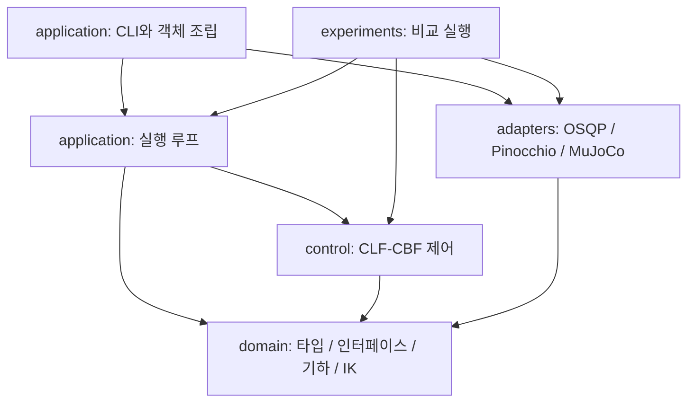

# 아키텍처와 파일 구조 개선

> 기존 설계·구현·실험 기록입니다. 본문의 현재·기본값은 작성 당시 기준이며, 현재 동작은 [구현 지도](../current/README.md)를 참고하세요.

이 문서는 2026-09-23 아키텍처 리뷰를 바탕으로 적용한 변경, 설계 이유,
실행 방법과 검증 범위를 설명한다. 제어 알고리즘의 수식은
[Panda 제어 문서](panda_safe_pose_ik.md)와 [평면 로봇 순차 제어 문서](sequential_control.md)를 참고한다.

## 1. 구조와 책임

```text
main.py                         Panda CLI를 호출하는 작은 진입점
pyproject.toml / uv.lock         설치·명령 등록·개발 의존성·잠긴 환경
configs/
  panda.yaml                    사용자가 편집하는 Panda 실험 설정
  planar.yaml                   사용자가 편집하는 planar 실험 설정
  training/                     오프라인 RDF 학습·샘플링 설정
  archive/                      과거 비교 실험·고정 프로토콜 (재현용)
assets/robots/
  panda.xml                     고정 gripper Panda MJCF
  planar.xml / planar.urdf       planar 시뮬레이션·기구학 모델
models/                         버전 관리하는 학습 RDF
vendor/                         외부 원본 모델·mesh·출처·라이선스
src/safe_ik/
  domain/                       설정 값 타입, 기하, 회전, IK, 데이터·인터페이스
  control/                      planar/Panda CLF-CBF 제어와 solver 계약
  adapters/                     Pinocchio, OSQP, MuJoCo 구현
  application/                  YAML 검증, 객체 조립, 실행 조정, CLI, provenance
  experiments/                  planar 샘플링·실행·분석·보고서
  logging/                      trajectory 기록, NPZ·CSV 입출력
  visualization/                저장 데이터의 그래프·GUI·거리장 렌더링
tests/fixtures/                변경하지 않는 회귀 테스트 시나리오
docs/                          알고리즘·실험 해석·구조 설명
outputs/                       Git에서 제외하는 실행 결과
```

`src`를 Python 패키지 이름으로 사용하던 방식을 `src/safe_ik` 설치 패키지로 바꿨다.
Planar 전용 코드는 `planar_controller.py`, `planar_configuration.py`,
`planar_simulation.py`, `planar_kinematics.py`로 명명했다. 일반 이름의 모듈이
모든 로봇을 지원하는 것으로 오해하지 않도록 한 것이다.

Planar와 Panda 제어기는 계속 분리한다. 두 로봇은 IK 풀이와 단계 전환의 세부
동작이 다르므로, 검증된 공통 데이터·solver 계약을 공유하면서 알고리즘을
각각 읽을 수 있도록 했다.

## 2. 핵심 계산의 의존성 방향

이전에는 `domain`이 application의 설정 타입과 Pinocchio adapter의 quaternion
함수를 가져왔다. 계산 함수 하나를 사용해도 YAML 파서나 native backend가
따라오는 구조였다.

현재 의존성 규칙은 다음과 같다.



- `domain/planar_config.py`, `domain/panda_config.py`는 검증된 값의 dataclass만 갖는다.
- YAML 읽기·검증은 `application/*_configuration.py`에 남긴다.
- quaternion 계산은 `domain/rotations.py`로 이동했다.
- `PandaCapsuleSafety`는 Pinocchio의 `model.nv`를 직접 읽지 않는다.
- `domain`, `control`에는 application, adapter, YAML 파서, OSQP, MuJoCo,
  Pinocchio import가 없다. NumPy·SciPy 같은 수치 계산 의존성은 허용한다.

`tests/test_architecture.py`가 이 방향을 검사한다. 순수 모듈을 import했을 때
native backend나 Matplotlib pyplot이 로드되지 않는지도 별도 프로세스에서 확인한다.

## 3. 해법 실행 결과를 명시적인 계약으로 변경

이전 `solve()`는 배열 또는 `None`을 반환했다. Panda는 선언되지 않은
`solver.last_status` 문자열을 읽어 실패 원인을 추측했고, planar는 모든 실패를
infeasible로 세었다.

현재 `QPSolver.solve(QPProblem)`는 다음 값을 반환한다.

```python
QPSolution(
    status=QPStatus.SOLVED,  # INFEASIBLE / ITERATION_LIMIT / FAILED
    x=solution,
    solve_time=elapsed_seconds,
    message=backend_diagnostic,
)
```

제어기는 backend 메시지를 해석하지 않는다. OSQP adapter가 상태 코드를 공통 상태로
변환한다. 정확도가 부족한 `solved inaccurate` 결과는 이전 정책처럼 채택하지 않는다.
setup/update/solve 예외도 `FAILED`로 전달하고, 다음 호출에서는 workspace를 다시 만든다.

OSQP workspace는 동일한 문제 구조에서 재사용한다. Hessian `P`나 제약 행렬 크기가
달라지면 다시 초기화하므로, 인터페이스가 허용하는 문제 변경이 무시되지 않는다.
`solve_time`은 setup/update를 포함한 전체 호출의 wall time이다.

Planar와 Panda 모두 실제 infeasible과 수치 실패를 따로 기록한다. Planar의 수치 실패는
infeasible 단계 전환으로 취급하지 않는다. Panda rollout의 최종 상태에서도 실패 원인이
유지되며, 실패해서 적분하지 않은 시도는 실제 시뮬레이션 경과 시간에 더하지 않는다.

## 4. Panda 객체 조립과 실행 루프 분리

| 모듈 | 책임 |
|---|---|
| `application/panda_setup.py` | 실제 기구학·안전 모델·solver·plant를 조립 |
| `application/panda_runtime.py` | backend 의존성과 선택적인 IK search factory를 묶음 |
| `application/parallel_ik.py` | seed별 프로세스 풀과 worker 전용 모델 수명 관리 |
| `application/panda_rollout.py` | safe IK, 제어 반복, 진단 수집 |
| `adapters/mujoco_plant.py` | MuJoCo 상태·적분·선택적인 viewer |
| `application/panda_results.py` | 결과 타입, JSON payload, trace 저장 |
| `visualization/panda.py` | trace로부터 그래프 생성 |
| `application/panda_run.py` | CLI 옵션, 조립·실행·저장의 순서 결정 |

사용 예:

```python
from safe_ik.application.panda_configuration import load_panda_config
from safe_ik.application.panda_setup import build_panda_runtime
from safe_ik.application.panda_rollout import run_panda

config = load_panda_config("configs/panda.yaml")
runtime = build_panda_runtime(config)
result = run_panda(config, runtime)
```

`PandaRuntime`에 다른 `PoseKinematics`, `SafetyEvaluator`, `QPSolver`, `JointPlant`
구현을 전달할 수 있다. 실행 루프는 MuJoCo를 import하지 않는다. 화면 동기화,
종료 요청, 단계 전환 출력은 `observe`, `should_continue`, `on_transition`
콜백으로 연결한다. 최종 상태 조회는 공개 `controller.status(q)`를 사용한다.

MuJoCo가 없는 선형 기구학·고정 solver·Euler 적분기로도 전체 direct rollout을
실행하는 테스트가 있다. 이는 의존성 주입이 실제로 동작함을 확인하기 위한 테스트이며,
실제 로봇의 동역학이나 실시간 통신을 검증한다는 뜻은 아니다.

IK 병렬화는 [Panda 병렬 seed 탐색](panda_safe_pose_ik.md#parallel-seed-search)을 참고한다.
수학 모듈은 단일 seed 계산과 결과 선택을 담당하고, 프로세스 생성은 application에 둔다.

## 5. 실험 실행·분석·화면 표시 분리

780줄의 `compare_sequential.py`를 다음 책임으로 나눴다.

| 위치 | 내용 |
|---|---|
| `experiments/models.py` | case, worker input, 결과 타입과 비교 식별자 |
| `experiments/sampling.py` | seed 기반 시나리오 생성과 IK 가능성 필터 |
| `experiments/runner.py` | 한 쌍 실행, process pool, 결과 집계 조정 |
| `experiments/analysis.py` | 성공·실패 분류, 통계와 paired metric 계산 |
| `experiments/reporting.py` | JSON·CSV 저장 |
| `visualization/comparison.py` | 완료된 결과의 비교 그림 |
| `application/compare_sequential.py` | CLI |

기존 pair 단위 병렬 처리와 성공 기준은 유지한다. 그래프 생성과 JSON/CSV 저장을
분리했으므로, 그래프 생성에서 문제가 생겨도 앞서 저장한 수치 결과를 확인할 수 있다.

`Recorder`는 수치 기록과 NPZ·CSV 저장을 담당한다. GUI와 backend 선택은
`visualization/recording.py`에 있다. 기존 `recorder.plot()`과 `show_gui()`는
시각화 함수를 지연 import하는 편의 wrapper로 유지했다. 거리장 렌더링 역시
`visualization/rdf.py`로 옮겼다.

## 6. 실행 결과와 재현 정보

Panda 기본 출력:

```text
outputs/panda/<run-id>/
  config.yaml                   CLI override와 절대 자산 경로가 적용된 YAML
  resolved_config.json          파싱·검증 후 전체 dataclass 값
  metadata.json                 Git, 환경, 코드·자산 해시
  summary.json                  IK·제어 결과
  trajectory.npz                시각, q, 명령, CLF, slack, stage, named CBF
  plots/control.png
```

Planar는 `outputs/sequential_comparison/<run-id>/`에 동일한 세 provenance 파일과
기존 `summary.json`, `summary.csv`, `analysis.json`, `paired_metrics.png`,
case별 NPZ를 저장한다. Case trace에는 barrier label도 포함한다.

`run-id`는 UTC 시각과 임의 식별자로 만들어 기본 실행끼리 덮어쓰지 않는다.
`--run-name`으로 이미 존재하는 디렉터리를 지정하면 오류를 낸다. Panda의
`--output`은 선택적인 추가 summary export이며, 기존 파일을 덮어쓰지 않는다.
수치 trace는 그래프 저장 성공 여부와 독립적으로 저장한다.

`metadata.json`에는 다음이 들어간다.

- Git commit, dirty 여부, 변경 파일 상태. Git이 없는 환경에서는 `null`.
- Python·플랫폼·주요 dependency 버전, 실행 인자, 생성 시각.
- 실행한 패키지 Python 소스의 SHA-256과 `uv.lock` 해시.
- 사용한 XML/URDF/RDF 및 MJCF가 참조하는 mesh/include 파일의 SHA-256.

Seed를 포함한 전체 적용 값은 `resolved_config.json`에 보존한다. 비교 실험의
`--cases`, `--workers`, `--duration`도 보존한 YAML에 반영한다.

해시는 자산을 식별하지만 자산 자체의 백업은 아니다. 저장한 `config.yaml`은
동일 머신의 자산 경로에서 다시 읽을 수 있으며, 다른 머신으로 옮기려면 자산도
가져가 경로를 수정해야 한다. Dirty 작업 트리의 변경 코드 역시 해시만으로 복원할 수
없으므로 장기 보관 실험은 해당 코드를 commit하거나 별도로 보관해야 한다.

## 7. 설정 경로·설치·명령 변경

현재 모든 Make target과 로봇별 사용법은 [Make 명령 안내](make_commands.md)에 정리되어 있다.

```bash
uv sync --locked
make run
make panda-view
make test
make check
```

Black·isort는 runtime dependencies에서 `dev` dependency group으로 옮겼다.
`uv sync`는 기본적으로 개발 도구도 설치하며, 실행 전용 환경은 `uv sync --no-dev`를
사용할 수 있다. `make format`은 import 순서와 포맷을 정리하고 `make check`는
포맷 검사와 회귀 테스트를 함께 수행한다.

| 이전 | 현재 |
|---|---|
| `python -m src.application.panda_run` | `uv run safe-ik` |
| `python -m src.application.compare_sequential` | `uv run safe-ik-compare` |
| `python -m src.application.train_rdf` | `uv run safe-ik-train-rdf` |
| `python -m src.application.visualize_rdf` | `uv run safe-ik-visualize-rdf` |
| `settings/controller.yaml` | `configs/planar.yaml` |
| `settings/panda_controller.yaml` | `configs/panda.yaml` |
| `settings/urdf.xml` | `assets/robots/planar.urdf` |
| `settings/mujoco.xml` | `assets/robots/planar.xml` |
| `settings/panda.xml` | `assets/robots/panda.xml` |

기존 `main.py`와 Makefile 별칭은 유지한다. Python import 경로는 `safe_ik.*`로
변경되었으므로 외부 스크립트에서는 새 모듈 경로를 사용해야 한다.

YAML 내부 `model_path`와 `rdf_model_path`는 **YAML 파일이 있는 디렉터리 기준**이다.
예를 들어 `configs/panda.yaml`은 `../assets/robots/panda.xml`을 사용한다.
CLI의 명시적인 `--config`는 호출 위치 기준이고, comparison은 `--root` 기준이다.
Editable install에서는 기본 입력 경로를 checkout에서 찾아 저장소 밖에서 명령을
실행해도 동작한다. Wheel에는 대용량 로봇 자산과 실험 설정을 묶지 않으므로, 별도
설치 환경에서는 `--config` 및 필요한 모델 경로를 제공해야 한다.

짧은 Panda 확인:

```bash
uv run safe-ik --mode direct --duration 0.1
```

고정 planar 시나리오로 실행·병렬 처리 확인:

```bash
uv run safe-ik-compare run --config tests/fixtures/planar.yaml \
  --cases 2 --workers 2 --duration 0.1
```

0.1초 실행은 데이터 경로 확인용이며 목표 수렴을 검증하는 실험은 아니다.

## 8. 테스트와 사용자 작업 보존

`tests/fixtures/planar.yaml`, `tests/fixtures/panda.yaml`을 고정 시나리오로 추가했다.
알고리즘 회귀 테스트가 실험용 `configs/*.yaml` 수정 때문에 바뀌지 않도록 했다.
잘못된 YAML을 만드는 테스트는 원문 문자열 치환 대신 YAML 객체의 특정 값을
수정한다. 사용자 설정이 유효한지와 고정된 알고리즘 동작이 맞는지를 구분할 수 있다.

추가 검증은 solver 상태·문제 변경, 계층 의존성, native backend 없는 rollout,
실패 시 정지, 실행 디렉터리 충돌 방지, archived config 재로딩, 외부 작업 디렉터리에서
entry point 실행을 다룬다.

리팩터링 전에 있던 planar `frame_names: [joint2, joint5, ee_joint]` 변경은
`configs/planar.yaml`에 그대로 보존했다. 현재 planar URDF에는 `joint5`가 없으므로
그 설정으로 비교 실험을 실행하면 이름을 포함한 오류가 발생한다. 모델에 맞게 프레임을
선택해야 하며, 기본 모델의 회귀 fixture는 `[joint2, joint3, ee_joint]`를 사용한다.
사용자가 작업 중이던 미추적 문서와 prompts 파일도 수정하지 않았다.

## 9. 검증 범위

- 기존 수치·제어·설정·기록 테스트와 신규 구조·병렬 IK 테스트: 82개 통과.
- 실제 MuJoCo/Pinocchio/OSQP를 사용하는 Panda direct 0.1초 headless 실행.
- 초기 자세를 목표로 하고 IK seed·hold 시간을 줄인 sequential 시나리오에서 safe IK 후보 선택과 모든 단계 전환 확인.
- 2개 case, 2개 worker의 planar direct/sequential 비교 및 결과 저장.
- 비교 결과 전체 시각화, 거리장 렌더링, 기록 파일 재로딩.
- `uv build --offline`으로 sdist와 wheel 빌드.

GUI 창의 수동 조작, 실제 로봇 연결, 장시간 수렴 성능 비교는 이번 구조 변경 검증에
포함하지 않는다. CLF·CBF 수식과 기존 수치 회귀 테스트는 유지했다.
