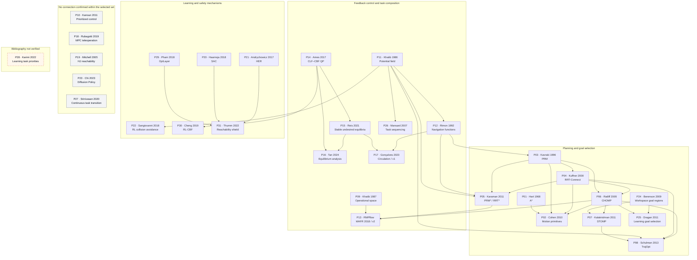

# 안전한 로봇팔 목표 도달: 논문 관계도와 문헌 요약

- 작성일: 2026-11-16
- 갱신일: 2026-11-17 — 사용자 제공 P22 출판 PDF의 본문·실험·참고문헌 전체 확인 반영.
- 범위: 앞선 대화에서 선정한 **31편**. 분야 전체를 망라한 systematic review는 아님.
- 인용 검증: 2026-11-15 조사 및 후속 점검. 30편의 참고문헌을 원문 또는 원문 검색 인덱스로 대조하여, 선정 목록 내부의 **직접 인용 35개** 확인. 2026-11-17 P22의 참고문헌 18개를 출판본으로 재확인하였으며 연결 수는 동일; P28의 참고문헌은 미확인.
- 문서 구성: 방법론 분류 트리, 실제 인용 그래프, 31편의 간단한 설명과 링크, 인용 근거 표.
- P01–P31은 이 문서의 고유 식별자이며 논문 원문의 참고문헌 번호와 무관.

목차: [분류 트리](#taxonomy) · [전체 인용 그래프](#citation-graph) · [논문별 설명](#papers) · [인용 근거](#evidence) · [미확인 및 판본 주의](#limitations) · [읽을 때의 비교 기준](#reading)

<a id="taxonomy"></a>

## 1. 방법론 분류 트리

아래 트리는 **방법의 역할에 따라 정리한 독해용 분류**. 실제 인용 관계는 다음 절의 그래프에서 별도로 표시. 경로 계획, feedback control, 학습, task 구성은 함께 사용할 수 있으므로 서로 배타적인 분류는 아님. 특히 D는 다른 방법과 결합하는 구조를 묶은 항목.

```text
안전 제약 아래 end-effector 목표 도달을 위한 방법론
├─ A. 경로·궤적 계획 — 실행할 경로나 trajectory 구성
│  ├─ Graph/search-based planning
│  │  ├─ P01 Hart et al. 1968 — A*
│  │  └─ P02 Cohen et al. 2010 — Manipulation motion primitives
│  ├─ Sampling-based planning
│  │  ├─ P03 Kavraki et al. 1996 — PRM
│  │  ├─ P04 Kuffner & LaValle 2000 — RRT-Connect
│  │  └─ P05 Karaman & Frazzoli 2011 — PRM* / RRT*
│  └─ Trajectory optimization
│     ├─ P06 Ratliff et al. 2009 — CHOMP
│     ├─ P07 Kalakrishnan et al. 2011 — STOMP
│     └─ P08 Schulman et al. 2013 — TrajOpt
├─ B. 모델 기반 feedback control 및 안전 분석
│  ├─ Task-space / prioritized control
│  │  ├─ P09 Khatib 1987 — Operational-space formulation
│  │  └─ P10 Kanoun 2011 — Prioritized kinematic control
│  ├─ Potential / geometric motion policies
│  │  ├─ P11 Khatib 1986 — Artificial potential field
│  │  ├─ P12 Rimon & Koditschek 1992 — Navigation functions
│  │  └─ P13 Cheng et al. — RMPflow, WAFR 2018
│  ├─ CLF–CBF QP 및 undesired equilibria
│  │  ├─ P14 Ames et al. 2017 — CLF–CBF QP
│  │  ├─ P15 Reis et al. 2021 — Stable undesired equilibria
│  │  ├─ P16 Tan & Dimarogonas 2024 — Equilibrium analysis
│  │  └─ P17 Gonçalves et al. 2023 — Circulation inequalities
│  ├─ Model predictive control
│  │  └─ P18 Rubagotti et al. 2019 — Obstacle-aware teleoperation
│  └─ Reachability analysis
│     └─ P19 Mitchell et al. 2005 — Hamilton–Jacobi reachable sets
├─ C. 정책 학습 — 관측·상태에서 action 생성
│  ├─ Reinforcement learning
│  │  ├─ P20 Haarnoja et al. 2018 — Soft Actor-Critic
│  │  ├─ P21 Andrychowicz et al. 2017 — Hindsight Experience Replay
│  │  └─ P22 Sangiovanni et al. 2018 — Manipulator collision avoidance
│  └─ Imitation learning
│     └─ P23 Chi et al. 2023 — Diffusion Policy
└─ D. Goal·task 구성 및 학습과 안전 제어의 결합
   ├─ Goal representation / goal selection
   │  ├─ P24 Berenson et al. 2009 — Workspace goal regions
   │  └─ P25 Dragan et al. 2011 — Learning goal selection
   ├─ Task sequencing / transition
   │  ├─ P26 Mansard & Chaumette 2007 — Sensor-based task sequencing
   │  └─ P27 Srinivasan et al. 2020 — Continuous reachability transition
   ├─ Learning task priorities
   │  └─ P28 Karimi & Ahmadi 2022 — RL-based priority assignment
   └─ Constrained / shielded reinforcement learning
      ├─ P29 Pham et al. 2018 — OptLayer
      ├─ P30 Cheng et al. 2019 — RL-CBF
      └─ P31 Thumm & Althoff 2022 — Reachability-based safety shield
```

이 연구의 검토 위치는 **B의 CLF–CBF QP와 D의 IK 기반 goal·subtask 구성 및 학습을 통한 선택의 교차점**. 이는 방법의 구조를 해석한 위치이며, 아래 인용 그래프에 본 논문의 인용 관계를 추가한 것은 아님. 차별점 판단에는 각 원문의 task 정의, IK 사용 목적, 안전·수렴 가정의 추가 대조가 필요.

<a id="citation-graph"></a>

## 2. 확인된 전체 인용 그래프

**화살표 `A → B`의 의미: B의 참고문헌에 A가 수록됨.** 선행 논문에서 인용한 논문으로 향하도록 표시한 방향. 방법의 계승, 개선, 우월성 또는 같은 이론에 속한다는 뜻은 아님.

31개 노드와 확인된 35개 연결을 모두 표시. 색상과 묶음은 읽기 위한 배치이며, 실제 관계는 화살표만 의미. P10·P18·P19·P23·P27은 검토한 범위에서 연결이 확인되지 않은 노드. P28은 참고문헌 미확인 노드. 따라서 이 그림은 **선정 논문과 확인 판본에 한정한 부분 인용망**.

Mermaid를 지원하는 Markdown viewer에서 그림으로 표시되며, 지원하지 않는 환경에서는 [인용 근거 표](#evidence)로 같은 관계를 확인 가능.



예를 들어 `P12 → P03`은 PRM이 navigation functions를 선행연구로 인용했다는 뜻이며, PRM이 potential-field 방법의 하위 분류라는 뜻은 아님. 또한 P20 SAC와 P21 HER는 서로 연결된 계보가 아니라, P31에서 함께 인용되는 별개의 기반 연구.

<a id="papers"></a>

## 3. 논문별 간단 설명과 링크

각 항목의 **핵심**은 논문 내용의 요약이고, **검토 관점**은 본 연구와 비교하기 위한 독해 질문 또는 해석. 링크는 논문 원문, 저자 공개본 또는 공식 학회·출판사 페이지.

### A. 경로·궤적 계획

<a id="p01"></a>

#### P01. Hart, Nilsson & Raphael — A* (1968)

*A Formal Basis for the Heuristic Determination of Minimum Cost Paths.* IEEE Transactions on Systems Science and Cybernetics.

- **핵심:** 누적 비용과 heuristic으로 탐색 우선순위를 정하는 A*의 이론적 기반. 적절한 heuristic 및 탐색 조건 아래 최소 비용 경로 탐색.
- **검토 관점:** 로봇팔 자체에 특화된 제어기가 아니라 graph search의 기반. 로봇에 적용할 때 state discretization, edge 구성, 충돌 검사가 별도로 필요.
- **링크:** [저자 공개 원문](https://ai.stanford.edu/~nilsson/OnlinePubs-Nils/PublishedPapers/astar.pdf) · [대학 보관 원문](https://www.cs.auckland.ac.nz/courses/compsci709s2c/resources/Mike.d/astarNilsson.pdf)

<a id="p02"></a>

#### P02. Cohen, Chitta & Likhachev — Search-based manipulation (2010)

*Search-based Planning for Manipulation with Motion Primitives.* ICRA.

- **핵심:** Manipulator의 움직임을 motion primitives로 구성하고 heuristic search로 연결하여 collision-free motion을 계획.
- **검토 관점:** 탐색 공간과 motion primitives를 어떻게 구성하는지가 성능에 미치는 영향. 매 제어 주기 국소 입력을 계산하는 방식과 경로 전체를 탐색하는 방식의 비교 대상.
- **링크:** [저자 공개 원문](https://www.cs.cmu.edu/~maxim/files/SBPlanningwithMotionPrims_icra10.pdf)

<a id="p03"></a>

#### P03. Kavraki, Švestka, Latombe & Overmars — PRM (1996)

*Probabilistic Roadmaps for Path Planning in High-Dimensional Configuration Spaces.* IEEE Transactions on Robotics and Automation.

- **핵심:** Collision-free configuration을 sampling하고 local planner로 연결한 roadmap을 구축하여 고차원 경로 탐색 수행.
- **검토 관점:** Roadmap 구축 비용과 여러 planning query에서의 재사용. 확률적 완전성은 관련 가정과 충분한 sampling에 대한 성질이며 유한 시간 내 성공 보장과 구분.
- **링크:** [저자 연구실 페이지](https://www.kavrakilab.org/publications/kavraki-svestka1996probabilistic-roadmaps-for.html) · [참고문헌 확인 원문](https://web.ics.purdue.edu/~rvoyles/Classes/ROSprogramming/Kavraki_Latombe.PRM_PathPlanning.TRA96.pdf)

<a id="p04"></a>

#### P04. Kuffner & LaValle — RRT-Connect (2000)

*RRT-Connect: An Efficient Approach to Single-Query Path Planning.* ICRA.

- **핵심:** 시작과 목표에서 자라는 두 RRT를 적극적으로 연결하여 single-query planning의 탐색 효율 개선.
- **검토 관점:** 알려진 장애물 환경에서 collision-free path를 찾는 대표 비교 대상. 계획된 경로의 충돌 검사와 실제 시스템의 tracking·안전 보장은 별도 문제.
- **링크:** [저자 공개 원문](https://kuffner.org/james/papers/kuffner_icra2000.pdf)

<a id="p05"></a>

#### P05. Karaman & Frazzoli — PRM* / RRT* (2011)

*Sampling-based Algorithms for Optimal Motion Planning.* The International Journal of Robotics Research.

- **핵심:** 기존 sampling-based planner의 최적성 문제를 분석하고 PRM*와 RRT*의 asymptotic optimality를 제시.
- **검토 관점:** Sampling 수 증가에 따른 최적성이라는 이론적 성질과, 제한된 계산 시간에서의 실제 성능을 구분하여 비교.
- **링크:** [논문 정보](https://arxiv.org/abs/1105.1186) · [원문](https://arxiv.org/pdf/1105.1186)

<a id="p06"></a>

#### P06. Ratliff, Zucker, Bagnell & Srinivasa — CHOMP (2009)

*CHOMP: Gradient Optimization Techniques for Efficient Motion Planning.* ICRA.

- **핵심:** Smoothness와 obstacle cost를 고려한 trajectory를 gradient 기반으로 개선하는 motion optimization 방법.
- **검토 관점:** 초기 trajectory와 local optimum의 영향. 최종 목표 pose에 대응하는 configuration 선택이 optimization 결과에 미치는 영향도 확인 대상.
- **링크:** [저자 공개 원문](https://mzucker.github.io/swarthmore/papers/icra09-chomp.pdf)
- **판본:** 2013년 IJRR의 *CHOMP: Covariant Hamiltonian Optimization for Motion Planning*과 구분.

<a id="p07"></a>

#### P07. Kalakrishnan et al. — STOMP (2011)

*STOMP: Stochastic Trajectory Optimization for Motion Planning.* ICRA.

- **핵심:** Noisy trajectory samples의 비용으로 trajectory를 갱신하는 stochastic optimization. 비용 함수의 미분을 직접 요구하지 않는 구성.
- **검토 관점:** 비매끄러운 비용의 활용 가능성과 sampling에 드는 계산량. 여러 trajectory 후보를 평가하는 방식과 subtask 후보를 고르는 방식의 차이 확인.
- **링크:** [연구기관 논문 페이지](https://is.mpg.de/publications/kalakrishnan_raiic_2011) · [대학 보관 원문](https://whiteoak.umd.edu/roswiki/attachments/Papers%282f%29ICRA2011_Kalakrishnan/kalakrishnan_icra2011.pdf)

<a id="p08"></a>

#### P08. Schulman et al. — TrajOpt (2013)

*Finding Locally Optimal, Collision-Free Trajectories with Sequential Convex Optimization.* Robotics: Science and Systems.

- **핵심:** 비선형 trajectory optimization을 반복적인 convex subproblem으로 풀고, collision penalty와 구간 사이의 충돌 검사를 활용하는 방법.
- **검토 관점:** 반복 최적화, 초기화, 충돌 처리 방식. 여기서 sequential은 convex optimization의 반복을 뜻하며 link subtask의 순차 실행과 다른 의미.
- **링크:** [저자 공개 원문](https://people.eecs.berkeley.edu/~pabbeel/papers/Schulmanetal_RSS2013.pdf)
- **판본:** 2014년 IJRR 확장 논문과 구분하여 RSS 2013을 사용.

### B. 모델 기반 feedback control 및 안전 분석

<a id="p09"></a>

#### P09. Khatib — Operational-space formulation (1987)

*A Unified Approach for Motion and Force Control of Robot Manipulators: The Operational Space Formulation.* IEEE Journal of Robotics and Automation.

- **핵심:** Manipulator의 motion·force control을 operational space의 동역학으로 다루는 통합 formulation.
- **검토 관점:** 로봇팔의 task-space 구조와 redundancy를 활용하는 기반 연구. 따라서 기존 제어 연구 전체가 로봇팔의 특성을 활용하지 않는다는 주장은 부적절.
- **링크:** [저자 공개 원문](https://khatib.stanford.edu/publications/pdfs/Khatib_1987_RA.pdf)

<a id="p10"></a>

#### P10. Kanoun — Prioritized kinematic control (2011)

*Real-time Prioritized Kinematic Control under Inequality Constraints for Redundant Manipulators.* Robotics: Science and Systems.

- **핵심:** Redundant manipulator에서 equality·inequality task의 우선순위를 다루는 실시간 kinematic optimization 방법.
- **검토 관점:** 동시에 주어진 task 사이의 priority와, task를 시간에 따라 바꾸는 sequencing을 구분하여 비교. Subtask를 달성한 뒤 해제하는 본 연구의 구조와 대조할 대상.
- **링크:** [공식 학회 페이지](https://www.roboticsproceedings.org/rss07/p21.html) · [원문](https://www.roboticsproceedings.org/rss07/p21.pdf)

<a id="p11"></a>

#### P11. Khatib — Artificial potential field (1986)

*Real-Time Obstacle Avoidance for Manipulators and Mobile Robots.* The International Journal of Robotics Research.

- **핵심:** 목표의 attractive potential과 장애물의 repulsive potential을 이용하는 실시간 obstacle avoidance.
- **검토 관점:** 국소적인 attraction·repulsion의 결합과 목표 이외의 정체 가능성. 로봇팔의 obstacle avoidance를 오래전부터 다룬 선행연구.
- **링크:** [저자 공개 원문](https://khatib.stanford.edu/publications/pdfs/Khatib_1986_IJRR.pdf)
- **판본:** 같은 제목의 ICRA 1985 논문과 구분하여 IJRR 1986을 사용.

<a id="p12"></a>

#### P12. Rimon & Koditschek — Navigation functions (1992)

*Exact Robot Navigation Using Artificial Potential Functions.* IEEE Transactions on Robotics and Automation.

- **핵심:** 특정 공간·장애물 구조의 가정 아래 navigation function을 구성하여 장애물을 피하며 목표로 이동하는 feedback 설계.
- **검토 관점:** 일반적인 potential field의 정체 문제에 이론적으로 접근한 연구. 적용 공간의 가정과 almost-global 성질을 임의의 로봇팔 환경으로 확대 해석하지 않도록 주의.
- **링크:** [원문](https://www.cs.cmu.edu/~motionplanning/papers/sbp_papers/r/rimon_koditschek_potential.pdf)

<a id="p13"></a>

#### P13. Ching-An Cheng et al. — RMPflow (WAFR 2018)

*RMPflow: A Computational Graph for Automatic Motion Policy Generation.* WAFR 2018; 확인 원고는 arXiv v2, 2019-04-05.

- **핵심:** 여러 task space에 정의한 Riemannian Motion Policies를 기하학적으로 일관된 방식으로 결합하여 로봇의 motion policy 구성. Stability의 충분조건도 제시.
- **검토 관점:** 여러 task policy의 동시 결합과 하나의 active subtask를 전환하는 제어의 차이. Stability 조건을 모든 환경의 충돌 회피·목표 수렴 보장으로 해석하지 않도록 주의.
- **링크:** [확인 판본 정보](https://arxiv.org/abs/1811.07049v2) · [확인 판본 원문](https://arxiv.org/pdf/1811.07049v2)

<a id="p14"></a>

#### P14. Ames, Xu, Grizzle & Tabuada — CLF–CBF QP (2017)

*Control Barrier Function Based Quadratic Programs for Safety Critical Systems.* IEEE Transactions on Automatic Control.

- **핵심:** Control Lyapunov Function(CLF)의 목표 성능 조건과 Control Barrier Function(CBF)의 안전 조건을 quadratic program(QP)에 결합하는 framework.
- **검토 관점:** CBF의 safe-set invariance 조건과 CLF의 convergence 조건을 각각 확인. CLF relaxation, QP feasibility, 입력 제한 때문에 안전성과 전역 목표 도달을 동일한 보장으로 취급할 수 없음.
- **링크:** [저자 공개 원문](https://ames.caltech.edu/ames2017cbf.pdf) · [참고문헌 확인 원고](https://arxiv.org/pdf/1609.06408)

<a id="p15"></a>

#### P15. Reis, Aguiar & Tabuada — Undesirable stable equilibria (2021)

*Control Barrier Function-Based Quadratic Programs Introduce Undesirable Asymptotically Stable Equilibria.* IEEE Control Systems Letters.

- **핵심:** CLF–CBF QP 폐루프에서 목표가 아닌 asymptotically stable equilibrium이 발생할 수 있음을 분석.
- **검토 관점:** 안전한 제어가 목표 도달을 자동으로 의미하지 않는다는 직접적인 문제 근거. 볼록 QP 자체의 local minimum과, state-dependent QP 제어기로 구성한 폐루프의 equilibrium을 구분.
- **링크:** [논문 정보](https://arxiv.org/abs/2003.07819v4) · [확인 원고](https://arxiv.org/pdf/2003.07819v4)
- **판본:** L-CSS 권호 연도는 2021, 확인한 arXiv v4의 공개 연도는 2020.

<a id="p16"></a>

#### P16. Tan & Dimarogonas — Undesired equilibria analysis (2024)

*On the Undesired Equilibria Induced by Control Barrier Function Based Quadratic Programs.* Automatica.

- **핵심:** Control-affine system의 CBF-based QP가 유도하는 undesired equilibrium의 발생과 설계변수 영향을 분석하고, 일부 equilibrium을 제거하는 수정된 QP 제안.
- **검토 관점:** Nominal control 및 CLF–CBF 구성과 equilibrium의 관계. 모든 boundary equilibrium 제거 또는 전역 목표 수렴을 보장하는 결과와 구분하고, 본 연구의 subtask target·활성 objective 변경과 대조할 대상.
- **링크:** [저자 공개 원문](https://people.kth.se/~dimos/pdfs/Xiao_Automatica_2024.pdf) · [DOI](https://doi.org/10.1016/j.automatica.2023.111359)

<a id="p17"></a>

#### P17. Gonçalves et al. — Circulation inequalities (2023)

*Using Circulation to Mitigate Spurious Equilibria in Control Barrier Function — Extended Version.* arXiv:2307.09901v1.

- **핵심:** QP에 circulation inequality를 추가하여 configuration space에서 장애물 주위를 도는 방향을 유도하고 spurious equilibrium 문제를 완화.
- **검토 관점:** 기본 구성의 짝수 차원 가정과 논문 IV-C의 홀수 차원 확장을 구분. 홀수 차원 확장에서는 circulation 방향이 소실되는 지점의 QP infeasibility 가능성도 논의하므로, “짝수 차원에서만 적용 가능”이라는 단정과 조건 없는 일반 적용 주장을 모두 피할 필요.
- **링크:** [확인 판본 정보](https://arxiv.org/abs/2307.09901v1) · [원문](https://arxiv.org/pdf/2307.09901v1) · [홀수 차원 확장](https://arxiv.org/html/2307.09901v1#S4.SS3)
- **판본:** 이후 저널 논문 *Control Barrier Functions With Circulation Inequalities*와 혼합하지 않고, 위 arXiv v1의 참고문헌으로 연결 확인.

<a id="p18"></a>

#### P18. Rubagotti et al. — MPC obstacle avoidance (2019)

*Semi-Autonomous Robot Teleoperation with Obstacle Avoidance via Model Predictive Control.* Robotics: Science and Systems.

- **핵심:** Operator의 손 pose를 end-effector reference로 받아 whole-arm collision avoidance와 joint 제약을 고려하는 model predictive control(MPC) 기반 semi-autonomous teleoperation.
- **검토 관점:** 유한 horizon의 미래 motion을 고려하는 방식의 장점과 계산량. Teleoperation 문제 설정을 autonomous goal reaching과 동일한 과제로 취급하지 않도록 구분.
- **링크:** [공식 원문](https://www.roboticsproceedings.org/rss15/p81.pdf)

<a id="p19"></a>

#### P19. Mitchell, Bayen & Tomlin — Hamilton–Jacobi reachability (2005)

*A Time-Dependent Hamilton–Jacobi Formulation of Reachable Sets for Continuous Dynamic Games.* IEEE Transactions on Automatic Control.

- **핵심:** Control과 disturbance의 상호작용을 continuous dynamic game으로 다루고, Hamilton–Jacobi 방정식으로 reachable set을 계산하는 방법.
- **검토 관점:** 안전·도달 가능 영역을 집합으로 분석하는 기반. 고차원 manipulator 적용에서는 state dimension에 따른 계산 부담과 근사 방법을 별도로 검토할 필요.
- **링크:** [저자 공개 원문](https://www.cs.ubc.ca/~mitchell/Papers/publishedIEEEtac05.pdf)

### C. 정책 학습

<a id="p20"></a>

#### P20. Haarnoja et al. — Soft Actor-Critic (2018)

*Soft Actor-Critic: Off-Policy Maximum Entropy Deep Reinforcement Learning with a Stochastic Actor.* ICML.

- **핵심:** Expected reward와 policy entropy를 함께 고려하는 off-policy actor–critic 알고리즘으로 continuous-control policy 학습.
- **검토 관점:** 범용 reinforcement learning(RL) 알고리즘이며 그 자체가 whole-arm collision avoidance의 형식적 보장을 제공하는 것은 아님. 안전 기구를 결합한 P29–P31과 구분.
- **링크:** [공식 학회 페이지](https://proceedings.mlr.press/v80/haarnoja18b.html) · [원문](https://proceedings.mlr.press/v80/haarnoja18b/haarnoja18b.pdf)
- **판본:** 별도 논문인 *Soft Actor-Critic Algorithms and Applications*와 구분.

<a id="p21"></a>

#### P21. Andrychowicz et al. — Hindsight Experience Replay (2017)

*Hindsight Experience Replay.* NeurIPS.

- **핵심:** Episode에서 실제로 달성한 상태를 다른 목표로 재해석하여 replay에 활용함으로써 sparse-reward, goal-conditioned RL의 학습 효율 개선.
- **검토 관점:** HER는 안전 제어기나 별도의 action policy 구조가 아니라 experience 재사용 기법. 목표 달성 학습과 충돌 안전 보장의 역할을 분리해서 비교.
- **링크:** [공식 논문 페이지](https://papers.nips.cc/paper_files/paper/2017/hash/453fadbd8a1a3af50a9df4df899537b5-Abstract.html) · [공식 원문](https://papers.nips.cc/paper_files/paper/2017/file/453fadbd8a1a3af50a9df4df899537b5-Paper.pdf)

<a id="p22"></a>

#### P22. Sangiovanni et al. — RL for manipulator collision avoidance (2018)

*Deep Reinforcement Learning for Collision Avoidance of Robotic Manipulators.* European Control Conference, pp. 2063–2068.

- **핵심:** Normalized Advantage Function(NAF) 기반 RL이 joint position·velocity, end-effector·target·obstacle position 및 obstacle velocity를 입력받아 joint target velocity를 생성. Target 거리·action 크기·로봇–장애물 최소 거리로 구성한 reward를 사용하며, 별도의 CBF/QP safety filter는 제시하지 않음 [§III, 식 (9)–(14)].
- **검증 범위:** 6-joint COMAU SMART3-S2의 V-REP simulation에서 end-effector **position** 도달과 회피 평가. **직선 경로를 이동하는 구형 장애물 1개**에 대해 target의 고정·무작위 배치와 장애물의 일정 왕복·무작위 방향 전환 및 정지를 조합한 네 조건으로, 임의 형상·개수·배치에 대한 일반화 검증은 아님 [§IV, 인쇄 pp.2066–2067].
- **검토 관점:** Action을 직접 학습하는 obstacle-avoidance baseline으로 비교하되, 본 연구의 IK 기반 link target·실행 전 pair 선택·CLF–CBF QP 및 pose 목표와 구분. 원문의 transfer는 다른 장애물 운동 조건에서의 추가 학습이며, zero-shot 일반화나 안전성의 이론적 보장으로 해석하지 않음.
- **링크:** [공식 기관 저장소](https://re.public.polimi.it/handle/11311/1071419) · [사용자 제공 출판 원문](https://drive.google.com/file/d/1kKNwdEX8-Q-C6kqfdmk1U9oBonGVqWcu/view?usp=drivesdk) · [상세 원문 검토](/home/jinoo/prj/safe-inv-clbf-robot-arm/presentations/masters_defense/문헌조사_P22_원문검토_2026-11-17.md)
- **확인 상태:** 2026-11-17 사용자 제공 출판 PDF 6쪽의 본문과 참고문헌 **18개** 확인 완료. 이전 검색 인덱스의 17개 표기를 정정하며, 인쇄 p.2068 / PDF p.6의 ref.7에서 P11 인용을 재확인.

<a id="p23"></a>

#### P23. Chi et al. — Diffusion Policy (2023)

*Diffusion Policy: Visuomotor Policy Learning via Action Diffusion.* Robotics: Science and Systems.

- **핵심:** Demonstration으로 학습한 conditional diffusion model을 이용하여 관측에 대응하는 action sequence를 생성하는 visuomotor imitation learning.
- **검토 관점:** RL과 구분되는 데이터 기반 정책 학습 대안. Receding-horizon action 실행을 사용하지만, 그것만으로 model-based MPC나 formal safety controller가 되는 것은 아님.
- **링크:** [공식 학회 페이지](https://www.roboticsproceedings.org/rss19/p026.html) · [확인 원문](https://www.roboticsproceedings.org/rss19/p026.pdf) · [프로젝트](https://diffusion-policy.cs.columbia.edu/)
- **판본:** 2024년 IJRR 확장본과 구분하여 RSS 2023의 참고문헌 사용.

### D. Goal·task 구성과 학습·안전 제어의 결합

<a id="p24"></a>

#### P24. Berenson et al. — Workspace goal regions (2009)

*Manipulation Planning with Workspace Goal Regions.* ICRA.

- **핵심:** End-effector의 허용 목표 pose를 workspace goal region으로 표현하고, RRT-JT 확장과 IKBiRRT를 이용하여 해당 영역까지의 motion planning 수행.
- **검토 관점:** IK를 최종 goal configuration의 생성 및 planning에 활용하는 선행연구. IK로 link별 subtask target을 구성하는 역할과 구별하여 비교.
- **링크:** [저자 공개 원문](https://personalrobotics-files.cs.washington.edu/berenson2009wgr.pdf)

<a id="p25"></a>

#### P25. Dragan, Gordon & Srinivasa — Learning goal selection (2011)

*Learning from Experience in Manipulation Planning: Setting the Right Goals.* ISRR 2011 발표 원고; proceedings 출판 연도 2016과 구분.

- **핵심:** 과거 planning 경험을 이용하여 trajectory optimization에 유리한 goal을 예측하는 방법. Trajectory 전체 대신 성능에 중요한 속성인 goal 선택을 학습하는 접근.
- **검토 관점:** 학습이 최종 action을 직접 출력하지 않고, 기존 planner에 영향을 주는 선택을 담당한다는 점에서 본 연구와 비교 가치가 있음. 선택 대상은 goal이며 link subtask pair와는 다름.
- **링크:** [저자 공개 원문](https://www.cs.cmu.edu/~ggordon/dragan-gordon-srinivasa-goal-learning.pdf)

<a id="p26"></a>

#### P26. Mansard & Chaumette — Sensor-based task sequencing (2007)

*Task Sequencing for High-Level Sensor-Based Control.* IEEE Transactions on Robotics.

- **핵심:** 전체 task를 subtasks로 나누고 환경 제약에 따라 활성화·비활성화하며, 정체 시 상위 수준의 look-ahead를 결합하는 sensor-based control.
- **검토 관점:** Task를 나누고 활성 task를 바꾸는 아이디어의 직접적인 비교 대상. Subtask 생성, 전환 기준, 제약 처리, 정체 대응이 본 연구와 어떻게 다른지 확인 필요.
- **링크:** [저자 공개 원문](https://gepettoweb.laas.fr/uploads/Publications/2007-mansard-itro.pdf) · [DOI](https://doi.org/10.1109/TRO.2006.889487)

<a id="p27"></a>

#### P27. Srinivasan, Santoyo & Coogan — Continuous task transition (2020)

*Continuous Reachability Task Transition Using Control Barrier Functions.* IFAC World Congress / IFAC-PapersOnLine.

- **핵심:** 시간에 따라 가중되는 barrier 조건으로 reachability task 사이를 전환하며 제어 입력의 연속성을 확보하는 방법. Mobile robot의 순차 영역 방문으로 검증.
- **검토 관점:** Task 순서를 만드는 문제와 주어진 task 사이를 연속적으로 전환하는 문제의 차이. Manipulator의 IK 기반 link target 생성 자체를 다룬 논문으로 분류하지 않도록 주의.
- **링크:** [저자 공개 원문](https://coogan.ece.gatech.edu/papers/pdf/srinivasan2020tasktransition.pdf)

<a id="p28"></a>

#### P28. Karimi & Ahmadi — Learning task priorities (2022)

*A Reinforcement Learning Approach in Assignment of Task Priorities in Kinematic Control of Redundant Robots.* IEEE Robotics and Automation Letters.

- **핵심:** Deep Q-Network(DQN)으로 미리 정의된 kinematic task의 strict priority를 상태에 따라 재배정하고, 전환 시 joint velocity의 불연속을 완화하는 접근. 이 설명은 확보한 공식 초록에 근거.
- **검토 관점:** 동시에 수행할 task의 priority를 재배정하는 방식과 link subtask를 순차 수행하는 방식의 차이. 안전 제약의 세부 처리와 본문 실험 조건은 후속 원문 검토 항목.
- **링크:** [공식 출판사 페이지](https://ieeexplore.ieee.org/document/9645158/)
- **확인 상태:** 본문·참고문헌 미확인. 이 논문에서 다른 논문으로 향하는 인용 관계는 “없음”이 아니라 “미확인”.

<a id="p29"></a>

#### P29. Pham, De Magistris & Tachibana — OptLayer (2018)

*OptLayer — Practical Constrained Optimization for Deep Reinforcement Learning in the Real World.* ICRA.

- **핵심:** Neural network가 예측한 action을 지정된 제약을 만족하는 가까운 action으로 바꾸는 optimization layer를 RL에 결합.
- **검토 관점:** 학습된 action과 실제 실행 action의 분리. 본 연구에서 학습은 subtask 선택, QP는 joint velocity 계산을 담당한다는 역할 분담과 대조.
- **링크:** [확인 판본 정보](https://arxiv.org/abs/1709.07643v2) · [원문](https://arxiv.org/pdf/1709.07643v2)

<a id="p30"></a>

#### P30. Richard Cheng et al. — RL-CBF (2019)

*End-to-End Safe Reinforcement Learning through Barrier Functions for Safety-Critical Continuous Control Tasks.* AAAI.

- **핵심:** Model-free RL policy에 CBF 기반 제어와 Gaussian process dynamics learning을 결합하여, 모델 불확실성 조건 아래 학습 중 높은 확률의 안전성을 다루는 architecture.
- **검토 관점:** RL도 CBF 기반 안전 제어와 결합 가능함을 보여주는 비교 대상. 원문 실험은 inverted pendulum과 car-following이므로, manipulator whole-arm avoidance 결과와 직접 동일시할 수 없음.
- **링크:** [논문 정보](https://arxiv.org/abs/1903.08792) · [원문](https://arxiv.org/pdf/1903.08792)
- **저자 구분:** P13 RMPflow의 Ching-An Cheng과 다른 연구자.

<a id="p31"></a>

#### P31. Thumm & Althoff — Reachability-based safe RL (2022)

*Provably Safe Deep Reinforcement Learning for Robotic Manipulation in Human Environments.* ICRA.

- **핵심:** 사람과 manipulator의 reachable motion을 계산하여 위험 전에 정지할 수 있도록 RL action을 감시하는 safety shield. Human motion capture 데이터를 이용한 simulation 검증.
- **검토 관점:** 로봇팔 RL과 명시적 안전 기구를 결합한 직접 비교 후보. 보장은 reachability·사람 움직임·정지 동작 등에 대한 가정과 함께 읽을 필요가 있으며, CBF-QP 방식과는 안전 기구가 다름.
- **링크:** [논문 정보](https://arxiv.org/abs/2205.06311) · [원문](https://arxiv.org/pdf/2205.06311)

<a id="evidence"></a>

## 4. 직접 인용 35개의 확인 근거

표의 왼쪽은 **인용한 논문**, 가운데는 **그 논문이 실제로 인용한 목록 내 논문**. 따라서 위 그래프에서는 가운데에서 왼쪽으로 화살표를 표시. `ref.` 번호는 해당 원문의 참고문헌 번호이며 P 번호와 다름. PDF 쪽수는 1부터 계산.

| 인용한 논문 | 목록 내부에서 인용된 논문과 참고문헌 위치 | 근거 원문 |
|---|---|---|
| P02 Cohen 2010 | P01 (ref.6), P03 (ref.8), P04 (ref.10), P06 (ref.15) | [PDF p.7](https://www.cs.cmu.edu/~maxim/files/SBPlanningwithMotionPrims_icra10.pdf) |
| P03 PRM 1996 | P12 (ref.46) | [인쇄 p.580 / PDF p.15](https://web.ics.purdue.edu/~rvoyles/Classes/ROSprogramming/Kavraki_Latombe.PRM_PathPlanning.TRA96.pdf) |
| P04 RRT-Connect 2000 | P03 (ref.15) | [PDF p.7](https://kuffner.org/james/papers/kuffner_icra2000.pdf) |
| P05 RRT* 2011 | P03, P04, P11, P12 (저자–연도식) | [PDF pp.46–48](https://arxiv.org/pdf/1105.1186) |
| P06 CHOMP 2009 | P03 (ref.15), P04 (ref.16) | [PDF p.8](https://mzucker.github.io/swarthmore/papers/icra09-chomp.pdf) |
| P07 STOMP 2011 | P24 (ref.1), P06 (ref.9) | [References](https://whiteoak.umd.edu/roswiki/attachments/Papers%282f%29ICRA2011_Kalakrishnan/kalakrishnan_icra2011.pdf) |
| P08 TrajOpt 2013 | P07 (ref.13), P11 (ref.14), P04 (ref.15), P06 (ref.25) | [PDF p.10](https://people.eecs.berkeley.edu/~pabbeel/papers/Schulmanetal_RSS2013.pdf) |
| P12 Rimon 1992 | P11 (ref.17) | [인쇄 p.517 / PDF p.17](https://www.cs.cmu.edu/~motionplanning/papers/sbp_papers/r/rimon_koditschek_potential.pdf) |
| P13 RMPflow v2 | P05 (ref.7), P09 (ref.10), P06 (ref.24) | [PDF pp.15–16](https://arxiv.org/pdf/1811.07049v2) |
| P15 Reis 2021 | P14 (ref.1) | [PDF p.7](https://arxiv.org/pdf/2003.07819v4) |
| P16 Tan 2024 | P14, P15 (저자–연도식) | [PDF pp.10–11](https://people.kth.se/~dimos/pdfs/Xiao_Automatica_2024.pdf) |
| P17 Gonçalves 2023 v1 | P15 (ref.12), P12 (ref.13) | [PDF p.8](https://arxiv.org/pdf/2307.09901v1) |
| P22 Sangiovanni 2018 | P11 (ref.7) | [사용자 제공 출판본, 인쇄 p.2068 / PDF p.6](https://drive.google.com/file/d/1kKNwdEX8-Q-C6kqfdmk1U9oBonGVqWcu/view?usp=drivesdk) — 참고문헌 18개 전체 대조 |
| P25 Dragan 2011 | P06 (ref.15), P24 (ref.20) | [PDF p.16, References 검색 인덱스](https://www.cs.cmu.edu/~ggordon/dragan-gordon-srinivasa-goal-learning.pdf) |
| P26 Mansard 2007 | P11 (ref.18) | [13쪽 저자 원고, References 검색 인덱스](https://gepettoweb.laas.fr/uploads/Publications/2007-mansard-itro.pdf) |
| P30 Cheng 2019 | P14 (저자–연도식) | [PDF p.9](https://arxiv.org/pdf/1903.08792) |
| P31 Thumm 2022 | P29 (ref.6), P20 (ref.9), P21 (ref.10) | [PDF p.7](https://arxiv.org/pdf/2205.06311) |

합계: 17편의 인용 논문에서 35개 연결. 위 표에 없는 논문이 목록 내 다른 논문을 인용한 관계는 확인되지 않았거나(P28 제외), 참고문헌 미확인(P28). 해당 논문들이 다른 연구를 인용하지 않는다는 뜻은 아님.

<a id="limitations"></a>

## 5. 미확인 항목과 판본에 따른 주의점

### 5.1 연결이 없는 노드의 의미

| 노드 | 검토 상태 | 해석 |
|---|---|---|
| P10 Kanoun 2011 | 참고문헌 확인 | 검토한 31편·판본 내부에서 연결 미확인. Task-priority 분야와 무관하다는 의미가 아님. |
| P18 Rubagotti 2019 | 참고문헌 확인 | MPC 선행연구 대부분이 현재 목록 밖에 있어 연결 미확인. |
| P19 Mitchell 2005 | 참고문헌 확인 | Reachability의 기반 연구지만, 목록 내부 후속 논문과의 직접 인용 연결 미확인. |
| P23 Diffusion Policy 2023 | RSS 2023 참고문헌 확인 | Imitation learning·generative modeling 선행연구가 현재 목록에 적어 연결 미확인. |
| P27 Srinivasan 2020 | 참고문헌 확인 | Ames 2014와 Ames 2019 survey를 인용하지만, 목록의 Ames 2017과는 다른 논문. |
| P28 Karimi 2022 | 본문·참고문헌 미확인 | 연결 부재를 판정할 수 없음. 추가 원문 확보 필요. |

P28의 참고문헌을 확인하면 현재 미연결 노드가 연결될 가능성도 존재. 따라서 완전한 induced citation graph로 단정하지 않음.

### 5.2 잘못 연결하기 쉬운 사례

- **Khatib 1987과 Khatib 1986 IJRR:** Khatib 1987의 실제 인용은 같은 제목의 ICRA 1985 판본. 엄밀한 판본 그래프에서는 P11과 P09를 연결하지 않음. [P09 원문](https://khatib.stanford.edu/publications/pdfs/Khatib_1987_RA.pdf)
- **CHOMP 2009와 Khatib 1986:** CHOMP의 관련 인용은 Elastic Bands 1993, Elastic Strips 2002 등 별도 논문. Potential-field 관련성이 있다는 이유로 P11과 직접 연결하지 않음. [P06 원문](https://mzucker.github.io/swarthmore/papers/icra09-chomp.pdf)
- **TrajOpt 2013과 Dragan 2011:** TrajOpt의 ref.9는 *Manipulation Planning with Goal Sets Using Constrained Trajectory Optimization*이라는 별도 ICRA 논문. P25 *Setting the Right Goals*와 구분. [P08 원문](https://people.eecs.berkeley.edu/~pabbeel/papers/Schulmanetal_RSS2013.pdf)
- **Gonçalves 2023과 Ames 2017:** Gonçalves의 ref.1은 *Control barrier functions: Theory and applications*, ECC 2019. P14와 구분. [P17 원문](https://arxiv.org/pdf/2307.09901v1)
- **Thumm 2022와 Sangiovanni 2018:** Thumm의 ref.7은 Sangiovanni 등의 2021 L-CSS *Self-configuring Robot Path Planning…*. P22의 ECC 2018과 구분. [P31 원문](https://arxiv.org/pdf/2205.06311)
- **Tan의 참고문헌 연도:** Ames 항목은 2016, Reis 항목은 2020으로 표기되지만 제목·저자·권호·쪽수가 P14와 P15에 일치. Early access·출판 연도 차이로 처리하여 같은 논문으로 연결. [P16 원문](https://people.kth.se/~dimos/pdfs/Xiao_Automatica_2024.pdf)
- **같은 저자·비슷한 제목:** RMPflow가 인용한 Rimon의 1991 논문, Kanoun이 인용한 Khatib의 1986 book chapter 등을 P12·P11로 치환하지 않음.

### 5.3 인용 사실과 학문적 해석

인용 사실만으로 직접적인 이론 계승이나 성능 우월성을 판단할 수 없음. 관련 연구 소개, 비교 대상, 문제 제기, 구현 도구 등 서로 다른 이유로 인용 가능. 반대로 직접 인용이 없어도 같은 문제를 다루는 비교 대상일 수 있음. 현재 표는 **참고문헌 수록 여부**를 검증한 것이며, 35개 연결 각각의 본문 인용 목적까지 모두 분류한 결과는 아님.

<a id="reading"></a>

## 6. 후속 독해에서 통일할 비교 기준

각 방법론의 대표 논문을 한 편씩 검토한 뒤, 본 연구와 가까운 CLF–CBF QP·IK 기반 goal 구성·task sequencing·safe RL을 더 깊게 대조하는 순서.

| 비교 기준 | 논문을 읽으며 기록할 내용 |
|---|---|
| 문제와 가정 | Robot model, state·obstacle 정보, static/dynamic 환경, 목표 position/pose, 입력 제한 |
| 계산하는 결과 | 경로, trajectory, 매 순간의 제어 입력, goal configuration, subtask 또는 priority |
| 안전성과 수렴 | 각각의 보장, 필요한 가정, feasibility, 모델 오차·불확실성 처리 |
| 로봇 구조 활용 | IK, redundancy, link geometry, whole-arm collision, self-collision의 역할 |
| 학습의 역할 | Action 직접 출력, goal·task 선택, value/cost 예측, dynamics 추정 중 무엇인지 |
| 검증과 한계 | 실험 plant, baseline, 성공·실패 기준, 실패 사례, 계산 시간 |
| 본 연구와 차이 | IK로 link target을 구성하는지, 활성 subtask 전환 방식, 선택 후보, QP의 역할 |

특히 **IK를 사용한다는 사실 자체와 IK를 어떤 목적에 사용하는지를 구분**. Goal configuration 선택, planner의 초기화, link별 subtask target 구성은 서로 다른 역할. 또한 safe-set invariance, probabilistic completeness, asymptotic optimality, empirical success rate는 서로 다른 종류의 성질이므로 같은 보장으로 묶지 않음.
