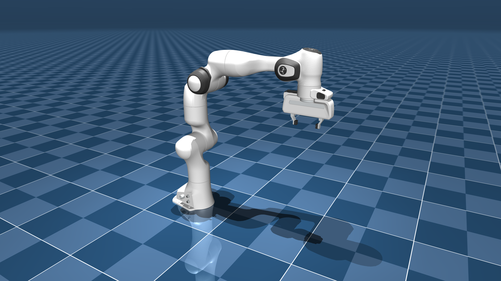

# Franka Emika Panda 모델 설명(MJCF)

이 문서는 외부 원본 설명서의 한국어 번역이다. 모델 출처와 기준 커밋은
[SOURCE.md](./SOURCE.md)에 기록되어 있다.

> [!IMPORTANT]
> MuJoCo 2.3.3 이상이 필요하다.

## 변경 이력

전체 변경 이력은 [CHANGELOG.md](./CHANGELOG.md)를 참조한다.

## 개요

이 패키지는 [Franka Emika](https://www.franka.de/company)가 개발한
[Franka Emika Panda](https://www.franka.de/)의 단순화된 로봇 모델(MJCF)을
포함한다. [공개 URDF 모델](https://github.com/frankaemika/franka_ros/tree/develop/franka_description)을 바탕으로 만들었다.

  

## URDF에서 MJCF로 변환한 과정

1. [Blender](https://www.blender.org/)로 DAE [메시 파일](https://github.com/frankaemika/franka_ros/tree/develop/franka_description/meshes/visual)을 OBJ로 변환했다.
2. [`obj2mjcf`](https://github.com/kevinzakka/obj2mjcf)로 `.obj` 파일을 처리했다.
3. `link0`에 생성된 하위 메시 중 완전히 평평한 `link0_6`을 제거했다.
4. [V-HACD](https://github.com/kmammou/v-hacd)로 `link5`의 STL 충돌 [메시 파일](https://github.com/frankaemika/franka_ros/tree/develop/franka_description/meshes/collision)을 볼록 분해했다.
5. 시각화 형상을 보존하려고 [URDF](https://github.com/frankaemika/franka_ros/tree/develop/franka_description/robots)의 `<robot>` 안에 `<mujoco> <compiler discardvisual="false"/> </mujoco>`를 추가했다.
6. URDF를 MuJoCo로 불러온 뒤 대응하는 MJCF를 저장했다.
7. 관성 매개변수를 [inertial.yaml](https://github.com/frankaemika/franka_ros/blob/develop/franka_description/robots/common/inertial.yaml)과 맞췄다.
8. 베이스에 추적 조명을 추가했다.
9. MJCF를 수동으로 편집하여 공통 속성을 `<default>`로 분리했다.
10. `link7`과 `link8`의 충돌을 막기 위해 `<exclude>`를 추가했다.
11. 손가락 끝의 충돌 형상을 직접 설계했다.
12. 팔에 위치 제어 액추에이터를 추가했다.
13. 왼쪽 손가락이 오른쪽 위치를 따르도록 등식 제약을 추가했다.
14. 양쪽 손가락에 힘을 균등하게 분배하는 텐던과 이를 구동하는 위치 액추에이터를 추가했다.
15. 로봇, 질감이 있는 지면, 배경 하늘, 안개를 포함하는 `scene.xml`을 추가했다.

### MJX

Franka Emika Panda 환경의 MJX 버전은 다음과 같이 만들었다.

1. `panda.xml`을 바탕으로 `mjx_panda.xml`을 추가했다.
2. `scene.xml`을 바탕으로 `mjx_scene.xml`과 `mjx_single_cube.xml`을 추가했다.
3. 그리퍼의 충돌 형상 개수를 줄이고 손에 캡슐 충돌 형상을 추가했다.
4. 성능을 위해 해법 매개변수를 조정했다.
5. 시뮬레이션을 더 안정화하도록 액추에이터의 `kp`, `kv`를 낮췄다.
6. 그리퍼에 `site`를 추가했다.
7. 텐던을 제거하고 그리퍼용 위치 액추에이터를 추가했으며, 그리퍼의 `ctrlrange`를 변경했다.

## 라이선스

이 모델은 [Apache-2.0 라이선스](LICENSE)로 배포한다. 라이선스 원문은 번역하거나 변경하지 않았다.
